# DeskcommCRM — App flow

> User and system flows for the three lane slices: (1) a SIP call summary lands on the deal
> timeline, (2) the AI writes the deal stage and next step from a WhatsApp conversation, (3) every
> priced model call is metered in credits on a ledger. `PRD.md` says what and why, `TRD.md` says
> how the code changes, this file says **which screen, which state, which path a person or a job
> takes**, including the failure paths and where each one becomes visible. Look and copy live in
> `DESIGN_BRIEF.md`; tables and DDL in `BACKEND_SCHEMA.md`.

---

## 0. How to read this document

- **Pinned commit.** Paths and line numbers refer to `main` at `f322ca4` of the fork
  `jaimedhenriques/deskcommcrm`. They go stale; §9 gives the command that re-measures each number
  (CLAUDE.md DoD 16).
- **Tags.** `CONFIRMED`: the writer opened the cited file at `f322ca4`. `INFERRED`: deduced from
  code or docs, not proven by a test or by running the product. `PROPOSED`: behaviour the slice
  adds, as fixed by the lane decisions D1–D3 or by `TRD.md`; nothing tagged `PROPOSED` exists yet.
- **Diagram conventions.** Same as the screen-flow pack: mermaid `flowchart` for flows (decisions
  in `{}`), `stateDiagram-v2` for state machines (`docs/design-system/screen-flow/04-clickflows.md`,
  `05-state-machines.md`). Routes are written as the app tree has them under `app/app/`.
- **No numbers invented.** No price, SLA, quota or volume appears here. The credit unit is the
  lane's provisional rule (PRD §4.3, open as PRD Q1). Retry counts and grouping thresholds are
  constants in code; §9 shows where to read them instead of copying them.
- **Roles** are the code's (`lib/auth/types.ts:25-31`: `viewer` < `agent` < `ai_operator` <
  `manager` < `admin`). Personas are PRD master §3, cited by `PRD.md`, not restated here.

---

## 1. Screens these flows touch

### 1.1 Route map

The "deal page" is not a page of its own. `/app/leads/[id]` resolves the deal's pipeline and
redirects to the board with `?lead=` (`app/app/leads/[id]/page.tsx:41-49`, CONFIRMED); the board
opens the deal dossier, a right-side sheet (`components/kanban/LeadDossier.tsx:66-160`, CONFIRMED).
`/app/kanban` is the list of funnels, each linking to `/app/pipelines/[id]`
(`app/app/kanban/_client.tsx:548`, CONFIRMED).

| Route                            | What it shows                                                                                                                                                           | Min role (gate)                                                                                             | Nav entry (`lib/navigation/catalogo.ts`)                                             | Slice                                           |
| -------------------------------- | ----------------------------------------------------------------------------------------------------------------------------------------------------------------------- | ----------------------------------------------------------------------------------------------------------- | ------------------------------------------------------------------------------------ | ----------------------------------------------- |
| `/app/inbox`, `/app/inbox/[id]`  | WhatsApp conversations; side panel with the contact's deals, a stage select and an "Atividade" list (`components/inbox/CRMSidePanel.tsx:400`, `:423-458`, `:876-912`)   | none (no `minRole`)                                                                                         | `:136`, sidebar                                                                      | 2 (where the AI talks), 1 and 2 (activity list) |
| `/app/kanban`                    | Funnel list ("Funis")                                                                                                                                                   | none for reading (`app/app/kanban/page.tsx:26-31` comment)                                                  | `:195`, sidebar                                                                      | entry to the board                              |
| `/app/pipelines/[id]?lead=`      | Board; the card's agent slot ③ (`components/kanban/KanbanCard.tsx:250-286`); the dossier sheet with "Linha do tempo" and "Dados do negócio" (`LeadDossier.tsx:140-158`) | read for any member; deciding a proposal needs `agent` (`app/api/v1/leads/[id]/next-action/route.ts:51-54`) | none: dynamic route, reached from `/app/kanban`                                      | 1, 2                                            |
| `/app/leads/[id]`                | Stable deal link; redirect only                                                                                                                                         | authenticated, org-filtered (`page.tsx:31-48`)                                                              | none: `[id]` segments are skipped by `tests/unit/navegacao-completude.test.ts:57-59` | 1, 2 (link target)                              |
| `/app/calls`                     | SIP call table; row click opens a dialog with the transcript (`app/app/calls/_client.tsx:173`, `:197`, `:212-236`)                                                      | `manager` (API `app/api/v1/calls/route.ts:73`)                                                              | `:265`, CRM hub only                                                                 | 1 (source of the summary)                       |
| `/app/ai/inbox` ("Alertas")      | The Central: rows of `agent_inbox_items` (`app/app/ai/inbox/_components/AgentInboxList.tsx:32`, `:139`)                                                                 | none                                                                                                        | `:517`                                                                               | 1, 2, 3 (failure surface)                       |
| `/app/ai/proposals`              | The AI's next actions as a list, with approve/dismiss (`app/app/ai/proposals/page.tsx:10-27`, `hooks/leads/useProposals.ts:39`)                                         | read for any member, decide with `agent`                                                                    | `:546`                                                                               | 2                                               |
| `/app/ai/runs` ("Execuções")     | `llm_calls` rows, including failures (`app/app/ai/runs/page.tsx:10-23`; API reads `llm_calls`, `app/api/v1/ai/runs/route.ts`)                                           | `manager` (`page.tsx:23`)                                                                                   | `:558`                                                                               | 1, 3 (model errors, refusals)                   |
| `/app/ai/usage`                  | "Uso de IA": `BudgetCard` in USD plus the usage dashboard (`app/app/ai/usage/page.tsx:58-69`)                                                                           | `manager` (`page.tsx:26-28`); budget edit `admin` (`app/api/v1/ai/budget/route.ts:99-104`)                  | `:569`                                                                               | 3                                               |
| `/app/settings/billing`          | Placeholder "Em breve — Fase 2" (`app/app/settings/billing/page.tsx`)                                                                                                   | `admin` (nav)                                                                                               | `:851`                                                                               | none (stays a placeholder)                      |
| `/app/settings/tenant/pipelines` | Stage mapping, including the agent's step per stage (nav description at `:379-382`)                                                                                     | `manager`                                                                                                   | `:379`                                                                               | 2 (precondition for any AI move)                |

All rows CONFIRMED by opening the cited files, except where a cell says otherwise.

### 1.2 How the screens connect

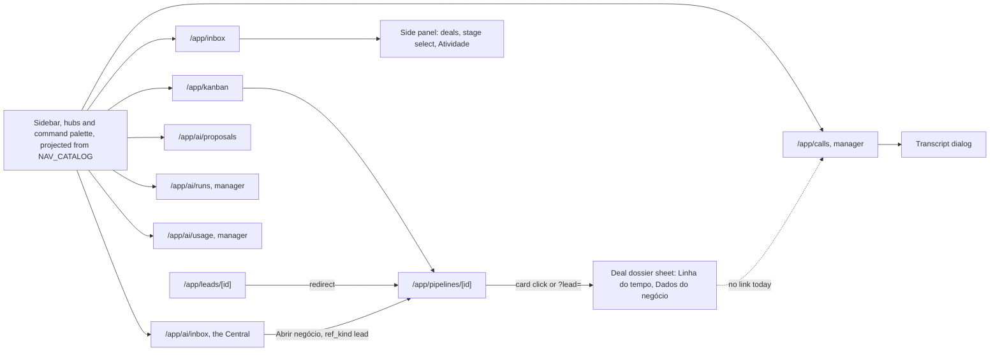

`CEN -->|"Abrir negócio"|` is the destination rule in `lib/ai/inbox-destino.ts:21` (CONFIRMED). The
dotted edge is a gap: nothing links a deal to its calls (grep for `/app/calls` under
`components/kanban/` returns nothing, CONFIRMED), and `/app/calls` has no deep link to one call
(selection is component state, `app/app/calls/_client.tsx:135`, CONFIRMED). See §8, A4.

---

## 2. Flow 1 — a SIP call becomes a summary on the deal

Scope per D1: only SIP calls handled by the voice agent. WhatsApp calls carry no audio
(`record` is never sent, `lib/wacalls/client.ts:126-127`, CONFIRMED; spec 18 §1.2 item 2) and
meetings are a Meet link only. Neither enters this flow.

### 2.1 Today (CONFIRMED)

1. The voice agent creates the `voice_calls` row (`provider: "sip"`) when the call rings and, for a
   known contact, ensures a deal exists through `garantirLeadDaConversa`
   (`workers/voice-agent/index.ts:101-133`).
2. When the AudioSocket closes, `finalizeAudioSocketCall` writes `status`, `ended_at`,
   `duration_ms` and `transcript` (`index.ts:208-228`). The update filters by `id` only.
3. Nothing else happens: no `event_log` row, no activity, no summary (`index.ts:36-39`; grep for
   `emit_event` and `emitAgentActivityForContact` under `workers/voice-agent/` returns nothing).
4. A manager can read the transcript on `/app/calls` by clicking the row. The deal timeline shows
   nothing about the call.

### 2.2 System flow (PROPOSED, per D1 and TRD §4)

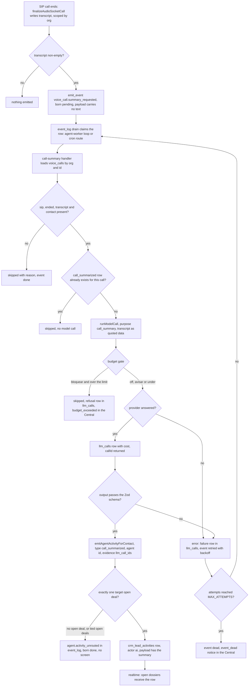

What each node rests on:

- Emit, drain, claim, retry, dead: `lib/event-log/drain.ts:17` (`MAX_ATTEMPTS`), `:246-268`
  (select of pending rows of registered types, optimistic claim to `processing`), `:305-321`
  (error branch, backoff, `dead`, `avisarEventoMorto`), `:322-330` (`skipped` keeps its reason).
  The drain runs in the agent worker (`runEventLogDrainLoop`, `workers/agent-worker/main.ts:93`)
  and in the cron route (`app/api/v1/cron/event-log-drain/route.ts:36`). CONFIRMED. The handler
  registration in `lib/event-log/register-handlers.ts` and the
  `voice_call.summary_requested` name are PROPOSED (D1, TRD §4.4).
- Budget gate inside `runModelCall`: refusal opens `budget_exceeded` once per open item and records
  an `erro` row (`lib/agent-engine/edge/llm/run-model-call.ts:373-410`); exempt purposes are only
  `connection_test`, `jailbreak_detect`, `promise_semantic`
  (`lib/agent-engine/edge/llm/orcamento.ts:50-54`). CONFIRMED. That the handler treats the refusal
  as `skipped` is PROPOSED (TRD §4.5).
- Success row and `callId`: `run-model-call.ts:738-787`. Failure row: `:925-929`. CONFIRMED.
- Routing and the unrouted record: `lib/leads/agent-activity.ts:50-87`; tie rule in
  `lib/leads/active-lead.ts:43-84` (one open deal routes; several prefer the default pipeline, then
  the most recently active; a tie refuses). CONFIRMED. `agent.activity_unrouted` is in the fact
  list that is forced to `done` on insert (`supabase/baseline.sql:24504`, `:24546-24560`,
  CONFIRMED), and no code reads it (grep, CONFIRMED).
- Actor `ai` needs evidence: without it the row is demoted to `system`
  (`lib/leads/agent-activity.ts:97-104`; constraint
  `crm_lead_activities_ai_needs_evidence` at `supabase/baseline.sql:8281-8287`, its only
  definition). CONFIRMED.
- Realtime: the dossier subscribes to `crm_lead_activities` (`hooks/leads/useLeadTimeline.ts:110`)
  and marks rows that arrived in the session with "agora" (`LeadTimeline.tsx:71-77`). CONFIRMED.

### 2.3 What the operator sees and can do

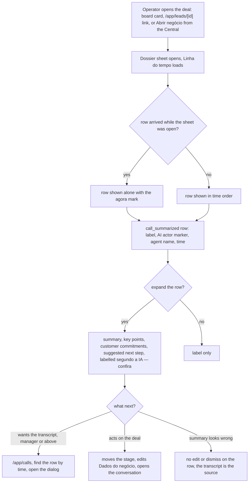

| Step                                  | Status        | Evidence or owner                                                                                                                                                                       |
| ------------------------------------- | ------------- | --------------------------------------------------------------------------------------------------------------------------------------------------------------------------------------- |
| Entry points to the dossier           | CONFIRMED     | `app/app/leads/[id]/page.tsx:49`; `lib/ai/inbox-destino.ts:21`; `app/app/pipelines/[id]/_client.tsx:155`                                                                                |
| Row is never folded into a group      | PROPOSED      | `call_summarized` joins `NUNCA_COLAPSA` (`lib/leads/timeline-grouping.ts:27-47`), which escapes both the 60-second actor groups and the day blocks (`:166-167`, `:192-193`), D1         |
| Row line: label, actor marker, name   | CONFIRMED     | `components/kanban/LeadTimeline.tsx:54-87` renders `activityLabel(type)`, `reason` through `t()`, actor name and time; it never renders `payload` today                                 |
| Expandable summary from `payload`     | PROPOSED      | D1, TRD §4.2. `abertos` (`LeadTimeline.tsx:98`) holds block indexes, not row ids, so a single row needs its own expand key; mechanics in `DESIGN_BRIEF.md`                              |
| AI-reading label                      | PROPOSED      | Convention from `lib/escalacao/briefing-da-passagem.ts:19-30` (CONFIRMED source)                                                                                                        |
| `suggested_next_step` is display only | PROPOSED      | TRD §4.5: it never writes `crm_leads.next_step`; slice 2 is the only writer                                                                                                             |
| Same row in the inbox side panel      | INFERRED      | The panel lists activities with label and `reason` only (`components/inbox/CRMSidePanel.tsx:876-912`), so it will show the label without the summary unless slice 1 changes it (§8, A5) |
| Transcript reachable from the deal    | CONFIRMED gap | No link (§1.2); `/app/calls` needs `manager`                                                                                                                                            |

### 2.4 Failure paths and where each one surfaces

| Case                                         | What happens                                                              | Where a person sees it                                                                            | Status                                                                                                          |
| -------------------------------------------- | ------------------------------------------------------------------------- | ------------------------------------------------------------------------------------------------- | --------------------------------------------------------------------------------------------------------------- |
| Transcript empty, or redacted before the run | No event, or handler `skipped`                                            | Nowhere; the event row keeps the reason                                                           | PROPOSED (PRD CALL-11)                                                                                          |
| Call has no `contact_id`                     | `skipped` with reason, no model call                                      | Nowhere; event row reason                                                                         | PROPOSED (PRD edge case)                                                                                        |
| Contact has no open deal                     | Model call already made; `agent.activity_unrouted`; no row                | **No screen.** Cost visible on `/app/ai/runs` and `/app/ai/usage`; the call still on `/app/calls` | CONFIRMED emitter behaviour; gap §8, A1                                                                         |
| Contact's open deals tie                     | Same as above                                                             | Same as above                                                                                     | CONFIRMED emitter behaviour; gap §8, A1                                                                         |
| Budget `bloquear` and over the limit         | Refusal row (`erro`, `orcamento_esgotado`), handler `skipped`, no summary | Central: `budget_exceeded` (critical, deduplicated); `/app/ai/runs` shows the refusal             | CONFIRMED gate (`run-model-call.ts:373-410`, `:832-834`); PROPOSED skip                                         |
| Budget `avisar` and over the warning         | Call proceeds                                                             | Central: `budget_warning` (`orcamento.ts:395-401`)                                                | CONFIRMED                                                                                                       |
| Provider or transport error                  | `erro` row; handler `error`; event back to `pending` with backoff         | `/app/ai/runs` (status `erro`); nothing on the deal                                               | CONFIRMED retry path; PROPOSED handler                                                                          |
| Output fails Zod                             | Handler `error`, retried; each attempt is its own `llm_calls` row         | `/app/ai/runs` shows the calls as `ok` (the model answered); the event row has `last_error`       | INFERRED from TRD §4.9                                                                                          |
| Attempts exhausted                           | Event `dead`                                                              | Central: `event_dead`, critical, one open per org, no link (`lib/event-log/drain.ts:44-122`)      | CONFIRMED                                                                                                       |
| Voice agent fails to emit                    | Transcript saved, no summary                                              | Nowhere on screen; found by the gap query in TRD §8                                               | PROPOSED                                                                                                        |
| Contact redacted (LGPD) after the summary    | Activity `payload` cleared by the cascade; transcript nulled after 0443   | The row stays as a label with no summary                                                          | CONFIRMED for `payload` (`supabase/baseline.sql:35245-35253`, inside the last cascade); PROPOSED for transcript |

The timeline is a success-only surface in this flow: no failure ever writes a row on the deal.
The Central (`/app/ai/inbox`) carries budget and dead-event failures; `/app/ai/runs` carries every
model-level failure; the unrouted case has no surface at all.

### 2.5 State machine — the summary job

One `voice_call.summary_requested` event from emission to its terminal state. `Pending`,
`Claimed`, `Done` and `Dead` map to `event_log.status` values `pending`, `processing`, `done` and
`dead` (`lib/event-log/drain.ts:246-330`, CONFIRMED). The states between `Claimed` and the outcome
are the handler's steps (PROPOSED, TRD §4.3, §4.9).

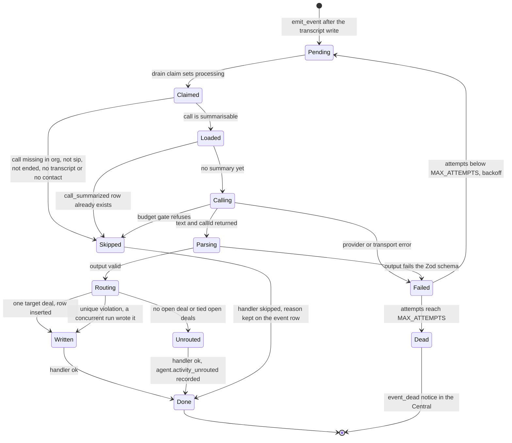

Idempotency on this machine (PROPOSED, TRD §4.6): the lookup in `Loaded` avoids a second model
call; a partial unique index in migration 0443 makes `Written` reachable at most once per call;
`Unrouted` is not guarded, so a re-emitted event for an unrouted call summarises again (each attempt
visible in `llm_calls`).

---

## 3. Flow 2 — a WhatsApp turn updates the deal's stage and next step

### 3.1 Today (CONFIRMED)

- An inbound message reaches the agent through an `ai_agent.dispatch_requested` row in `event_log`,
  which the agent-engine drain consumes (`lib/agent-engine/edge/crm/drain.ts:2`, `:70`) and turns
  into an `inbound_turn` job (`:480-505`); the worker runs it with
  `createInboundTurnHandler` (`workers/agent-worker/main.ts:724`,
  `lib/agent-engine/agent/inbound-turn.ts:4929`).
- The turn opens with playbook, checkpoint, `lead_state` and history, lets the model call tools,
  and closes with a second model call (purpose `checkpoint`) that writes the checkpoint
  (`inbound-turn.ts:16-30`). The whole turn runs inside `comHandoffSeOrcamentoAcabar`
  (`inbound-turn.ts:702`, `:2013`), which hands the conversation to a human on a budget block
  (`workers/agent-worker/main.ts:140-179`).
- `update_lead_state` (`inbound-turn.ts:233-257`, execute at `:3629-3680`) calls
  `applyLeadStateUpdate` (`lib/agent-engine/agent/lead-state.ts:172`), which enforces the strict
  whitelist and the 7-step graph (`:22-43`) and returns a teaching error to the model on an invalid
  field or transition (`:194`).
- On a stage transition, `mirrorLeadStageToCrm` (`lib/agent-engine/edge/crm/move-lead-stage.ts:237`)
  calls `sincronizaEstagioDoAgente` (`lib/leads/agent-stage-sync.ts:208`). On a move it writes
  `stage_changed` with actor `webhook_source` and payload `de`/`para` (`:395-408`) and emits
  `lead.stage_changed` (`:449-458`). The call passes no pipeline scope (`inbound-turn.ts:3649-3656`).
- The next step is `lead_state.next_action`, per contact. The board shows it on the card's slot ③
  as "Propõe:" with Aprovar/Ignorar (`components/kanban/KanbanCard.tsx:252-262`,
  `components/kanban/NextActionSlot.tsx:42-76`); `/app/ai/proposals` lists the same items; the
  decision posts to `app/api/v1/leads/[id]/next-action/route.ts:44`. The closing call also writes an
  `ai_turn` row with "Próxima ação: …" and `llm_call_ids` evidence (`lib/leads/checkpoint-diff.ts:77`,
  `inbound-turn.ts:4700-4710`).

### 3.2 System flow (current path plus PROPOSED changes from D2 and TRD §5)

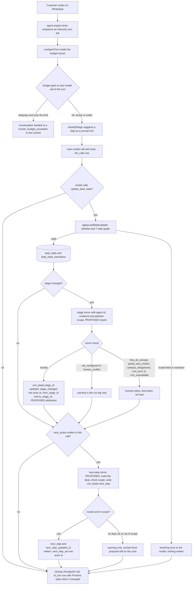

Facts behind the branches (CONFIRMED unless tagged): the warn-only set is exactly `not_configured`
and `human_conflict` (`move-lead-stage.ts:65-68`); unmapped stage, no deal and an ambiguous deal
all translate to `not_configured` (`:261-305`); the other reasons open one deduplicated Central item
with `kind: 'other'` and `refKind: 'lead'` (`:112-230`), which links to the deal through "Abrir
negócio" (`lib/ai/inbox-destino.ts:21`). A mirror failure never reverts `lead_state` or fails the
job (`inbound-turn.ts:3642-3648` comment). The mirror's new inputs, the attribution, the payload
keys and the whole next-step branch are PROPOSED (D2; TRD §5.2-5.3). The evidence kind for both
rows is open: D2 names `llm_call_ids`, TRD §5.5 shows the turn's own call id does not exist yet when
the tool runs and proposes `trace_ids: [job_id]` (TRD §7 Q1).

### 3.3 Refusals the operator can meet

| Refusal                                        | Trigger                                                                                                                                      | Operator surface                                                                                                                         | Status                                                      |
| ---------------------------------------------- | -------------------------------------------------------------------------------------------------------------------------------------------- | ---------------------------------------------------------------------------------------------------------------------------------------- | ----------------------------------------------------------- |
| Invalid transition or field                    | Skip, regression, extra key (`lead-state.ts:22-43`, `:172-194`)                                                                              | None; the model is taught in-turn                                                                                                        | CONFIRMED                                                   |
| Stage not mapped (`sem_mapeamento`)            | No stage carries the step in `agent_stage_hint`                                                                                              | None (warn only). The fix is on `/app/settings/tenant/pipelines`                                                                         | CONFIRMED                                                   |
| No open deal or tie (`sem_negocio`, `ambiguo`) | Routing refuses (`agent-stage-sync.ts:254-266`)                                                                                              | None for the stage. For the proposal, the board route opens `next_action_ambiguous` (`app/api/v1/pipelines/[id]/board/route.ts:150-162`) | CONFIRMED                                                   |
| Human moved first (`conflito_humano`)          | Stage changed since read (`agent-stage-sync.ts:386-390`)                                                                                     | None; the human's move stands and no row is written                                                                                      | CONFIRMED                                                   |
| Out of the agent's pipelines                   | `escopoDeFunis` excludes the deal's pipeline (`agent-stage-sync.ts:275-288`)                                                                 | Central item "O assistente quis organizar um negócio de um funil que não é dele" (`move-lead-stage.ts:126`)                              | CONFIRMED item; PROPOSED that the harness path passes scope |
| Loss needs a human reason                      | Target stage `is_lost` (`agent-stage-sync.ts:97-111`)                                                                                        | Central item telling the owner to use "Marcar como perdido" (`move-lead-stage.ts:136-165`)                                               | CONFIRMED                                                   |
| Required fields missing                        | Target stage demands fields                                                                                                                  | Central item naming the fields (`move-lead-stage.ts:167-185`)                                                                            | CONFIRMED                                                   |
| CRM write failed or DB unavailable             | `crm_error`, `crm_unavailable`                                                                                                               | Generic incident item (`move-lead-stage.ts:187-197`)                                                                                     | CONFIRMED                                                   |
| Budget block                                   | `LlmBudgetExceededError` in any call of the turn                                                                                             | Conversation goes to the human queue; `budget_exceeded` in the Central                                                                   | CONFIRMED                                                   |
| Operator role owns CRM tools                   | `update_lead_state` removed from the conversational agent (`lib/agent-engine/agent/entrega-de-capacidade.ts:115-124`, either tool is enough) | None; this flow does not run                                                                                                             | Out of scope (PRD §3.2)                                     |

### 3.4 Human correction loop

The correction check exists, but no screen a person uses reaches it. This is the most important
finding of this document for slice 2.

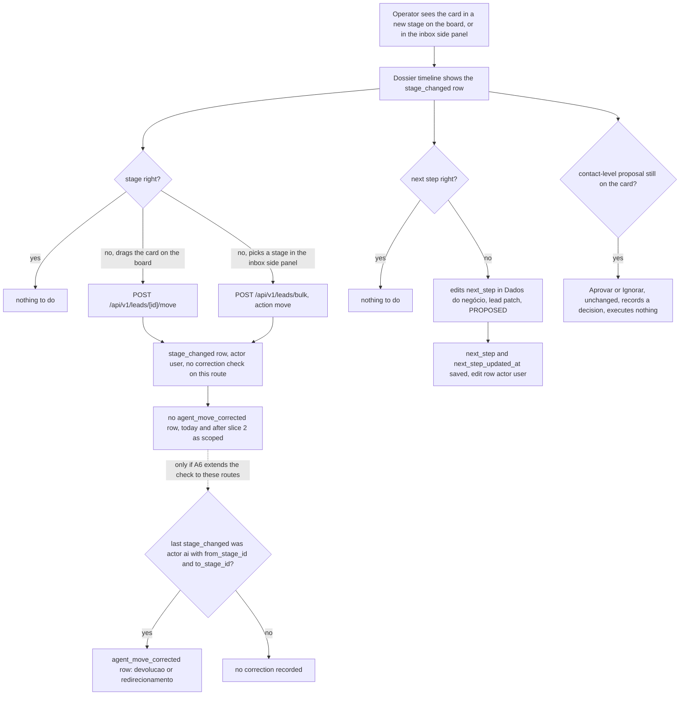

- Board drag posts to `/api/v1/leads/[id]/move` (`hooks/kanban/useMoveCard.ts:68`), and that route
  says it does not go through `moveLeadHandler` (`app/api/v1/leads/[id]/move/route.ts:267-268`).
  The inbox stage select and the board's bulk move post to `/api/v1/leads/bulk`
  (`components/inbox/CRMSidePanel.tsx:418-432`, `hooks/kanban/useBulkAction.ts:34`), which writes
  its own rows (`app/api/v1/leads/bulk/route.ts:320-329`). Neither route imports the correction
  module. CONFIRMED.
- The check `ehCorrecaoDeMovimentoDaIa` is imported only by `app/api/v1/leads/_handler.ts:43` and
  runs inside `moveLeadHandler` for a user actor (`:1118-1160`). `moveLeadHandler` is called by the
  MCP tool `crm_move_lead_stage` (`lib/mcp/tools/leads.ts:331`) and by automation actions
  (`lib/automation/actions/create-or-move-lead.ts:54`, `:66`). CONFIRMED. So today the loop can fire
  only for an MCP call made with a person's token (INFERRED), never for a drag or a select.
- The check also reads `from_stage_id`/`to_stage_id` from the last `stage_changed` rows
  (`_handler.ts:1119-1150`) and requires actor `ai` (`lib/leads/correcao-humana.ts:79`). Slice 2's
  attribution and payload fix is necessary but not sufficient: PRD DEAL-02 ("a human then moves the
  card back") also needs the check on the two UI routes (§8, A6). The repro test PRD DEAL-02 asks
  for should drive the drag route, not only `moveLeadHandler`.
- Grouping risk: once attributed `ai` with an agent id, a `stage_changed` row shares the actor key
  of the same turn's `ai_turn` row (`lib/leads/timeline-grouping.ts:84-86`) and folds into one
  block inside the 60-second window (`:50`). TRD §5.4 keeps it foldable and proves it reachable;
  `next_step_set` joins `NUNCA_COLAPSA`. PRD Q9 is still open on this.
- The human edit path for `next_step` (lead patch, user actor) is PROPOSED (PRD DEAL-07, TRD §5.2).

### 3.5 What the operator sees after slice 2 (PROPOSED)

| Surface                                      | Before                                    | After                                                                |
| -------------------------------------------- | ----------------------------------------- | -------------------------------------------------------------------- |
| Board card position                          | Moves when mapped (CONFIRMED)             | Same, and fails closed outside the agent's pipelines                 |
| Dossier `stage_changed` row                  | Actor shown as system, no agent name      | Actor `ai` with the agent's name; may sit inside the turn's AI block |
| Dossier `next_step_set` row                  | Does not exist                            | Own row, never folded                                                |
| Deal's next step                             | Only the contact-level proposal on slot ③ | `crm_leads.next_step` written by the AI; placement open (§8, A2)     |
| Card slot ③ proposal and `/app/ai/proposals` | Aprovar/Ignorar (CONFIRMED)               | Unchanged (D2)                                                       |
| Central                                      | Mirror refusals (CONFIRMED)               | Same items; `fora_do_escopo` now also from the harness path          |
| Undo of an AI move by drag or select         | Not detected (CONFIRMED, §3.4)            | Still not detected unless A6 is taken into the slice                 |

---

## 4. Flow 3 — a model call is metered in credits

### 4.1 Today (CONFIRMED)

- Every `runModelCall` writes one `llm_calls` row: `status 'ok'` with `cost_cents` on success
  (`run-model-call.ts:738-787`), `status 'erro'` with null cost on failure or refusal (`:925-929`).
  `llm_calls.status` is constrained to `ok` and `erro` (`supabase/baseline.sql:11252`).
- Spend is shown in USD only: `BudgetCard` formats cents as dollars
  (`components/ai/BudgetCard.tsx:61-70`); the usage API aggregates `llm_calls`
  (`app/api/v1/ai/usage/route.ts:96-104`, `requireRole("manager")` at `:66`).
- No credit, ledger or balance exists anywhere (PRD §2 G5). The billing screen is a placeholder.
- Spend that never reaches `llm_calls` (transcription, image description, embeddings, the voice
  agent's Realtime session) is outside any meter (PRD §4.3 edge cases, TRD §6.5).

### 4.2 System flow (PROPOSED, per D3 and TRD §6)

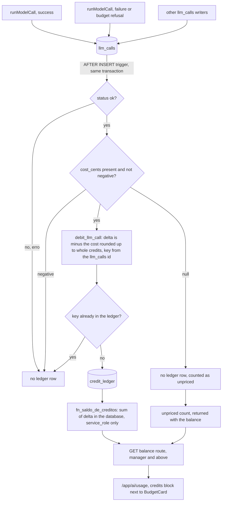

- The trigger shape copies `trg_llm_calls_budget` (`supabase/baseline.sql:9526-9530`, CONFIRMED
  location). The single spend ruler `fn_gasto_de_ia_do_mes` (`baseline.sql:13125`) is not touched
  and stays the budget's only measure (PRD CRED-07).
- Zero cost: TRD §6.6 writes a zero-delta row so that every priced call has exactly one row; PRD Q2
  still lists it as undecided. The diagram's "not negative" follows the TRD.
- Credits never gate a call in this lane (D3, PRD CRED-06): the budget ladder `off`/`avisar`/
  `bloquear` (`orcamento.ts:57`) remains the only gate, and it measures USD.
- Route and screen are PROPOSED here because TRD §6.2 delegates the path to this file:
  `app/api/v1/ai/credits/route.ts` with `GET` (balance plus unpriced count, `manager`) and `POST`
  (grant or adjustment, `admin`), the same one-file split as `app/api/v1/ai/budget/route.ts`
  (`GET` manager at `:89-91`, `PATCH` admin at `:99-104`). The block on `/app/ai/usage` depends on
  PRD Q4, whose current default is "API and DB only" (§8, A3).

### 4.3 What a manager sees (PROPOSED, if PRD Q4 lands on `/app/ai/usage`)

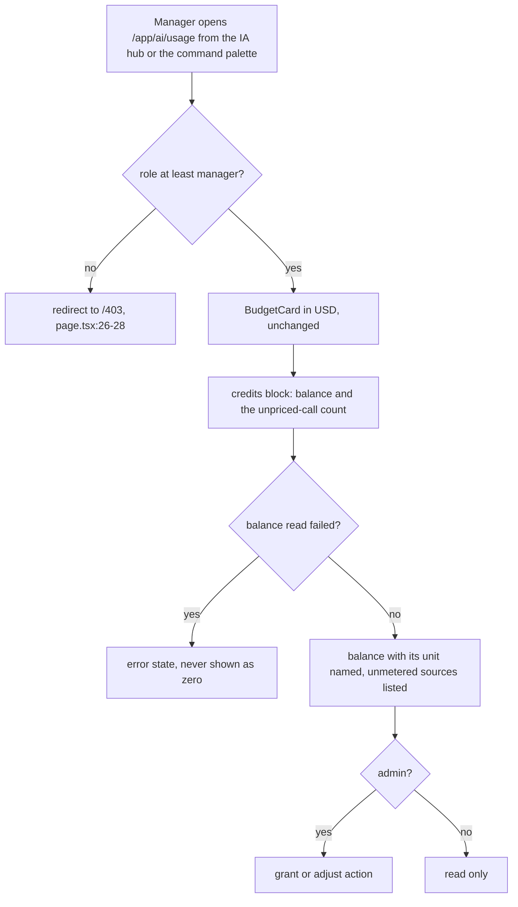

The "never shown as zero" rule mirrors the three-state rule already in the timeline
(`LeadTimeline.tsx:101-120`: loading, error and empty are distinct, CONFIRMED) and PRD CRED-04.

### 4.4 Admin grant flow (PROPOSED, per D3, PRD CRED-12 to CRED-14, TRD §6.2)

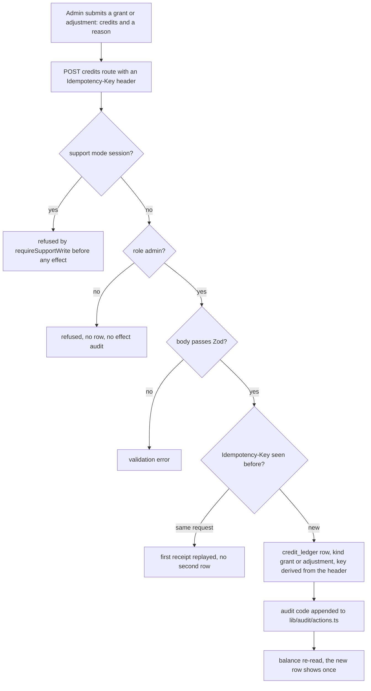

The order (support guard, then role, then body) follows `app/api/v1/ai/budget/route.ts:99-104`,
CONFIRMED. Whether a grant should need a platform admin instead of an organization admin is open
(TRD §7 Q2).

### 4.5 State machine — one ledger entry

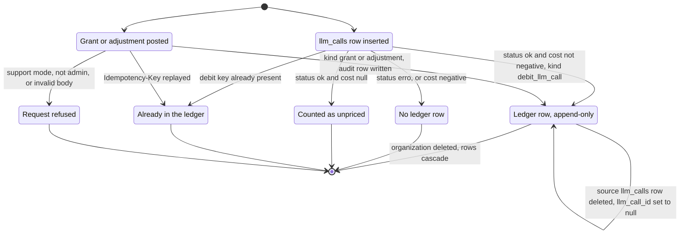

Every transition is PROPOSED (D3; TRD §6.6-6.14; DDL in `BACKEND_SCHEMA.md`). A `Recorded` row has
no edit or delete transition by design: corrections are new `adjustment` rows. Append-only applies
to the PostgREST roles through revokes and to the owner through a trigger with the
organization-deletion exemption (PRD CRED-09, CRED-10).

---

## 5. How the three flows meet

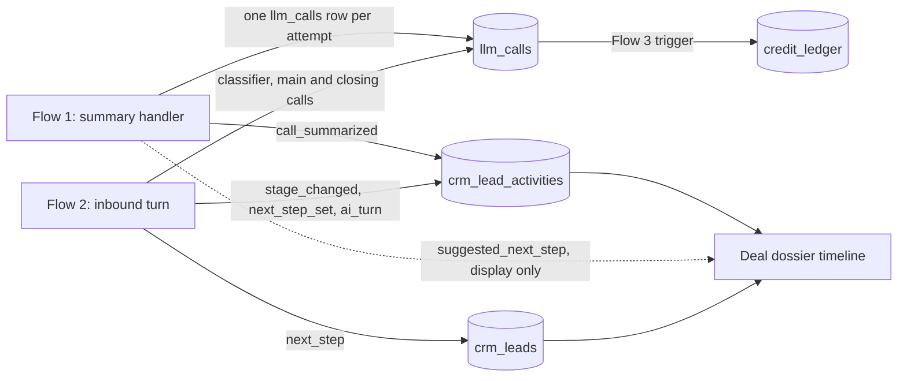

- Slice 2 adds no model call (TRD §5.5); its cost is the turn's existing calls.
- Slice 1's call summary never writes `next_step` (TRD §4.5). If both slices ship, a deal can show
  an AI-suggested next step inside a call summary and a different AI-written `next_step` from the
  chat. They are different sources by design; the summary's suggestion is labelled as the AI's
  reading of the call.
- A summary retried after a Zod failure is debited once per attempt, because each attempt is its own
  `ok` row (INFERRED from TRD §4.9 and §6.3).

---

## 6. Navigation entries affected (`lib/navigation/catalogo.ts`)

No slice adds a screen, so DoD 14 needs no new entry as long as the credits block lives inside an
existing screen. Every entry below exists at `f322ca4` (CONFIRMED).

| Entry (line)                              | Current label and description                                                               | Effect of the slices                                                                                                                                                                                                                                                                          |
| ----------------------------------------- | ------------------------------------------------------------------------------------------- | --------------------------------------------------------------------------------------------------------------------------------------------------------------------------------------------------------------------------------------------------------------------------------------------- |
| `/app/inbox` (`:136`)                     | "Inbox" — "As conversas de WhatsApp, com você e a IA atendendo lado a lado."                | None to the entry. Side panel activity list gains new row types (slices 1, 2)                                                                                                                                                                                                                 |
| `/app/kanban` (`:195`)                    | "Funis" — "Seus funis de venda — clique em um para abrir o quadro de clientes."             | None to the entry. The board and dossier carry slices 1 and 2                                                                                                                                                                                                                                 |
| `/app/calls` (`:265`)                     | "Chamadas" — "Histórico de ligações (voz por IA) com transcrição.", `manager`, CRM hub only | None in slice 1 as scoped. If A4 adds a link from the summary to the call, the description stays true                                                                                                                                                                                         |
| `/app/settings/tenant/pipelines` (`:379`) | "Etapas do funil"                                                                           | None. It stays the place to map stages, the precondition for any AI move                                                                                                                                                                                                                      |
| `/app/ai/inbox` (`:517`)                  | "Alertas" — "O que a IA encontrou e precisa de uma decisão sua."                            | None to the entry. Receives `budget_exceeded`, `event_dead` (slice 1) and mirror refusals including harness `fora_do_escopo` (slice 2). No new `agent_inbox_items` kind in D1–D3                                                                                                              |
| `/app/ai/proposals` (`:546`)              | "Propostas" — "Melhorias que a IA sugere para si mesma, esperando sua decisão."             | Unchanged by D2. Drift found: the page lists the AI's next actions per deal (`app/app/ai/proposals/page.tsx:10-27`), not self-improvements; a DoD 16 fix outside these slices                                                                                                                 |
| `/app/ai/runs` (`:558`)                   | "Execuções", `manager`                                                                      | None to the entry. Shows the new `call_summary` purpose rows and their failures: the API reads every `llm_calls` row of the org and filters by `purpose`, `status` and `provider` (`app/api/v1/ai/runs/route.ts:83-118`, CONFIRMED); INFERRED that the new purpose needs no code change there |
| `/app/ai/usage` (`:569`)                  | "Uso e orçamento" — "Quanto a IA consumiu e qual é o teto de gasto do mês.", `manager`      | If A3 lands here: the description no longer names everything on the screen and should mention credits (DoD 16). Label stays                                                                                                                                                                   |
| `/app/settings/billing` (`:851`)          | "Billing" — "Plano e cobrança.", `admin`                                                    | None. It stays the Phase 2 placeholder: the lane meters and never prices, so credits do not belong on a page about plans and payment                                                                                                                                                          |
| `/app/leads/[id]`, `/app/pipelines/[id]`  | Not in the catalog                                                                          | Dynamic routes, excluded by the completeness test (`tests/unit/navegacao-completude.test.ts:57-59`)                                                                                                                                                                                           |

---

## 7. Proof of the flows (what must be seen on screen)

The flows above are only "done" when proven on the product (standing rule; CLAUDE.md DoD 12; PRD
§4.5). For each slice, the screen evidence a verifier looks for, in a fresh environment and never
against production:

| Slice | Path a verifier walks                                                                                                       | Expected on screen                                                                                                                             |
| ----- | --------------------------------------------------------------------------------------------------------------------------- | ---------------------------------------------------------------------------------------------------------------------------------------------- |
| 1     | Fixture call with the fixture transcript, handler run with a scripted provider, then `/app/kanban` → board → card → dossier | One `call_summarized` row, AI marker, expandable summary with the AI-reading label; same row once after a second run                           |
| 2     | Recorded conversation replayed, then board → card → dossier; then drag the card back                                        | Card in the new stage; `stage_changed` by the agent; `next_step_set` row; after the drag, an `agent_move_corrected` row only if A6 is in scope |
| 3     | Insert priced, unpriced and failed `llm_calls` rows, then `/app/ai/usage` as manager and as admin; post a grant twice       | Balance equals the debits; unpriced count shown; one grant row after the double submit                                                         |

Anything that goes through the agent is proven by both the UI path and the direct tool call with the
same raw text (`docs/doctrine/prova-em-par.md`, PRD DEAL-10).

---

## 8. Flow decisions this document could not make

Questions already open in `PRD.md` §10 and `TRD.md` §7 are referenced, not repeated.

| #   | Question                                                                                                                                                                                                                                                                            | Why it matters                                                                                                                                              | Default in this doc                                               |
| --- | ----------------------------------------------------------------------------------------------------------------------------------------------------------------------------------------------------------------------------------------------------------------------------------- | ----------------------------------------------------------------------------------------------------------------------------------------------------------- | ----------------------------------------------------------------- |
| A1  | A summary for a contact with no open deal or tied deals is paid for and then lands nowhere: `agent.activity_unrouted` is forced to `done` and has no reader. Should slice 1 open a Central item (kind `other`, ref `contact`), show the summary on `/app/calls`, or accept the gap? | Sistema-vivo invariant 3 (visible log) and the operator never learning a call was summarised                                                                | Gap accepted and recorded (D1 is silent)                          |
| A2  | Where does `crm_leads.next_step` show, and how does it coexist with the contact-level proposal on slot ③ when both carry the same text? Slot ③ holds one state at a time (`KanbanCard.tsx:250`)                                                                                     | The card could say "Propõe:" with Aprovar/Ignorar for a step the AI already wrote on the deal                                                               | Card unchanged; `next_step` in the dossier, per `DESIGN_BRIEF.md` |
| A3  | Credits block placement (PRD Q4): inside `/app/ai/usage` as drawn in §4.3, or API and DB only?                                                                                                                                                                                      | Without a screen, slice 3 misses sistema-vivo invariant 6 and DoD 13                                                                                        | `/app/ai/usage`, no new nav entry                                 |
| A4  | Link from a `call_summarized` row to its call on `/app/calls`? The page has no deep link and needs `manager`                                                                                                                                                                        | An `agent` reading the summary cannot reach the transcript at all                                                                                           | No link in slice 1                                                |
| A5  | Should the inbox side panel's "Atividade" list render the summary, or only the label as today?                                                                                                                                                                                      | The operator works from `/app/inbox`; the dossier is one more click away                                                                                    | Label only; summary in the dossier                                |
| A6  | The human-correction check runs only inside `moveLeadHandler` (MCP tool and automations). Should slice 2 also run it on `/api/v1/leads/[id]/move` (board drag) and `/api/v1/leads/bulk` (inbox select, bulk move), so a person undoing an AI move is counted?                       | Without it, PRD DEAL-02 cannot pass through the UI, spec 17 step 5 stays open, and sistema-vivo invariant 7 (the loop closes) is not met for AI stage moves | Recommended in scope of slice 2; not decided by D2                |
| —   | Evidence kind for slice 2 rows (TRD Q1), credits unit (PRD Q1), zero-cost row (PRD Q2), grouping of AI stage rows (PRD Q9), grant role (TRD Q2)                                                                                                                                     | Change labels and edges in §3.2, §4.2, §4.5 but not the flow shape                                                                                          | As stated in those docs                                           |

---

## 9. Re-measure commands (DoD 16)

Run from the repository root. Each prints a number or a line this document cites instead of
freezing.

```bash
# Commit these flows were measured against
git rev-parse --short HEAD

# Nav entries named in §6 (line numbers move when the catalog changes)
grep -nE 'href: "/app/(inbox|kanban|calls|ai/inbox|ai/proposals|ai/runs|ai/usage|settings/billing|settings/tenant/pipelines)"' lib/navigation/catalogo.ts

# Event drain retry limit and status transitions (flow 1 state machine)
grep -nE 'MAX_ATTEMPTS =|status: dead|status: "processing"' lib/event-log/drain.ts

# Fact events forced to done on insert (agent.activity_unrouted among them)
grep -n "'agent.activity_unrouted'" supabase/baseline.sql

# Anything that mentions agent.activity_unrouted (today only its writer and comments: A1)
grep -rn "activity_unrouted" app lib workers components hooks --include=*.ts --include=*.tsx | grep -v '\.test\.'

# The voice agent emits nothing and writes no activity (empty today)
grep -rn "emit_event\|emitAgentActivityForContact" workers/voice-agent

# Never-collapse set of the timeline
sed -n '/const NUNCA_COLAPSA/,/\]);/p' lib/leads/timeline-grouping.ts

# Grouping window and block limit
grep -nE 'const (JANELA_MS|LIMITE_DE_BLOCOS)' lib/leads/timeline-grouping.ts

# Stage mirror reasons that stay warn-only (no Central item)
sed -n '/MIRROR_WARN_ONLY: ReadonlySet/,/\]);/p' lib/agent-engine/edge/crm/move-lead-stage.ts

# Attribution and payload keys of the AI stage row (webhook_source, de/para today)
grep -nE 'actor: \{ type: "webhook_source"|payload: \{ passo_do_agente' lib/leads/agent-stage-sync.ts

# Links from the deal UI to the calls screen (empty today: A4)
grep -rn "/app/calls" components app --include=*.tsx | grep -v '\.test\.'

# Who runs the human-correction check (only _handler.ts today: A6)
grep -rn "correcao-humana" app lib --include=*.ts | grep -v '\.test\.'

# Role gates on the screens of flow 3
grep -n "requireRole(" app/api/v1/ai/usage/route.ts app/api/v1/ai/budget/route.ts app/api/v1/calls/route.ts

# llm_calls status vocabulary
grep -n "llm_calls_status_check check" supabase/baseline.sql
```
