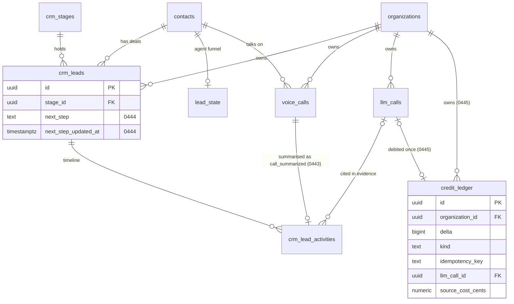
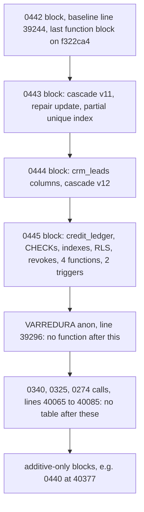

# DeskcommCRM — Backend schema reference

| Field     | Value                                                                                                                                                                                                                                                     |
| --------- | --------------------------------------------------------------------------------------------------------------------------------------------------------------------------------------------------------------------------------------------------------- |
| Status    | Draft for review. Docs-only PR from branch `claude/deskcomm-project-docs`.                                                                                                                                                                                |
| Base      | `main` at `f322ca4` of `jaimedhenriques/deskcommcrm`. Every line number below was read at that commit in `supabase/baseline.sql` (40402 lines at that commit; re-measure with `wc -l supabase/baseline.sql`).                                             |
| Scope     | The tables and functions the three lane slices touch, quoted by their LAST definition, and the schema changes each slice adds: migration 0443 (slice 1), 0444 (slice 2), 0445 (slice 3).                                                                  |
| Owns      | DDL sketches, baseline appendix placement, MANIFEST rows, revokes, the invariant tests each change must pass, and the new TypeScript vocabulary and event types.                                                                                          |
| Does not  | Component design, data flow and error handling (in `TRD.md`), screens (in `APP_FLOW.md`), copy and labels (in `DESIGN_BRIEF.md`), task order (in `IMPLEMENTATION_PLAN.md`), product rationale and doctrine divergence (in `PRD.md`).                      |
| Authority | Below `CLAUDE.md`, `docs/specs/` and `docs/doctrine/` (precedence in `docs/index.md:22-24`). When this file and `supabase/baseline.sql` disagree about the schema **today**, the baseline wins and this file is the one to fix (DoD 16, `CLAUDE.md:735`). |

---

## 0. How to read this document

- **Markers.** `CONFIRMED` means the writer opened the cited file at `f322ca4` and read the cited
  lines. `INFERRED` means it follows from what was read, but nobody executed it. `PROPOSED` marks
  schema that does not exist yet; it is what the slice PRs must build. Every DDL block in §4-§6 is a
  sketch marked `PROPOSED`, not text to paste unreviewed.
- **Last definition wins.** `baseline.sql` is a `pg_dump` body plus an idempotent appendix, applied
  whole and in order, so the same function appears several times and only the last one is what an
  install gets (`CLAUDE.md:636-666`). Every "last definition" below was located with the
  case-insensitive, quote-tolerant search in §11, not with a first-match `grep`. Note that the
  `rfind` snippet in `CLAUDE.md:658-662` searches the lowercase, unquoted spelling; it misses the
  dump-style `CREATE OR REPLACE FUNCTION "public"."…"` form that the last cascade definition uses.
- **No business numbers.** No price, SLA or customer figure appears here (`AGENTS.md:544-551`).
  The only constant is the credit unit that the lane decisions fix (1 credit = 1 US cent of
  recorded provider cost), which is a decision to confirm, not a price.
- **Synthetic data only.** Fixtures and examples use no real phone number, email or name
  (`tests/unit/sem-identificador-de-producao.test.ts` scans `docs/`).

---

## 1. The decisions this file implements

From the lane decisions (binding for all six docs), schema-relevant parts only:

- **D1, slice 1, migration 0443.** Restore `transcript = null` in the last
  `fn_lgpd_cascade_redact_contact`; make sure `call_summarized` payloads are redacted with the
  contact; at most one `call_summarized` row per call. New command event
  `voice_call.summary_requested`; new activity type `call_summarized`.
- **D2, slice 2, migration 0444.** `crm_leads.next_step text` and
  `crm_leads.next_step_updated_at timestamptz`, written by the stage mirror path from
  `update_lead_state.next_action`; new activity type `next_step_set` (actor `ai`, with evidence).
- **D3, slice 3, migration 0445.** Table `credit_ledger` (not `credits`): signed `bigint delta`,
  `kind` in `debit_llm_call | grant | adjustment`, `idempotency_key` unique per organization,
  `llm_call_id` on delete set null, `source_cost_cents numeric`, `source_currency char(3)`,
  `created_at`. Append-only for PostgREST roles (copy migration 0258), owner immutability trigger
  with the org-deletion exemption, RLS SELECT-only. AFTER INSERT trigger on `llm_calls` for
  `status = 'ok'` and non-null cost. Balance through `fn_saldo_de_creditos`, `service_role` only.
  `fn_gasto_de_ia_do_mes` is not touched.
- **Numbers.** 0443, 0444, 0445 are free on `f322ca4` (highest is 0442). Re-check with
  `pnpm checar:colisao-de-migration` before each PR and renumber NNNN and timestamp together if
  `main` moved.

---

## 2. Rules every migration in this lane follows

| #   | Rule                                   | Source (CONFIRMED)                                                                                                                                                                                                                                                                                                                                                                                                                                           |
| --- | -------------------------------------- | ------------------------------------------------------------------------------------------------------------------------------------------------------------------------------------------------------------------------------------------------------------------------------------------------------------------------------------------------------------------------------------------------------------------------------------------------------------ |
| S1  | The triple                             | `supabase/migrations/<YYYYMMDDHHMMSS>_<NNNN>_<slug>.sql` + an idempotent block in `supabase/baseline.sql` labelled `-- ---- <what> (migration NNNN) ----` + a row in `supabase/migrations/MANIFEST.md` (`CLAUDE.md:577`, `:623-624`). No `BEGIN`/`COMMIT` (`:621`). Never edit an applied migration; fix forward (`:668`).                                                                                                                                   |
| S2  | Timestamp and number                   | Real UTC timestamp from `date -u +%Y%m%d%H%M%S`, later than the newest file (`20260927140300_0442_aviso_da_central_no_barramento.sql` at `f322ca4`). The number sequence has gaps (`0411`, `0429`-`0431`, `0433` near the top); never reuse a gap. `tests/unit/manifest-x-migrations.test.ts` fails on a missing, orphan or duplicated MANIFEST row and on a duplicate NNNN or timestamp.                                                                    |
| S3  | MANIFEST row                           | One table row with three cells: the timestamp in backticks, `NNNN_slug` in backticks, then the what and why in pt-BR (rows at `MANIFEST.md:445-447` for 0440-0442). The file is `merge=union` in `.gitattributes:10`, so two PRs appending rows do not conflict.                                                                                                                                                                                             |
| S4  | Functions go before the anon sweep     | No `create function` anchored at line start may appear after `-- ---- VARREDURA anon:` (`baseline.sql:39296`; guarded by `tests/unit/varredura-anon-e-o-ultimo-bloco.test.ts`). The last function block on `f322ca4` is 0442 at `:39244`. All three lane blocks therefore go between `:39244`'s block and `:39296`, in number order.                                                                                                                         |
| S5  | Tables go before the end-of-file calls | A new table, an `organization_id` column, RLS or a grant to `authenticated` must precede the calls of 0340 (`:40065`), 0325 (`:40073`) and 0274 (`:40085`); guarded by `tests/invariants/travas-de-suporte-cobrem-toda-tabela-na-instalacao.test.ts`. Purely additive columns may sit after them (0440 at `:40377`). Because S4 places every lane block before `:39296`, S5 holds automatically.                                                             |
| S6  | Revoke both origins of `EXECUTE`       | Every new function in `public` ends with `revoke execute … from public, anon` and grants only to who needs it (`CLAUDE.md:627-634`), because the dump grants `ALL ON FUNCTIONS` to `anon` by default (`baseline.sql:4738`). The sweep at `:39296` heals only `security definer` functions (`p.prosecdef`), so an invoker function depends on its own revokes (comment at `:13107-13116`). Guarded by `tests/invariants/hardening-definer-varredura.test.ts`. |
| S7  | New tables are born granted            | The dump also grants `ALL ON TABLES` to `anon`, `authenticated` and `service_role` by default (`baseline.sql:4747-4750`), so a new table must revoke what it does not want (comment at `:11862-11866`).                                                                                                                                                                                                                                                      |
| S8  | Migration body equals appendix body    | For every function whose last baseline definition is in the appendix, the body must equal the last definition in the migration chain (`tests/unit/apendice-do-baseline-nao-diverge-da-cadeia.test.ts`). Write the function once and paste the same text into both artifacts.                                                                                                                                                                                 |
| S9  | One constraint, one block              | A vocabulary CHECK lives in a single appendix block that drops and re-adds it (`tests/unit/baseline-constraint-reconstruida.test.ts`); the chain and the baseline carry the same vocabulary (`tests/unit/check-do-baseline-nao-diverge-da-cadeia.test.ts`, `tests/unit/kind-check-migration-x-baseline.test.ts`).                                                                                                                                            |
| S10 | Re-applicable                          | `install.sh` applies the baseline with `ON_ERROR_STOP=1`, `update.sh` re-applies it without (`CLAUDE.md:624`); `pnpm test:db` applies it twice with `ON_ERROR_STOP=1`. Everything is `if not exists`, `create or replace` or `drop … if exists` then `add` (`tests/unit/baseline-reaplicavel.test.ts`).                                                                                                                                                      |
| S11 | Contract change                        | Regenerate `lib/database.types.ts` when columns or tables change (`CLAUDE.md:625`).                                                                                                                                                                                                                                                                                                                                                                          |

---

## 3. Existing schema the slices touch

All entries CONFIRMED by reading `supabase/baseline.sql` at `f322ca4` unless marked otherwise.

### 3.1 `voice_calls`

| Piece                          | Last definition                                                                                              | Facts                                                                                                                                                                                                                                                                                                                             |
| ------------------------------ | ------------------------------------------------------------------------------------------------------------ | --------------------------------------------------------------------------------------------------------------------------------------------------------------------------------------------------------------------------------------------------------------------------------------------------------------------------------- |
| Base table (migration 0233)    | `:23790-23815`                                                                                               | `id`, `organization_id` (cascade), `channel_session_id`, `contact_id` (set null), `wacalls_call_id`, `direction` in/out, `peer_phone not null`, `status` (`starting`, `ringing`, `connected`, `ended`), `end_reason` (no CHECK on purpose), timestamps, `duration_ms`, `created_by`, `unique (organization_id, wacalls_call_id)`. |
| Owner and RLS (0235)           | `:23883-23884`, `:23905-23916`, `:23918`                                                                     | `owner_user_id`; policy pair `voice_calls_select` (tenancy) and `voice_calls_write` (`for all`, tenancy and `fn_role_at_least(…, 'agent')`); `revoke all … from anon`. `channel_session_id` FK becomes `on delete restrict` (`:23938-23941`).                                                                                     |
| SIP columns (0348)             | `:32468-32469` (relax not null), `:32472-32479` (columns), `:32481-32489` (CHECKs), `:32491-32494` (indexes) | `provider text not null default 'wacalls'` (`wacalls`, `sip`), `asterisk_channel_id`, `lead_id` (FK `crm_leads`, set null), `ai_agent_id` (FK `ai_agents`, set null), `handled_by` (`human`, `ai`, `ai_then_human`), `transcript jsonb`, `metadata jsonb not null default '{}'`.                                                  |
| Transcript shape               | `workers/voice-agent/index.ts:202-206`, written at `:208-228`                                                | Array of `{ speaker, text, ts }`, written once by `finalizeAudioSocketCall` for SIP calls only. That `UPDATE` filters on `id` alone, with no `organization_id` (`:219-227`).                                                                                                                                                      |
| `lead_id` writers              | INFERRED from search (critic item 10 in the lane map)                                                        | No code writes `voice_calls.lead_id`; routing a call to a deal goes contact → deal through `resolveActiveLeadForContact`.                                                                                                                                                                                                         |
| No summary or recording column | —                                                                                                            | Slice 1 adds none: the summary lives in the activity `payload` (D1).                                                                                                                                                                                                                                                              |

### 3.2 `crm_leads`

- Base table at `:1463-1494`: `id`, `organization_id`, `pipeline_id`, `stage_id`, `contact_id`,
  `title`, `description`, `status` (`open`, `won`, `lost`), `lost_reason`, `position_in_stage`,
  `value_cents`, `currency` (ISO CHECK), `owner_user_id`, `assigned_at`, `last_activity_at`,
  `expected_close_date`, `closed_at`, `source`, `source_metadata`, `external_id`, `custom_fields`,
  `tags`, timestamps, `created_by_user_id`; CHECKs `crm_leads_closed_at_consistency`,
  `crm_leads_lost_reason_required`, `crm_leads_status_enum`.
- Later additive columns: `owner_kind`, `owner_agent_id` (`:8025-8031`), `stage_changed_at`
  (`:8241-8242`), `won_reason` (`:38403-38404`), `retomado_de_lead_id` (`:40310-40311`),
  `lost_from_stage_id` (`:40340-40341`).
- **No next-step column.** No `next_step`, `proxima_acao` or similar exists anywhere in the baseline
  (search for `next_step|proxima_acao` returns nothing).
- RLS: `crm_leads_update` requires `agent` or above and lead visibility, or `manager`
  (`:5591-5604`). A human edit of `next_step` passes through this policy unchanged.

### 3.3 `crm_stages.agent_stage_hint`

- Base table at `:1519-1538`. Column `agent_stage_hint text` added by migration 0084
  (`:8928-8929`), CHECK `crm_stages_agent_stage_hint_check` to the seven agent steps `new`,
  `contacted`, `qualifying`, `qualified`, `negotiating`, `won`, `lost` (`:8934-8942`), CHECK
  `crm_stages_hint_coerente_com_won_lost` tying `won`/`lost` hints to `is_won`/`is_lost`
  (`:8952-8960`), and unique index `uniq_crm_stages_pipeline_hint` per pipeline on non-archived
  stages (`:8978-8980`). One definition only.
- Slice 2 changes no column here; it only reads the mapping through `sincronizaEstagioDoAgente`.

### 3.4 `crm_lead_activities`

| Piece                     | Last definition                      | Facts                                                                                                                                                                                                                                                                                                 |
| ------------------------- | ------------------------------------ | ----------------------------------------------------------------------------------------------------------------------------------------------------------------------------------------------------------------------------------------------------------------------------------------------------- |
| Base table                | `:1427-1440`                         | `organization_id`, `lead_id not null`, `contact_id`, `source_module not null`, `source_id`, `type not null`, `payload jsonb`, `metadata jsonb`, `performed_at`, `created_at`, `performed_by_user_id`.                                                                                                 |
| Actor and evidence (0071) | `:8120-8136`                         | `actor_kind` CHECK `user`, `ai`, `system`, `rule`, `contact`; `actor_agent_id` (FK `ai_agents`, set null); `reason text` (column comment: no PII, shown on screen and exported); `evidence jsonb`.                                                                                                    |
| AI needs evidence (0072)  | `:8278-8287`                         | `crm_lead_activities_ai_needs_evidence`: an `ai` row needs a non-empty `run_ids`, `trace_ids` or `llm_call_ids` array. Column comment at `:8289-8290` maps each key to its table. `buildLeadActivityRow` silently demotes `ai` without evidence to `system` (`lib/leads/activity-emitter.ts:82-109`). |
| `type` vocabulary         | none in the DB                       | No CHECK on purpose; the vocabulary is the TypeScript union (`lib/leads/activity-vocabulary.ts:15-19`).                                                                                                                                                                                               |
| Indexes                   | `:2726-2738`                         | `(org, contact_id, performed_at desc)`, `(org, lead_id, performed_at desc)`, `(org, type, performed_at desc)`, GIN on `payload`. **No unique key** on `(source_module, source_id, type)`, so a retried handler can insert a duplicate today.                                                          |
| RLS                       | `:6205-6218`                         | `crm_lead_activities_select` (lead visibility through `fn_can_view_lead`) and `crm_lead_activities_insert` (tenancy or platform admin). Real writers use the service role or the schema owner.                                                                                                        |
| Engine writer             | `lib/leads/agent-activity.ts:50-132` | `emitAgentActivityForContact` routes contact → deal with `resolveActiveLeadForContact`, writes `contact_id` on the row, and on an ambiguous or missing deal writes `event_log` `agent.activity_unrouted` instead of a row. `performed_at` takes the column default.                                   |

### 3.5 `lead_state`, `lead_state_transitions`, `lead_checkpoints`

- `lead_state` at `:6527-6538`: one row per **contact** (`unique (organization_id, contact_id)`),
  `stage` CHECK on the seven steps, `qualification jsonb`, `next_action text`, `updated_at`.
  `next_action_seq bigint not null default 0` added at `:8300-8301` (comment `:8303`: identity of
  the current proposal).
- `lead_state_transitions` at `:6541-6551` plus index `:6552`: append-only history with `job_id`,
  `from_stage`, `to_stage`, `reason`; no agent id column.
- `lead_checkpoints` at `:6507-6519` plus index `:6520`: per-contact checkpoint with
  `commitments`, `objections`, `next_action`, `rolling_summary`; `declaracao jsonb` added at
  `:10917-10918`; `conversation_id`, `service_revision`, `demanda_id`, `demanda_revision` at
  `:19302-19305`.
- All three plus `llm_calls` are listed as known RBAC debt (tenancy-only `ALL` policy) in
  `tests/invariants/rbac-config-ia-canais.test.ts:181-191`.
- LGPD: the catalog test records `lead_state` and `lead_state_transitions` as "manter" (kept)
  (`tests/invariants/lgpd-redact-unificado-alcanca-pelo-catalogo.test.ts:260-267`). Slice 2 leaves
  that unchanged; the new free text it adds lives on `crm_leads`, which the catalog records as
  "redigir" (`:149-153`).

### 3.6 `llm_calls`

- Base table at `:6483-6499`, index `(organization_id, created_at)` at `:6500`: `contact_id` (set
  null), `job_id` (set null), `purpose`, `provider`, `model`, token counts, `cost_cents numeric`
  (comment: null means unknown price, never invent 0), `latency_ms`, `created_at`. No currency
  column; USD is stated by the comment on `fn_gasto_de_ia_do_mes` (`:13138-13139`).
- Migration 0128 (`:11239-11257`): `status text not null default 'ok'`, `error_code`,
  `error_message`, `http_status`, `origem_da_escolha`; `llm_calls_status_check` allows only
  `'ok'` and `'erro'` (`:11252`); budget refusals are `erro` rows (the smoke script counts them by
  `error_code = 'orcamento_esgotado'`, `scripts/smoke-llm.ts:261`).
- Migration 0130 (`:11278-11286`): `agent_id` (FK `ai_agents`, set null), `legacy_invocation_id`
  with a partial unique index; the backfill from `ai_invocations` at `:11296` is
  `on conflict do nothing`. No TypeScript code inserts into `ai_invocations` (search, INFERRED that
  the backfill copies nothing new after its first run).
- Existing AFTER INSERT trigger `trg_llm_calls_budget` (`:9526-9529`) runs
  `fn_update_budget_consumption` (`:758-774`, `security definer`, adds `coalesce(cost_cents, 0)` to
  a counter that never resets; ACL tightened at `:39364` and `:39370`). It is the precedent for a
  per-call metering hook.
- RLS: tenancy-only `ALL` policy, declared debt at `:12405-12414`. No CHECK on `cost_cents`.
- Writers that can delete a row: only `scripts/smoke-llm.ts:298`, which deletes a row it seeded at
  `:209-215` (search over `lib`, `app`, `workers`, `scripts`, `baseline.sql`).

### 3.7 `ai_budgets`

- Dump table at `:1043-1056` (`monthly_limit_cents`, `alarm_threshold_pct`,
  `current_month_consumed_cents`, legacy `action_at_100pct`, `is_throttled`, `is_disabled`).
- Migration 0159 (`:14630-14783`): `enforcement_mode` default `'off'` with CHECK
  `off | avisar | bloquear` (`:14734-14738`), `enforcement_effective_at`, and
  `ai_budgets_bloquear_precisa_de_teto` (`:14740-14744`).
- Migration 0160: `revoke insert, update, delete … from authenticated, anon` (`:14807`).
- Policies (0150): SELECT on tenancy or platform admin, write with `admin` role (`:12483-12502`).
- Slice 3 changes nothing here. The single spend measure is `fn_gasto_de_ia_do_mes`
  (`:13125-13146`, `security invoker`, revoked from `public, anon, authenticated`, granted to
  `service_role`); `tests/unit/orcamento-uma-regua-de-gasto.test.ts` requires exactly one creation
  of it, identical to migration 0159, and flags application files containing both
  `sum(cost_cents)` and `date_trunc('month'`.

### 3.8 `event_log`, `emit_event`, `fn_event_log_e_registro`

- `event_log` at `:1544-1561`: `organization_id`, `event_type`, `entity_kind`, `entity_id`,
  `payload`, `metadata`, `consumed_by text[]`, `attempts`, `last_error`, `next_attempt_at`,
  `status` CHECK `pending | processing | done | dead`, and `event_type_format` CHECK
  `^[a-z][a-z0-9_]*\.[a-z][a-z0-9_]*$`.
- `emit_event` is defined six times (`:69`, `:12277`, `:18717`, `:20119`, `:20709`, `:28409`). The
  **last** is `:28409-28501`. Facts from that body: rejects reserved types and `service_origin`
  keys for an authenticated caller; resolves the organization from `p_organization_id`, then the
  support context, then membership; checks `fn_role_at_least(…, 'viewer')` when `auth.uid()` is
  set; refuses when `fn_support_write_allowed` is false; stamps `service_origin` only for
  `lead.created`, `lead.stage_changed`, `lead.tag_added` and `contact.tag_added`; inserts with the
  column default status `pending` and adds `emitted_at` to `metadata`. A service-role call (no
  `auth.uid()`) passes every caller check.
- `fn_event_log_e_registro` at `:24489-24539` lists the fact types that have no consumer;
  trigger `trg_event_log_marca_registro` (`:24565-24569`) turns those to `done` at insert. A
  command (`*_requested`) must not be listed and must have a registered handler
  (`tests/unit/evento-comando-tem-consumidor.test.ts`; facts:
  `tests/unit/evento-de-fato-nao-fica-pendente.test.ts`).

### 3.9 `fn_lgpd_cascade_redact_contact` (the last body)

Defined ten times (`:339`, `:23306`, `:23945`, `:28803`, `:29344`, `:30036`, `:30960`,
`:32547`, `:34264`, `:35136`; `CLAUDE.md:644` still says eight, re-measure with §11). The last
definition is `:35136-35675`, ACL at `:35676-35677` (`revoke all … from public, anon,
authenticated`; `grant execute … to service_role`), plus the sweep's explicit pair at `:39363` and
`:39369`. Facts from that body:

| Step                     | Lines          | What it does                                                                                                                                                                                                          |
| ------------------------ | -------------- | --------------------------------------------------------------------------------------------------------------------------------------------------------------------------------------------------------------------- |
| Guard                    | `:35153-35164` | `fn_service_lock`; raises `P0002` if the contact is missing; **returns early when `contacts.is_anonymized` is already true**. A contact anonymized before a fix is never revisited by re-running the cascade.         |
| 3. `messages`            | `:35228-35243` | Body becomes a label, media columns and `metadata` cleared. `media_derived_text` is **not** cleared (out of the lane's decisions; see §10 Q5).                                                                        |
| 4. `crm_lead_activities` | `:35245-35268` | Sets `payload = '{}'`, `metadata = '{}'`, `reason = null` for rows whose `contact_id` is the contact or whose `lead_id` belongs to the contact (directly or through `crm_lead_links`). `evidence` is kept (ids only). |
| 5. `crm_leads`           | `:35270-35289` | `title` becomes the anonymous label; `description`, `custom_fields`, `source_metadata`, `tags` cleared; pipeline, stage and value kept.                                                                               |
| 7b. `voice_calls`        | `:35376-35396` | Sets `peer_phone` to the label, `owner_user_id = null`, `created_by = null`, `updated_at`. **`transcript` is not cleared** and `metadata` is not touched.                                                             |
| 8. Audit                 | `:35652-35666` | One `api_audit_log` row `lgpd.redact_executed` with the counts.                                                                                                                                                       |

The transcript regression: `transcript = null` appears only in the 0348 definition (`:32732`).
The next definition (`:34264`, block of migration 0359 at `:34246`) dropped it, and no later
migration in the chain mentions `transcript` (`*_0359_*.sql`, `*_0370_*.sql` and
`*_0379_campanha_na_cascata_lgpd.sql` each contain zero matches). SIP transcripts of every contact
anonymized since 0359 survive, and the early return means re-running the cascade will not reach
them.

The LGPD access export (`lib/lgpd/export-collector.ts`) selects `voice_calls` without `transcript`
(`:1044-1049`), selects `crm_lead_activities` without `payload` (`:917-925`) and `crm_leads`
without free-text fields (`:866-867`).

### 3.10 `fn_update_last_activity_at`

Defined three times (`:780`, `:8642`, `:24153`); the last is `:24153-24191`, fired by
`trg_update_last_activity_at` AFTER INSERT on `crm_lead_activities` (`:3050`). It is a positive
list: only `ai_turn`, `note`, `lead_edited`, `stage_changed`, `next_action_approved` and
`voice_call` touch `crm_leads.last_activity_at` and `contacts.last_activity_at`; any other type,
including a type that does not exist yet, leaves the silence clock alone. `stage_changed` counts
whatever the actor, so AI stage moves already count today.

### 3.11 Precedents the new DDL copies

| Precedent                            | Where                                       | What is copied                                                                                                                                                                    |
| ------------------------------------ | ------------------------------------------- | --------------------------------------------------------------------------------------------------------------------------------------------------------------------------------- |
| `loyalty_ledger`                     | `:33695-33720`                              | Ledger, not balance; signed amount; `idempotency_key` with unique `(organization_id, idempotency_key)`. Its grants are **not** copied: its policy lets `agent` update and delete. |
| `fn_saldo_de_fidelidade` (0355)      | `:34148-34168`                              | Balance summed in the database because PostgREST truncates at 1000 rows.                                                                                                          |
| `fn_lancamento_pago_e_imutavel`      | `:33723-33745`                              | `BEFORE UPDATE` trigger that raises `42501` with a hint.                                                                                                                          |
| `fn_audit_log_row` org exemption     | `:11000-11044`, exemption at `:11025-11027` | `if not exists (select 1 from organizations where id = …) then return …` so the organization cascade is not blocked.                                                              |
| Migration 0258                       | `:25024-25057`                              | `revoke update, delete, truncate … from public, anon, authenticated, service_role`; FK `set null` actions still run as the table owner (comment at `:25043-25044`).               |
| `trg_llm_calls_budget`               | `:9526-9529`                                | AFTER INSERT row trigger on `llm_calls`, `security definer` function, no HTTP.                                                                                                    |
| `fn_proteger_tabelas_de_organizacao` | `:6946`                                     | Skips tables that already have RLS; otherwise injects a tenancy-only `ALL` policy, which the RBAC gate rejects for a new table.                                                   |
| `fn_aplicar_travas_de_suporte`       | `:28195`                                    | A table where `authenticated` has none of `insert`, `update`, `delete` is server-only and keeps zero `support_write_*` policies.                                                  |

### 3.12 Entity map



The `voice_calls` to `crm_lead_activities` edge is logical (`source_module = 'voice_calls'`,
`source_id = voice_calls.id`), not a foreign key, and `evidence` holds ids, not foreign keys.

---

## 4. Slice 1 — migration 0443

**File name pattern.** `supabase/migrations/<UTC timestamp>_0443_<slug>.sql`, slug proposed
`resumo_da_chamada_e_transcricao_na_cascata`. PROPOSED.

**What it changes.** Three things, one block.

1. **Cascade fix.** A new last definition of `fn_lgpd_cascade_redact_contact`, built from the body
   at `:35136-35675` (or from whatever is the last definition when the PR is rebased, see §7),
   with one change in step 7b: `transcript = null` added to the `voice_calls` update. No other
   line changes; the ACL lines are repeated as at `:35676-35677`. Step 4 already clears
   `call_summarized` payloads, so no change is needed there; a test proves it (§9).
2. **Data repair for contacts already anonymized.** Because of the early return (§3.9), the fix
   alone never reaches transcripts of contacts anonymized since 0359. The block clears them once,
   idempotently (a re-run matches zero rows). This is part of "fix the regression" in D1; written
   for any clone, no hardcoded ids (`CLAUDE.md:622`).
3. **One summary per call.** A partial unique index on `crm_lead_activities` so a retried handler
   cannot add a second `call_summarized` row for the same call (shape from `TRD.md` §4.6). No row
   of that type exists before the slice, so the index cannot fail on `update.sh`.

```sql
-- PROPOSED sketch for migration 0443 and its baseline block.
-- ---- a transcrição da ligação volta à cascata e o resumo é um por chamada (migration 0443) ----

-- (1) new LAST definition: the full body of baseline.sql:35136-35675, unchanged except step 7b:
--   update voice_calls set
--     transcript = null,          -- restored (was in 0348 at :32732, lost since 0359)
--     peer_phone = v_anon_label,
--     owner_user_id = null,
--     created_by = null,
--     updated_at = now()
--   where organization_id = p_organization_id
--     and contact_id = p_contact_id;
revoke all on function public.fn_lgpd_cascade_redact_contact(uuid,uuid,uuid) from public,anon,authenticated;
grant execute on function public.fn_lgpd_cascade_redact_contact(uuid,uuid,uuid) to service_role;

-- (2) repair: transcripts left behind by the regression, for contacts the cascade will never revisit
update public.voice_calls v
   set transcript = null,
       updated_at = now()
  from public.contacts c
 where c.organization_id = v.organization_id
   and c.id = v.contact_id
   and c.is_anonymized
   and v.transcript is not null;

-- (3) at most one summary row per call
create unique index if not exists crm_lead_activities_um_resumo_por_chamada
  on public.crm_lead_activities (organization_id, source_id)
  where type = 'call_summarized';
```

**Placement.** Right after the 0442 block (`:39244`) and before `-- ---- VARREDURA anon:`
(`:39296`), because it creates a function (S4). The migration file carries the identical function
text (S8).

**MANIFEST row.** PROPOSED; the "what and why" names the regression (lost since 0359), the
one-time repair and the partial unique index, in pt-BR like its neighbours:

```text
| `<timestamp>` | `0443_<slug>` | **A transcrição da ligação volta a ser apagada com o contato, e o resumo é um por chamada.** … |
```

**Revokes.** The cascade keeps its existing ACL (S6). No new function, table or grant otherwise.

**Not in 0443.** `fn_update_last_activity_at` is unchanged (§10 Q3). `messages.media_derived_text`
stays uncleared (§10 Q5). `voice_calls.metadata` is not cleared; no SIP writer puts content in it
today (search of `workers/voice-agent/index.ts` finds no `metadata` write, INFERRED low risk). No
column is added to `voice_calls`.

**Access export (code, not schema).** `lib/lgpd/export-collector.ts:1046-1049` adds `transcript`
to the `voice_calls` select (D1). Whether the export also includes `call_summarized` payloads is
open (§10 Q6).

**`call_summarized` payload contract.** PROPOSED; the Zod schema and its named length limits live
in `lib/voip/resumo-da-chamada.ts` (`TRD.md` §4.5), so the UI never reads a raw `payload` path
without the central schema (`CLAUDE.md:203`, anti-pattern 6).

| Field                  | Kind           | Note                                                                                                |
| ---------------------- | -------------- | --------------------------------------------------------------------------------------------------- |
| `schema_version`       | integer        | Lets the reader reject an unknown shape and fall back to the label only.                            |
| `voice_call_id`        | uuid           | Same id as `source_id`; D1 asks for it in the payload. Never placed in `evidence` (column comment). |
| `summary`              | string         | The AI's reading, labelled "segundo a IA — confira" on screen.                                      |
| `key_points`           | string array   | Bounded by a named maximum.                                                                         |
| `customer_commitments` | string array   | Quoted as the customer's words, labelled as such.                                                   |
| `suggested_next_step`  | string or null | Display only; never written to `crm_leads.next_step`, which has one writer (slice 2).               |

Row columns: `type = 'call_summarized'`, `source_module = 'voice_calls'`,
`source_id = voice_calls.id`, `actor_kind = 'ai'`, `actor_agent_id = voice_calls.ai_agent_id`,
`evidence = {"llm_call_ids": [<runModelCall callId>]}`, `reason` PII-free (shown through `t()`,
column comment at `:8142-8143`). PROPOSED.

---

## 5. Slice 2 — migration 0444

**File name pattern.** `supabase/migrations/<UTC timestamp>_0444_<slug>.sql`, slug proposed
`proximo_passo_no_negocio`. PROPOSED.

**What it changes.**

1. Two nullable columns on `crm_leads`. Additive, no default, no backfill: an existing deal has no
   AI-written next step until the agent writes one.
2. A new last definition of `fn_lgpd_cascade_redact_contact` whose step 5 also sets
   `next_step = null`. Reason: `next_step` is free text a model writes about a person, and the
   catalog test records `crm_leads` as "redigir" with free text cleared
   (`tests/invariants/lgpd-redact-unificado-alcanca-pelo-catalogo.test.ts:149-153`). D2 does not
   mention it; it follows from the existing redact contract and matches `TRD.md` §5.12.
   `next_step_updated_at` is kept (a timestamp identifies nobody).

```sql
-- PROPOSED sketch for migration 0444 and its baseline block.
-- ---- o próximo passo mora no negócio (migration 0444) ----
alter table public.crm_leads
  add column if not exists next_step text,
  add column if not exists next_step_updated_at timestamptz;

comment on column public.crm_leads.next_step is
  'Próximo passo do negócio. Escrito pela IA a partir de update_lead_state.next_action (sem aprovação) ou editado por humano. Texto livre sobre a pessoa: a cascata LGPD o apaga.';
comment on column public.crm_leads.next_step_updated_at is
  'Quando next_step mudou pela última vez, por IA ou por humano. Quem mudou está na timeline (next_step_set ou lead_edited).';

-- new LAST definition of fn_lgpd_cascade_redact_contact: the body of the then-last definition
-- (0443's if slice 1 merged first, else baseline.sql:35136), unchanged except step 5:
--   update crm_leads set
--     title = v_anon_label,
--     description = null,
--     next_step = null,           -- new
--     custom_fields = '{}'::jsonb,
--     ...
revoke all on function public.fn_lgpd_cascade_redact_contact(uuid,uuid,uuid) from public,anon,authenticated;
grant execute on function public.fn_lgpd_cascade_redact_contact(uuid,uuid,uuid) to service_role;
```

**No CHECK on `next_step` length.** The bound is the Zod maximum of `update_lead_state.next_action`
(`lib/agent-engine/agent/lead-state.ts:60`, per `TRD.md` §5.5) and of the human edit route. A DB
CHECK would need a number this file does not invent and would add a constraint to a hot table.

**No index.** Nothing filters or sorts by `next_step`. INFERRED from the reads planned in
`TRD.md` §5.2 (board and card read it per row).

**Placement.** After the 0443 block, before `-- ---- VARREDURA anon:` (S4: it redefines a
function). The columns are additive and could sit anywhere, but splitting the migration across two
blocks gains nothing.

**MANIFEST row.** PROPOSED; the "what and why" names both columns, the writer and the cascade
change:

```text
| `<timestamp>` | `0444_<slug>` | **O próximo passo passa a morar no negócio, escrito pela IA sem aprovação.** … |
```

**Revokes.** None new: `crm_leads` keeps its grants and policies (`:5578-5612`); the cascade keeps
its ACL.

**Not in 0444.** No change to `lead_state`, `lead_checkpoints` or the next-action approval
columns: the contact-level proposal and its route stay (D2). No new event type. `fn_update_last_activity_at`
is unchanged: writing a next step is the AI recording intent, not an interaction with the
customer, and the list's own rule says only interactions break the silence (`:24159-24161`).

**Activity rows (code, not schema).** PROPOSED; exact payload schema in `TRD.md` §5.

| Row                     | `type`                 | `actor_kind`      | Evidence                                          | Payload keys                                      |
| ----------------------- | ---------------------- | ----------------- | ------------------------------------------------- | ------------------------------------------------- |
| AI stage move           | `stage_changed`        | `ai`              | `trace_ids: [job_id]` by default (`TRD.md` §7 Q1) | `from_stage_id`, `to_stage_id`, `passo_do_agente` |
| AI next step            | `next_step_set`        | `ai`              | same as above                                     | `schema_version`, `next_step`, `next_action_seq`  |
| Human correction (kept) | `agent_move_corrected` | `user` (INFERRED) | unchanged                                         | unchanged; it now fires because the keys match    |

Both AI rows are redacted by step 4 of the cascade (they carry `contact_id`; §3.4).

---

## 6. Slice 3 — migration 0445

**File name pattern.** `supabase/migrations/<UTC timestamp>_0445_<slug>.sql`, slug proposed
`livro_de_creditos`. PROPOSED.

**Name check.** The upstream doctrine's billing-table grep
(`docs/doctrine/operacao-de-agentes.md:106-107`) matches only whole table names `billing`, `plans`,
`subscriptions`, `quota`, `credits`, or any name containing `invoice`. It returns 0 on `f322ca4`
and a line `create table if not exists public.credit_ledger (` also returns 0 (both measured).

### 6.1 Table, indexes and CHECKs

```sql
-- PROPOSED sketch for migration 0445 and its single baseline block.
-- ---- o livro de créditos: medição por chamada, sem preço (migration 0445) ----
create table if not exists public.credit_ledger (
  id uuid primary key default gen_random_uuid(),
  organization_id uuid not null references public.organizations(id) on delete cascade,
  -- signed: a debit is negative or zero, a grant positive; no separate sign column
  delta bigint not null,
  kind text not null,
  -- 'llm_call:<llm_calls.id>' for debits; derived from the Idempotency-Key for grants
  idempotency_key text not null,
  -- the source call; the debit survives the call's deletion with its source cost
  llm_call_id uuid references public.llm_calls(id) on delete set null,
  source_cost_cents numeric,
  source_currency char(3),
  created_at timestamptz not null default now()
);

-- one block per constraint (S9); drop + add keeps the rule idempotent on update.sh
alter table public.credit_ledger drop constraint if exists credit_ledger_kind_check;
alter table public.credit_ledger
  add constraint credit_ledger_kind_check
  check (kind in ('debit_llm_call', 'grant', 'adjustment'));

-- a forged or buggy row can never turn a debit into a grant
alter table public.credit_ledger drop constraint if exists credit_ledger_sinal_por_tipo;
alter table public.credit_ledger
  add constraint credit_ledger_sinal_por_tipo check (
    (kind = 'debit_llm_call' and delta <= 0)
    or (kind = 'grant' and delta > 0)
    or (kind = 'adjustment' and delta <> 0)
  );

-- a debit always records what it was computed from
alter table public.credit_ledger drop constraint if exists credit_ledger_debito_tem_fonte;
alter table public.credit_ledger
  add constraint credit_ledger_debito_tem_fonte check (
    kind <> 'debit_llm_call'
    or (source_cost_cents is not null and source_currency is not null)
  );

alter table public.credit_ledger drop constraint if exists credit_ledger_source_currency_iso;
alter table public.credit_ledger
  add constraint credit_ledger_source_currency_iso
  check (source_currency is null or source_currency ~ '^[A-Z]{3}$');

create unique index if not exists credit_ledger_idem_key
  on public.credit_ledger (organization_id, idempotency_key);
create index if not exists credit_ledger_org_time
  on public.credit_ledger (organization_id, created_at desc);
create index if not exists credit_ledger_llm_call
  on public.credit_ledger (llm_call_id) where llm_call_id is not null;
```

Notes on the shape:

- Columns are exactly D3's list plus `id` and `organization_id`. There is no `reason` or
  `created_by_user_id`: who granted and why go in the `api_audit_log` row the grant route writes
  (`resource_type = 'credit_ledger'`, `resource_id` = the row id), so the ledger holds no free text
  and no person (`TRD.md` §6.9, §6.13). If reviewers want the reason on the row, it is one
  additive column; recorded as §10 Q8.
- `idempotency_key` is `not null` (unlike `loyalty_ledger`), so the unique index is total, not
  partial: every row has exactly one key.
- A zero-cost call writes a zero-delta debit row (`TRD.md` §6.6), which the sign CHECK allows. Open
  in `PRD.md` §10 Q2.
- The currency CHECK copies `crm_leads_currency_iso` (`:1490`).

### 6.2 Conversion function, metering trigger and balance

```sql
-- PROPOSED sketch, same block, before the anon sweep (S4).

-- The credit unit (D3): 1 credit = 1 US cent of llm_calls.cost_cents, rounded UP per call.
-- A decision to confirm, not a price. Mirrored by CENTAVOS_USD_POR_CREDITO in lib/creditos/conversao.ts;
-- a unit test reads this literal from the labelled block and compares (S8 spirit).
create or replace function public.fn_creditos_da_chamada(p_cost_cents numeric)
returns bigint
language sql
immutable
set search_path to 'public', 'pg_temp'
as $$
  select ceil(p_cost_cents / 1)::bigint;   -- 1 = centavos de dólar por crédito
$$;
revoke execute on function public.fn_creditos_da_chamada(numeric) from public, anon, authenticated;
grant  execute on function public.fn_creditos_da_chamada(numeric) to service_role;

-- AFTER INSERT on llm_calls. Never raises on expected input: a failing trigger would lose the
-- record of a call the provider already answered (TRD §6.10). Null cost is NOT debited as zero;
-- it is counted by the unpriced query (§11). Negative cost is skipped and counted.
create or replace function public.fn_debitar_creditos_da_chamada()
returns trigger
language plpgsql
security definer
set search_path to 'public', 'pg_temp'
as $$
begin
  if new.status = 'ok' and new.cost_cents is not null and new.cost_cents >= 0 then
    insert into public.credit_ledger
      (organization_id, delta, kind, idempotency_key, llm_call_id, source_cost_cents, source_currency)
    values
      (new.organization_id,
       -public.fn_creditos_da_chamada(new.cost_cents),
       'debit_llm_call',
       'llm_call:' || new.id::text,
       new.id,
       new.cost_cents,
       'USD')
    on conflict (organization_id, idempotency_key) do nothing;
  end if;
  return new;
end;
$$;
revoke execute on function public.fn_debitar_creditos_da_chamada() from public, anon, authenticated;
grant  execute on function public.fn_debitar_creditos_da_chamada() to service_role;

drop trigger if exists trg_llm_calls_creditos on public.llm_calls;
create trigger trg_llm_calls_creditos
  after insert on public.llm_calls
  for each row execute function public.fn_debitar_creditos_da_chamada();

-- Balance: sum in the database (PostgREST truncates at 1000 rows, :34148-34152).
-- security invoker and service_role only, exactly like fn_gasto_de_ia_do_mes (:13125-13146):
-- it takes the organization as an argument and checks no membership.
create or replace function public.fn_saldo_de_creditos(p_org uuid)
returns bigint
language sql
stable
security invoker
set search_path to 'public', 'pg_temp'
as $$
  select coalesce(sum(delta), 0)::bigint
    from public.credit_ledger
   where organization_id = p_org;
$$;
revoke execute on function public.fn_saldo_de_creditos(uuid) from public, anon, authenticated;
grant  execute on function public.fn_saldo_de_creditos(uuid) to service_role;
```

Why each choice:

- **`security definer` on the metering function.** `llm_calls` keeps a tenancy-only `ALL` policy
  (§3.6). If an `authenticated` insert into `llm_calls` is possible (INFERRED, not measured), an
  invoker trigger would fail on the ledger insert that `authenticated` may not do, and break that
  insert. As definer it writes the debit, which can only reduce the caller's own organization's
  balance (sign CHECK). The sweep at `:39296` keeps it away from `anon`; the explicit revokes keep
  it away from `authenticated`, as `fn_update_budget_consumption` is (`:39364`, `:39370`).
- **Trigger order.** Two AFTER INSERT row triggers on `llm_calls` fire in name order
  (`trg_llm_calls_budget` before `trg_llm_calls_creditos`); they are independent. INFERRED from
  PostgreSQL's documented ordering.
- **No backfill.** On `update.sh`, the 0130 backfill at `:11296` runs textually before this block
  and uses `on conflict do nothing`, so it does not fire the new trigger for skipped rows; rows that
  existed before 0445 are never debited (`TRD.md` §7 Q4, `PRD.md` §10 Q3). INFERRED from line order
  and PostgreSQL semantics.
- **No second spend measure.** The ledger sums `delta`, not `cost_cents`, and has no monthly
  window, so `tests/unit/orcamento-uma-regua-de-gasto.test.ts` is unaffected; `fn_gasto_de_ia_do_mes`
  is not redefined.

### 6.3 Immutability against the owner

Revokes bind only the PostgREST roles; the engine writes through a `pg.Pool` as the schema owner
(comment at `:13103-13105`). A trigger closes the owner path, with two
exemptions that the schema itself needs:

```sql
-- PROPOSED sketch, same block.
create or replace function public.fn_credit_ledger_imutavel()
returns trigger
language plpgsql
set search_path to 'public', 'pg_temp'
as $$
begin
  -- (a) the organization is being deleted: its ON DELETE CASCADE (and the SET NULL that the
  --     cascade of llm_calls triggers here) must go through. Shape of fn_audit_log_row, :11025-11027.
  if not exists (select 1 from public.organizations where id = old.organization_id) then
    return case when tg_op = 'DELETE' then old else new end;
  end if;
  -- (b) the only UPDATE allowed: the FK action llm_call_id -> null, nothing else changed.
  if tg_op = 'UPDATE'
     and old.llm_call_id is not null
     and new.llm_call_id is null
     and (to_jsonb(new) - 'llm_call_id') = (to_jsonb(old) - 'llm_call_id') then
    return new;
  end if;
  raise exception 'credit_ledger_append_only'
    using errcode = '42501',
          hint = 'O livro de créditos só recebe linha. Corrija com um lançamento de ajuste.';
end;
$$;
revoke execute on function public.fn_credit_ledger_imutavel() from public, anon, authenticated;
grant  execute on function public.fn_credit_ledger_imutavel() to service_role;

drop trigger if exists trg_credit_ledger_imutavel on public.credit_ledger;
create trigger trg_credit_ledger_imutavel
  before update or delete on public.credit_ledger
  for each row execute function public.fn_credit_ledger_imutavel();
```

- Exemption (b) exists because D3 asks for `on delete set null` and something deletes `llm_calls`
  rows: the organization cascade, and `scripts/smoke-llm.ts:298`, which deletes a priced row it
  seeded (`:209-215`). Without (b) that delete would raise. With (b) the smoke run against a
  throwaway or `SMOKE_DB_URL` database leaves a debit behind; the slice should either compensate
  with an `adjustment` or state it. INFERRED; §10 Q9.
- `TRUNCATE` is not row-level; the owner can still truncate. The PostgREST roles cannot (§6.4).
- Whether exemption (a) sees the parent row as gone during the cascade is the same assumption
  `fn_audit_log_row` relies on, and the invariant in §9 must prove it on `pnpm test:db` (organization
  delete with ledger rows and `llm_calls` rows succeeds).

### 6.4 RLS and grants

```sql
-- PROPOSED sketch, same block (before the 0325/0274 calls, S5).
alter table public.credit_ledger enable row level security;

drop policy if exists credit_ledger_select on public.credit_ledger;
create policy credit_ledger_select on public.credit_ledger
  for select to authenticated
  using (organization_id in (select public.fn_user_org_ids()));

-- The Supabase default table ACL grants everything to the three roles (:4747-4750). Copy 0258:
revoke all on table public.credit_ledger from anon;
revoke insert, update, delete, truncate on table public.credit_ledger from public, authenticated;
revoke update, delete, truncate on table public.credit_ledger from service_role;
```

Effective privileges after the block (PROPOSED, to be proven):

| Role            | SELECT          | INSERT | UPDATE                            | DELETE                            | TRUNCATE |
| --------------- | --------------- | ------ | --------------------------------- | --------------------------------- | -------- |
| `anon`          | no              | no     | no                                | no                                | no       |
| `authenticated` | own org via RLS | no     | no                                | no                                | no       |
| `service_role`  | yes             | yes    | no                                | no                                | no       |
| owner           | yes             | yes    | trigger raises (exemptions above) | trigger raises (exemptions above) | yes      |

- One SELECT policy only, never `ALL`: a new table with a tenancy-only `ALL` policy fails
  `tests/invariants/rbac-config-ia-canais.test.ts:226-239`. RLS is enabled in the block, so
  `fn_proteger_tabelas_de_organizacao` skips it.
- `authenticated` has no `insert`, `update` or `delete`, so `fn_aplicar_travas_de_suporte`
  classifies the table as server-only (`:28195`, server-only branch at `:28207-28211`) and support mode cannot
  write it.
- The policy follows `TRD.md` §6.8 (tenancy only). `ai_budgets` also lets a platform admin read
  (`:12487-12490`); adding `or public.fn_is_platform_admin()` is a one-line change if the admin
  console needs it.
- The grant route writes with the service client after `requireRole("admin")` and
  `requireSupportWrite()`, never with the user's client (`TRD.md` §6.2).

### 6.5 Placement, MANIFEST, types

- **Placement.** One labelled block after 0444's, before `-- ---- VARREDURA anon:` (`:39296`). It
  creates functions (S4) and a table with RLS (S5), and both rules are met there. The privilege
  statements of §6.4 sit in the same block so that the default-ACL invariant (§9) can extract the
  whole block by its label, as `blocoDa0258()` does
  (`tests/invariants/audit-log-sob-o-default-acl-do-supabase.test.ts:48-56`). The label must be
  unique in the file.
- **MANIFEST row.** PROPOSED; the "what and why" names the table, the trigger on `llm_calls`, the
  unit as a decision to confirm, and that nothing blocks:

  ```text
  | `<timestamp>` | `0445_livro_de_creditos` | **Cada chamada de modelo com custo conhecido debita créditos num livro que só recebe linha.** … |
  ```

- **Types.** Regenerate `lib/database.types.ts` (S11).
- **DoD 16.** `docs/doctrine/operacao-de-agentes.md` gets a note that a metering ledger now exists
  and bills nothing (`TRD.md` §6.2).

---

## 7. Appendix order across the three slices



- **The cascade is edited twice in sequence.** 0443 and 0444 each produce a new last definition of
  `fn_lgpd_cascade_redact_contact`. Whichever PR merges second must rebuild its definition from the
  one the first PR added, or it silently reverts the other's line (the failure mode in
  `CLAUDE.md:636-666` and `tests/unit/apendice-do-baseline-nao-diverge-da-cadeia.test.ts`). After
  both merge, the last definition must contain both `transcript = null` and `next_step = null`;
  the slice 2 invariant asserts the transcript line too, so a bad rebase fails CI. PROPOSED.
- If `main` moves and the numbers change, the order above still follows NNNN order, and every
  block stays before `:39296` (whose line number will move; re-measure with §11).

---

## 8. New TypeScript vocabulary and event types

All PROPOSED unless marked.

| Kind                        | Identifier                                                                            | File                                                                                                                                           | Rule it must satisfy                                                                                                                                                                                                                            |
| --------------------------- | ------------------------------------------------------------------------------------- | ---------------------------------------------------------------------------------------------------------------------------------------------- | ----------------------------------------------------------------------------------------------------------------------------------------------------------------------------------------------------------------------------------------------- |
| Activity type               | `call_summarized`                                                                     | `lib/leads/activity-vocabulary.ts` (`ActivityType` `:20-169`, `ACTIVITY_LABELS` `:171-270`)                                                    | `ACTIVITY_LABELS` is an exhaustive `Record`, so a type without a label does not compile (CONFIRMED, header `:12-14`). Label copy from `DESIGN_BRIEF.md`.                                                                                        |
| Activity type               | `next_step_set`                                                                       | same                                                                                                                                           | same                                                                                                                                                                                                                                            |
| Never-collapse set          | add `call_summarized` (D1) and `next_step_set` (`TRD.md` §5.4)                        | `lib/leads/timeline-grouping.ts:27-50` (`NUNCA_COLAPSA`)                                                                                       | Otherwise the 60 s window groups them with the same actor's `ai_turn` (CONFIRMED set contents).                                                                                                                                                 |
| Event type (command)        | `voice_call.summary_requested`                                                        | emitted in `workers/voice-agent/index.ts`; handler `workers/call-summary-worker.handler.ts` registered in `lib/event-log/register-handlers.ts` | Matches `event_type_format` (`:1560`); `*_requested` needs a registered handler (`tests/unit/evento-comando-tem-consumidor.test.ts`); must not be added to `fn_event_log_e_registro`. `entity_kind: 'voice_call'`, `entity_id: voice_calls.id`. |
| Event type (fact, existing) | `lead.stage_changed`                                                                  | `lib/leads/agent-stage-sync.ts:449-458`                                                                                                        | Unchanged name; metadata gains the agent id (`TRD.md` §5.4).                                                                                                                                                                                    |
| Event type (fact, existing) | `agent.activity_unrouted`                                                             | `lib/leads/agent-activity.ts:72-88`                                                                                                            | Already in `fn_event_log_e_registro` (`:24504`), so it is born `done` (CONFIRMED).                                                                                                                                                              |
| AI purpose                  | `call_summary`                                                                        | `lib/ai/pontos/registro.ts` (shape of `checkpoint`, `:417-427`)                                                                                | `registraEm: "llm_calls"`; every `purpose:` literal must be a registry entry (`tests/unit/pontos-de-ia-completude.test.ts`).                                                                                                                    |
| Ledger kind vocabulary      | `debit_llm_call`, `grant`, `adjustment` as a `const` tuple and its union type         | `lib/creditos/conversao.ts` (or a sibling vocabulary file)                                                                                     | Paired with `credit_ledger.kind` in `PARES` of `tests/invariants/vocabulario-banco-x-typescript.test.ts:45`, which compares the DB CHECK with the named TS symbol, never a copied list.                                                         |
| Credit unit constant        | `CENTAVOS_USD_POR_CREDITO` and `creditosDaChamada(costCents)` returning null for null | `lib/creditos/conversao.ts`                                                                                                                    | Equal to the literal in `fn_creditos_da_chamada`, read from the labelled 0445 block by a unit test.                                                                                                                                             |
| Audit codes                 | `ai.credits_granted`, `ai.credits_adjusted`                                           | `lib/audit/actions.ts`, appended at the end (`:916` closes the array)                                                                          | Append-only array, never renamed; precedent `ai.budget_*` at `:534-536`.                                                                                                                                                                        |

No new event type for slices 2 and 3: a fact with no consumer would have to join
`fn_event_log_e_registro`, and the ledger is written in the same transaction as `llm_calls`.

---

## 9. Tests each migration must pass

"New" files are PROPOSED names shared with `TRD.md`; "existing" files are CONFIRMED to exist at
`f322ca4`.

| Test                                                                                                                                                           | 0443 | 0444 | 0445 | What it checks for this lane                                                                                                                                                                                                                                                                                                                                                                    |
| -------------------------------------------------------------------------------------------------------------------------------------------------------------- | ---- | ---- | ---- | ----------------------------------------------------------------------------------------------------------------------------------------------------------------------------------------------------------------------------------------------------------------------------------------------------------------------------------------------------------------------------------------------- |
| `tests/unit/manifest-x-migrations.test.ts` (existing)                                                                                                          | yes  | yes  | yes  | Row present, unique NNNN and timestamp.                                                                                                                                                                                                                                                                                                                                                         |
| `tests/unit/varredura-anon-e-o-ultimo-bloco.test.ts` (existing)                                                                                                | yes  | yes  | yes  | No function created after the sweep.                                                                                                                                                                                                                                                                                                                                                            |
| `tests/unit/apendice-do-baseline-nao-diverge-da-cadeia.test.ts` (existing)                                                                                     | yes  | yes  | yes  | Migration and appendix function bodies are equal.                                                                                                                                                                                                                                                                                                                                               |
| `tests/unit/baseline-constraint-reconstruida.test.ts`, `check-do-baseline-nao-diverge-da-cadeia.test.ts`, `kind-check-migration-x-baseline.test.ts` (existing) | —    | —    | yes  | Each CHECK lives in one block and matches the chain.                                                                                                                                                                                                                                                                                                                                            |
| `tests/unit/orcamento-uma-regua-de-gasto.test.ts` (existing)                                                                                                   | —    | —    | yes  | `fn_gasto_de_ia_do_mes` still created once and unchanged.                                                                                                                                                                                                                                                                                                                                       |
| `tests/unit/evento-comando-tem-consumidor.test.ts`, `evento-de-fato-nao-fica-pendente.test.ts` (existing)                                                      | yes  | —    | —    | The command has a handler; no new fact left `pending`.                                                                                                                                                                                                                                                                                                                                          |
| `tests/invariants/hardening-definer-varredura.test.ts` (existing)                                                                                              | yes  | yes  | yes  | No definer executable by `anon`; no volatile definer executable by `authenticated` without a written reason (its `it` blocks at `:307`, `:322`).                                                                                                                                                                                                                                                |
| `tests/invariants/rls-isolation.test.ts` `TABLES` (existing, edited)                                                                                           | —    | —    | yes  | Add `credit_ledger` to `TABLES` (`:520`) and a seed row per organization as superuser (shape of the `loyalty_ledger` seed at `:449-452`): org A reads 0 rows of org B and at least 1 of its own.                                                                                                                                                                                                |
| `tests/invariants/rls-completude-varredura.test.ts` (existing)                                                                                                 | —    | —    | yes  | Passes once `credit_ledger` is in `TABLES` (it imports `TABLES`, `:4`). Never add it to `DEBITO_CONHECIDO`.                                                                                                                                                                                                                                                                                     |
| `tests/invariants/rbac-config-ia-canais.test.ts` (existing)                                                                                                    | —    | —    | yes  | No new table with a tenancy-only `ALL` policy (`:226-239`).                                                                                                                                                                                                                                                                                                                                     |
| `tests/invariants/travas-de-suporte-cobrem-toda-tabela-na-instalacao.test.ts` (existing)                                                                       | —    | —    | yes  | The table exists before the 0274 call on a single apply; as server-only it needs no `support_write_*` policy.                                                                                                                                                                                                                                                                                   |
| `tests/invariants/vocabulario-banco-x-typescript.test.ts` `PARES` (existing, edited)                                                                           | —    | —    | yes  | `credit_ledger.kind` paired with the TS symbol.                                                                                                                                                                                                                                                                                                                                                 |
| `tests/invariants/lgpd-redact-unificado-alcanca-pelo-catalogo.test.ts` (existing)                                                                              | yes  | yes  | —    | `voice_calls` and `crm_leads` stay "redigir + cascata" and the function body still has their commands. `credit_ledger` has no FK to `contacts`, so it needs no entry.                                                                                                                                                                                                                           |
| `tests/invariants/creditos-sob-o-default-acl-do-supabase.test.ts` (new)                                                                                        | —    | —    | yes  | The audit-log-under-default-ACL pattern: simulate the Supabase table default ACL, apply the labelled 0445 block, then probe `update`, `delete`, `truncate` for `anon`, `authenticated`, `service_role` (permission denied, not zero rows), with a control case without the block; `insert` and `select` still work for `service_role`; the owner's `UPDATE` raises `credit_ledger_append_only`. |
| `tests/invariants/creditos-no-livro.test.ts` (new)                                                                                                             | —    | —    | yes  | An `ok` priced insert debits once with `delta = -ceil(cost)`; a re-insert of the same key adds nothing; `erro`, null-cost and negative-cost inserts add no row and never fail; balance equals the sum; deleting an `llm_calls` row nulls `llm_call_id` and keeps the debit; deleting the organization succeeds.                                                                                 |
| `tests/invariants/resumo-da-chamada-na-timeline.test.ts` (new)                                                                                                 | yes  | —    | —    | One `call_summarized` row (actor `ai`, evidence `llm_call_ids`); a second insert for the same call fails `23505` on the partial index; after the cascade `transcript is null` and the row's `payload = '{}'`; a contact anonymized **before** the block was applied has `transcript is null` after it.                                                                                          |
| `tests/invariants/ia-move-etapa-e-proximo-passo.test.ts` (new)                                                                                                 | —    | yes  | —    | The recorded conversation writes `stage_id`, `next_step`, `next_step_updated_at`, `stage_changed` and `next_step_set` with actor `ai`; after the cascade `next_step is null` **and** the voice-call transcript is still cleared (catches a bad rebase, §7).                                                                                                                                     |

Edits to existing `tests/invariants/*` files are blocked by `loop/hooks/freeze-invariants.sh` unless
`DESKCOMM_GOV_INVARIANTS_EDIT=1` is set (adding files is free). The hook is not armed in this clone
(`git config --get core.hooksPath` prints nothing, measured), but the convention stands: declare
the `TABLES` and `PARES` edits in the PR body as additive registrations.

---

## 10. Decisions this file could not make

| #   | Question                                                                                                                                                                                                                           | Default in this file                                                  |
| --- | ---------------------------------------------------------------------------------------------------------------------------------------------------------------------------------------------------------------------------------- | --------------------------------------------------------------------- |
| Q1  | Credit unit: rounding up per call (D3) versus accumulating fractions? Same as `PRD.md` §10 Q1.                                                                                                                                     | Per call, `ceil`, one named constant.                                 |
| Q2  | Zero-cost call: zero-delta row or no row? Same as `PRD.md` §10 Q2.                                                                                                                                                                 | Zero-delta row (`TRD.md` §6.6).                                       |
| Q3  | Should `call_summarized` join the `fn_update_last_activity_at` list (`:24153-24191`)? A SIP call writes no `voice_call` activity, so the summary would be its only trace. Same as `TRD.md` §7 Q3.                                  | Not added in 0443.                                                    |
| Q4  | Backfill debits for `llm_calls` rows created before 0445? Same as `TRD.md` §7 Q4.                                                                                                                                                  | No backfill.                                                          |
| Q5  | Clear `messages.media_derived_text` in 0443's cascade redefinition? Same as `TRD.md` §7 Q5.                                                                                                                                        | Not included; known gap.                                              |
| Q6  | Should the access export include `call_summarized` payloads (the export selects activities without `payload`, `export-collector.ts:917-925`)? A summary is personal data derived from the transcript, which D1 adds to the export. | Not included; D1 names only the transcript.                           |
| Q7  | Is the one-time repair in 0443 (§4, item 2) acceptable as part of the regression fix, or does it need a separate decision because it changes stored data on every install?                                                         | Included; it only clears data the contract already says must be gone. |
| Q8  | Keep the grant reason and actor only in `api_audit_log`, or also on the ledger row?                                                                                                                                                | Audit row only, ledger free of text.                                  |
| Q9  | `scripts/smoke-llm.ts` seeds and deletes a priced `llm_calls` row; with 0445 the debit stays. Compensate inside the script with an `adjustment`, or document it?                                                                   | Document in the slice 3 PR; the script targets throwaway databases.   |

---

## 11. Re-measure commands (DoD 16)

Run from the repository root.

```bash
# Every definition line of a function, last one last (case-insensitive, quoted or not)
python3 -I -c '
import re, sys
s = open("supabase/baseline.sql").read()
for n in sys.argv[1:]:
    m = re.finditer(r"(?im)^create or replace function \"?public\"?\.\"?" + n + r"\"?\s*\(", s)
    print(n, [s.count("\n", 0, x.start()) + 1 for x in m])
' fn_lgpd_cascade_redact_contact fn_update_last_activity_at emit_event fn_gasto_de_ia_do_mes fn_event_log_e_registro

# Placement landmarks (S4, S5)
grep -n '^-- ---- VARREDURA anon:' supabase/baseline.sql
grep -nE '^-- ---- (módulos instalados|proteção de tabela de organização|travas do modo somente leitura)' supabase/baseline.sql
# last appendix block before the anon sweep (the lane blocks go right after it)
awk '/^-- ---- VARREDURA anon:/{print last; exit} /^-- ---- /{last=NR": "$0}' supabase/baseline.sql

# Highest migration number, newest timestamp, gaps, collisions (S2)
ls supabase/migrations | sed -nE 's#^([0-9]{14})_([0-9]{4})_.*#\2 \1#p' | sort -n | tail -1
pnpm checar:colisao-de-migration

# Does the last cascade clear the transcript? (prints the voice_calls update of the last body)
python3 -I -c '
s = open("supabase/baseline.sql").read()
i = s.rfind("CREATE OR REPLACE FUNCTION \"public\".\"fn_lgpd_cascade_redact_contact\"")
j = s.index("update voice_calls set", i)
print(s[j:s.index(";", j) + 1])
'

# No next-step column yet; no ledger table yet
grep -cE 'next_step|proxima_acao' supabase/baseline.sql
grep -ciE 'create table (if not exists )?public\.credit_ledger' supabase/baseline.sql

# Upstream doctrine's billing-table grep must stay 0 (docs/doctrine/operacao-de-agentes.md:106-107)
grep -oiE 'create table (if not exists )?public\.[a-z_]+' supabase/baseline.sql \
  | grep -icE 'invoice|^create table (if not exists )?public\.(billing|plans|subscriptions|quota|credits)$'

# Gates for these migrations
pnpm vitest run tests/unit/manifest-x-migrations.test.ts tests/unit/varredura-anon-e-o-ultimo-bloco.test.ts \
  tests/unit/apendice-do-baseline-nao-diverge-da-cadeia.test.ts tests/unit/orcamento-uma-regua-de-gasto.test.ts
pnpm test:db tests/invariants/rls-isolation.test.ts tests/invariants/rls-completude-varredura.test.ts \
  tests/invariants/rbac-config-ia-canais.test.ts tests/invariants/hardening-definer-varredura.test.ts
```

SQL to run against a database where the slices are applied (a `pnpm test:db` probe or a local
install, never production):

```sql
-- 0443: transcripts that should be gone
select count(*) from voice_calls v
  join contacts c on c.organization_id = v.organization_id and c.id = v.contact_id
 where c.is_anonymized and v.transcript is not null;

-- 0445: effective privileges on the ledger
select r.rolname,
       has_table_privilege(r.rolname, 'public.credit_ledger', 'select')   as sel,
       has_table_privilege(r.rolname, 'public.credit_ledger', 'insert')   as ins,
       has_table_privilege(r.rolname, 'public.credit_ledger', 'update')   as upd,
       has_table_privilege(r.rolname, 'public.credit_ledger', 'delete')   as del,
       has_table_privilege(r.rolname, 'public.credit_ledger', 'truncate') as trn
  from pg_roles r where r.rolname in ('anon', 'authenticated', 'service_role');

-- 0445: unpriced and anomalous successful calls, never debited
select count(*) filter (where cost_cents is null) as unpriced,
       count(*) filter (where cost_cents < 0)     as negative
  from llm_calls where status = 'ok';
```
