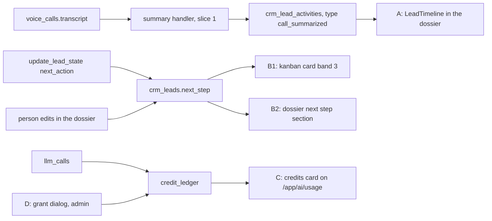
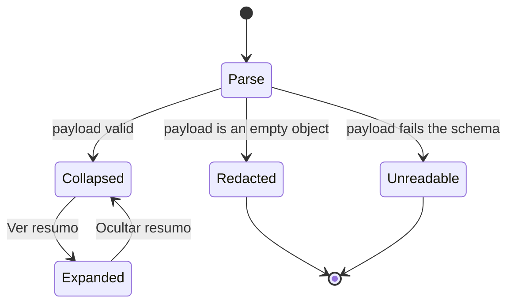
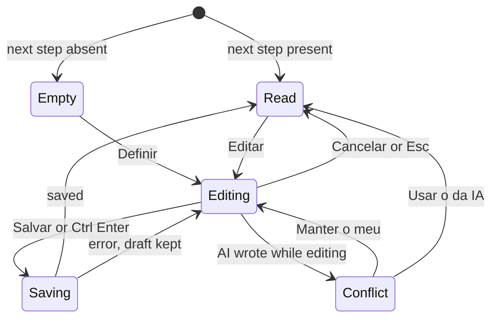
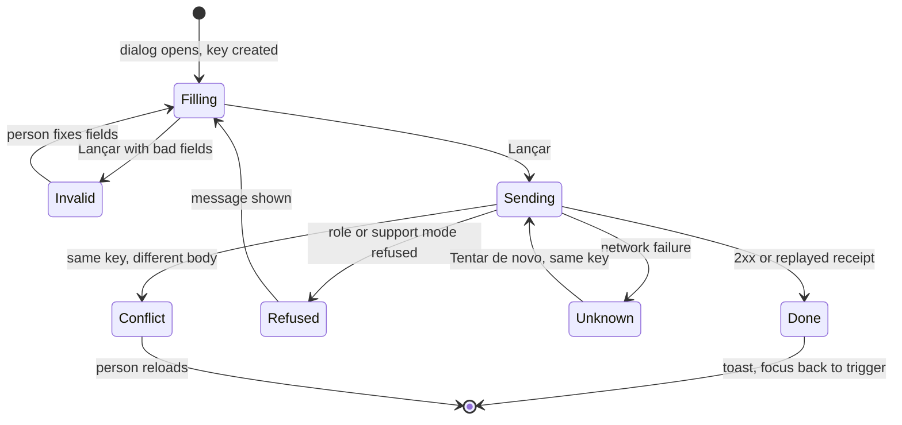

# DeskcommCRM — Design brief (call summary, deal next step, credits)

| Field     | Value                                                                                                                                                                                                                                                |
| --------- | ---------------------------------------------------------------------------------------------------------------------------------------------------------------------------------------------------------------------------------------------------- |
| Status    | Draft for review. Docs-only PR from branch `claude/deskcomm-project-docs`.                                                                                                                                                                           |
| Base      | `main` at `f322ca4` of `jaimedhenriques/deskcommcrm`. Every line number below was read at that commit.                                                                                                                                               |
| Scope     | Four UI surfaces: (A) call summary block in the deal timeline, slice 1; (B) deal next step on the kanban card and in the deal dossier, slice 2; (C) credits balance and ledger history on `/app/ai/usage`, slice 3; (D) admin grant dialog, slice 3. |
| Owns      | Look, copy (exact pt-BR strings), states, motion, accessibility, white-label and i18n rules for those surfaces; how 21st.dev and shadcn patterns are used here.                                                                                      |
| Does not  | Data flow, routes and guards (in `TRD.md`), DDL (in `BACKEND_SCHEMA.md`), journeys and screen order (in `APP_FLOW.md`), task order (in `IMPLEMENTATION_PLAN.md`), product rationale (in `PRD.md`).                                                   |
| Authority | Design system v1.0 (`docs/design-system/README.md:8`: "a doc vence" over code). This brief cites it and does not restate it. Where the design-system docs and the code differ today, §2 says which one a slice PR follows and why.                   |

**Markers.** `CONFIRMED` means the writer opened the cited file at `f322ca4` and read the cited
lines. `INFERRED` means it follows from code or docs that were read, but nobody rendered it.
`PROPOSED` marks design that does not exist in the code yet; the slice PRs build it. No business
number, price or SLA appears here (`AGENTS.md:544-551`). Where a number can go stale, Annex A gives
the command that re-measures it (CLAUDE.md DoD 16). Lane decisions D1–D3 are binding; where this
brief needs something they do not settle, §12 asks.

---

## 1. Surfaces at a glance

| Id  | Surface                       | Slice | Where it renders (today's file)                                                                           | Who sees it                                                                                     | State    |
| --- | ----------------------------- | ----- | --------------------------------------------------------------------------------------------------------- | ----------------------------------------------------------------------------------------------- | -------- |
| A   | Call summary block            | 1     | `components/kanban/LeadTimeline.tsx`, inside the deal dossier `components/kanban/LeadDossier.tsx:140-150` | Anyone who opens the deal                                                                       | PROPOSED |
| B1  | Next step on the kanban card  | 2     | `components/kanban/KanbanCard.tsx:250-287` (band ③), precedence in `lib/kanban/card-state.ts:166-243`     | Anyone on the board                                                                             | PROPOSED |
| B2  | Next step in the deal dossier | 2     | `components/kanban/LeadDossier.tsx`, between the live header (`:82-115`) and the conversation (`:128`)    | Anyone who opens the deal; editing follows the lead patch route's permissions (TRD §5.2)        | PROPOSED |
| C   | Credits card                  | 3     | `app/app/ai/usage/page.tsx`, between `BudgetCard` (`:68`) and `UsageDashboardClient` (`:69`)              | Manager and above (the page redirects lower roles, `page.tsx:26-28`)                            | PROPOSED |
| D   | Grant dialog                  | 3     | Opened from surface C                                                                                     | Admin only (`isAdmin` already computed at `page.tsx:54`); D3 route guard `requireRole("admin")` | PROPOSED |

"The deal page" is the dossier sheet: `/app/leads/[id]` only resolves the pipeline and redirects to
`/app/pipelines/<id>?lead=<id>`, which opens `LeadDossier` (`app/app/leads/[id]/page.tsx:41-49`,
CONFIRMED). No surface in this brief is a new route, so no new entry in `lib/navigation/catalogo.ts`
is needed (DoD 14); surface C lives on the existing `/app/ai/usage` entry (`catalogo.ts:568-576`,
CONFIRMED).



---

## 2. Binding rules from design system v1.0, and where the code differs

Read `docs/design-system/00-overview.md` to `09-anti-patterns.md` once; the slice PRs follow them.
This section only adds what those docs cannot know: how each token is spelled in the code today.

### 2.1 Tokens: doc name → class to use today

| Concern    | Doc rule (cite)                                                                                              | Code today (CONFIRMED)                                                                                                                                                                 | Rule for slice PRs                                                                                                                          |
| ---------- | ------------------------------------------------------------------------------------------------------------ | -------------------------------------------------------------------------------------------------------------------------------------------------------------------------------------- | ------------------------------------------------------------------------------------------------------------------------------------------- |
| Radius     | xs 4 controls, sm 8 cards, md 12, lg 16 modal (`01-foundation-tokens.md:28-39`)                              | The names are shifted by one: `--radius-sm` 4px, `--radius-md` 8px, `--radius-lg` 12px, `--radius-xl` 16px (`app/globals.css:110-115`)                                                 | Pick by **pixels**, not by name: controls `rounded-sm`, list and kanban cards `rounded-md`, panels `rounded-lg`, modal `rounded-xl`.        |
| Type scale | `body` 14/20, `body-sm` 13/18, `caption` 12/16, `mono-data` 13/18 (`03-typography.md:43-56`)                 | The `text-body-sm`, `text-caption`, `text-mono-data` utilities named in `03-typography.md:143-146` do not exist; no `--text-*` token in `app/globals.css` (0 consumers)                | `body` = `text-sm`; `caption` = `text-xs`; `body-sm` and `mono-data` = `text-[13px] leading-[18px]`. Nothing below 12px (`03:133`).         |
| Weights    | Atkinson 400 and 700 only; no 500 or 600 (`03-typography.md:29-37`)                                          | Only 400 and 700 are loaded (`app/layout.tsx:32-39`); many components still write `font-medium` or `font-semibold`                                                                     | New elements use `font-normal` or `font-bold`. Section headings copy the dossier's existing heading markup for visual parity (§2.8).        |
| Mono       | IBM Plex Mono for data: ids, values, tabular dates (`03-typography.md:17`, `:56`)                            | Plex Mono 400 and 500, variable `--font-mono` (`app/layout.tsx:41-48`), Tailwind `font-mono`                                                                                           | Credit amounts and ledger timestamps in `font-mono tabular-nums`. Prose stays Atkinson.                                                     |
| Colour     | Sage accent, greige neutrals, four states; no `#000`, no `#fff` page (`02-palette-sage.md`)                  | Semantic tokens bridged in `@theme inline` (`app/globals.css:455-532`): `text-text`, `text-text-muted`, `bg-surface`, `border-border`, `text-accent`, `text-warning-fg`, …             | Only these semantic classes. No hex, no Tailwind palette colours (`amber-*`, `zinc-*`, `slate-*`, `red-*`).                                 |
| Density    | Aerada row 56, gap 24, pad 20/16; data tables 44 / 10 / 16; kanban card pad 12 (`04-density-aerada.md:8-60`) | Variables are named `--density-row`, `--density-gap`, `--density-px`, `--density-py` (`app/globals.css:125-128`), not the `-row-h`/`-pad-x` names in the doc                           | Use the code names. Ledger table uses the data-table override.                                                                              |
| Focus      | 2px solid accent, offset 2px (`01-foundation-tokens.md:50`)                                                  | Global `:focus-visible` rule (`app/globals.css:724-732`) plus a forced-colors fallback (`:752-757`)                                                                                    | Rely on the global rule. Never `outline-none` or `outline-hidden` plus a `ring-*` substitute: forced-colors erases box-shadow (`:734-751`). |
| Motion     | 120 / 200 / 320 / 420 ms and four curves (`07-motion-language.md:85-103`)                                    | `--duration-fast/base/slow` and `--ease-out` (fast curve), `--ease-in-out` (base curve), `--ease-spring` (`app/globals.css:131-136`); utilities `duration-fast/base/slow` (`:585-593`) | Use the utilities. There is no token for the slow `(0.16, 1, 0.3, 1)` curve; slices add no animation that needs it (§2.6).                  |

### 2.2 Palette use on these surfaces

- Accent (`text-accent`) marks only what the person can act on or what the AI proposes. It is
  already taken on the card by the proposal prefix "Propõe:" (`NextActionSlot.tsx:43-45`), so the
  next step (B1) is **not** accent: it is a fact, not a pending decision.
- The card's left border is its only colour and appears only when the state asks for a decision
  (`KanbanCard.tsx:161-170`, "Lei C"). The next-step state is `neutral` (§5.2).
- Credit deltas are not coloured by sign. A sign character and a movement label carry the meaning;
  colour alone never does (`02-palette-sage.md:163`).
- Warnings use `text-warning-fg` for text and `text-warning` only for graphics, as the card already
  does (`KanbanCard.tsx:274-277`).

### 2.3 Type

Atkinson for every label and sentence; Plex Mono only for credit amounts and ledger timestamps.
The summary body is `body-sm`; section labels inside the summary are `caption` in
`text-text-muted`. Italic is reserved for literal quotes (`03-typography.md:87-96`); the summary is
a paraphrase, so it is never italic.

### 2.4 Density per surface

| Surface | Density                                                                                                                                                    |
| ------- | ---------------------------------------------------------------------------------------------------------------------------------------------------------- |
| A       | Inherits the timeline row (`py-1.5`, `LeadTimeline.tsx:66`). The expanded block indents with the same left rule the group expansion uses (`:159`, `:205`). |
| B1      | Kanban card override: band ③ keeps its reserved `h-6` (`KanbanCard.tsx:251`). The card never grows (`:58-67`).                                             |
| B2      | Dossier section rhythm: `border-b border-border py-3`, as the "Contato" section (`LeadDossier.tsx:132-138`). Input height per `04:71-76`.                  |
| C       | One card, padding `p-5` (space-5, `06-components.md:80`); data-table override for the history (`04-density-aerada.md:42-51`).                              |
| D       | Dialog: field spacing space-5, group spacing space-8 (`04-density-aerada.md:71-76`).                                                                       |

### 2.5 Icons: Phosphor through `lib/ui/icons.ts` only

Every icon is imported from `@/lib/ui/icons` (the barrel re-exports `@phosphor-icons/react/dist/ssr`,
`lib/ui/icons.ts:1-10,151`, CONFIRMED). Sizes 16/20/24/32 only (`05-iconography-phosphor.md:29-40`).
Icon next to text gets `aria-hidden="true"` (`05:176-178`).

| Icon           | Meaning in this lane (`05:132-133`, `09-anti-patterns.md:44-47`) | Where                                                                                   | Size, weight          | In the barrel today                                                                                     |
| -------------- | ---------------------------------------------------------------- | --------------------------------------------------------------------------------------- | --------------------- | ------------------------------------------------------------------------------------------------------- |
| `Brain`        | AI processing: the text below is the AI's reading of the call    | A, header of the expanded summary                                                       | 16, duotone, muted    | Yes (`icons.ts:44`, CONFIRMED)                                                                          |
| `MagicWand`    | Automatic suggestion that changes nothing by itself              | A, "Próximo passo sugerido" (display only, never feeds `crm_leads.next_step`, TRD §4.5) | 16, duotone, muted    | **No** — slice 1 adds it to the barrel (PROPOSED). The package has it (`@phosphor-icons/react` 2.1.10). |
| `PencilSimple` | Edit                                                             | B2 edit button                                                                          | 16, regular           | Yes (`icons.ts:60`)                                                                                     |
| `Warning`      | Attention without urgency                                        | C negative-balance hint, D idempotency notice                                           | 16, duotone, warning  | Yes (`icons.ts:74`)                                                                                     |
| `CircleNotch`  | Loading inside a disabled button                                 | B2 and D busy buttons                                                                   | 16, regular, spinning | Yes (`icons.ts:77`)                                                                                     |

- **`Sparkle` is never used for AI.** The barrel exports it (`icons.ts:22`) and two features use it
  (`components/inbox/composer/DraftReplyButton.tsx:4`, `app/app/ai/followups/_components/FlowsList.tsx:11`).
  `05-iconography-phosphor.md:132` still allows it for "sugestão criativa", which contradicts
  `09-anti-patterns.md` §6. This lane follows §6 (it is the guard-rail layer, `00-overview.md:35`);
  the row in `05` should get a patch (allowed without RFC, `README.md:49`) in a separate PR.
- `Lightning` stays reserved for templates (`05:135`).
- No icon on purely verbal buttons ("Ver resumo", "Salvar", "Lançar créditos") (`05:147-152`).
- The timeline keeps its actor grammar: shape, never colour, never an icon
  (`LeadTimeline.tsx:38-52`, `lib/leads/activity-vocabulary.ts:289-305`). An AI row already draws a
  ring; `Brain` appears only **inside** the expanded block, as the label of the AI reading.

### 2.6 Motion

| Element                        | Motion                                                                                                                                                     |
| ------------------------------ | ---------------------------------------------------------------------------------------------------------------------------------------------------------- |
| A, disclosure open and close   | None, like the existing day and group toggles (`LeadTimeline.tsx:135-157`, `:183-203`). Height animation is forbidden in spirit by `07:147` and `09` §23.  |
| A, toggle hover                | `transition-colors duration-fast ease-out` (colour only).                                                                                                  |
| B1, card after a remote change | The existing card pulse (`KanbanCard.tsx:147-160`, reduced-motion fallback at `app/globals.css:870-880`). Nothing new.                                     |
| B2, edit and read modes        | Swap without animation; focus moves (§8).                                                                                                                  |
| C, balance after a grant       | Replace the number. No count-up: celebration is out (`00-overview.md:13`, `08-voice-and-tone.md:117-119`).                                                 |
| D, dialog enter                | Whatever the shared primitive does today (`components/ui/dialog.tsx:25`, `:44`). Do not fork it per dialog; its drift from `07:32-44` is recorded in §3.4. |
| Loaders                        | One loader per region: skeleton or spinner, never both (`07:145`).                                                                                         |

Never `transition: all` or `transition-all` (`09` §23, `07:147`).

### 2.7 Voice and tone

pt-BR, "você", no emoji, no exclamation, buttons of one to three words in the infinitive,
confirmations in the past tense, toasts at most one sentence (`08-voice-and-tone.md:16-21`,
`:97-103`, `:129-135`, `:135-142`). Error copy has three parts: what happened, what it means,
what to do (`08:83-89`). Empty states have state, optional cause, next step (`08:75-81`). Every
string proposed here was checked against `08:144-153`. The ones longer than the 64-character line
of that checklist are descriptions, helpers or two-sentence empty and error states, which wrap by
design; labels, buttons and toasts stay under it. Never write the product's name or an agent
persona's name in copy (§9).

### 2.8 Consistency inside one surface

When a doc rule and the markup of the surface being extended disagree, the slice PR keeps the
**surface** consistent and records the drift instead of half-fixing it. Example: the dossier's
section headings use `font-medium uppercase` (`LeadDossier.tsx:133`, `:141`, `:154`); the new B2
heading copies that markup exactly, and the 500-weight drift (§2.1) is fixed for the whole app in a
separate pass. New **inner** elements (summary text, credit amounts, dialog fields) follow the doc.

---

## 3. 21st.dev and shadcn: what to take, what to strip

21st.dev is a community registry of shadcn-style React components. Use it for **structure and
behaviour** (markup, ARIA, state, keyboard), never for its skin. shadcn here means the primitives
already in `components/ui/` (21 files at `f322ca4`; `06-components.md:9-13` lists 14 and is stale on
this, re-measure with `ls components/ui`).

### 3.1 Pattern map

| Pattern (21st.dev / shadcn name) | Used for                      | Base in this repo (CONFIRMED)                                                                                                                                               | Take                                                                                  | Do not take                                                                                              |
| -------------------------------- | ----------------------------- | --------------------------------------------------------------------------------------------------------------------------------------------------------------------------- | ------------------------------------------------------------------------------------- | -------------------------------------------------------------------------------------------------------- |
| Activity feed item               | A, the `call_summarized` row  | `Linha` in `LeadTimeline.tsx:54-86`: label, reason, actor · time                                                                                                            | Row anatomy, relative-time line, actor attribution                                    | Avatars per row, coloured type icons, cards per item, hover elevation                                    |
| Disclosure                       | A, "Ver resumo"               | The existing `abertos` expand state and `aria-expanded` buttons (`LeadTimeline.tsx:98`, `:135-157`, `:183-203`)                                                             | Native `<button aria-expanded aria-controls>`; content after the button in DOM order  | `@radix-ui/react-collapsible` or shadcn `collapsible`/`accordion` (none installed, D1); height animation |
| Inline stat row                  | C, balance and unpriced count | The `09-anti-patterns.md` §11 alternative: big text plus label, no container per metric                                                                                     | `<dl>` with `dt`/`dd`, dividers between metrics                                       | The 4-card `StatCard` grid in `app/app/ai/usage/_client.tsx:21-37`, `:89-120`                            |
| Data table                       | C, ledger history             | `components/ui/table.tsx` (wraps in `overflow-auto`, `:9`); precedents `app/app/ai/agents/[id]/_components/RunsTable.tsx`, `app/app/team/_components/TeamMembersClient.tsx` | Semantic `<table>`, header cells with `scope="col"`, right-aligned numbers            | Zebra rows in accent, sticky glass headers, row hover lift, column icons                                 |
| Dialog                           | D, grant                      | `components/ui/dialog.tsx` (Radix); in-repo precedent `EditBudgetDialog` with native radios (`components/ai/BudgetCard.tsx:292`, `:314-515`)                                | Header, description, fieldset of radios, footer with Cancelar (ghost) and the primary | Multi-step wizards, a second dialog from this one (`06-components.md:295`), toast-only errors            |

### 3.2 Mandatory re-skin rules (from `09-anti-patterns.md`)

Every pasted or ported component passes all of these before review:

1. No Lucide import; icons from `@/lib/ui/icons` (§7).
2. No gradient of any kind, including skeleton-like shimmer on real content (§3).
3. No `backdrop-filter`/glass on cards, headers or overlays (§5).
4. No `Sparkle`/`Sparkles` for AI (§6); `Brain` and `MagicWand` per §2.5.
5. No grid of three or more stat cards; inline metrics or one wide card (§11).
6. No `transition: all` / `transition-all` (§23).
7. No `zinc`/`slate`/pure red/pure black shadows; semantic tokens only (§4, §10, §15).
8. No Inter, Geist or other default font classes (§1, §2).
9. No emoji and no exclamation in copy (§13, §14).
10. Tabs, if any, are underline style (§18). None of these surfaces needs tabs.
11. No tooltip on a button that already shows its label (§21); the card uses `title` only to show
    truncated text, as `NextActionSlot.tsx:43` does.
12. `cursor-pointer` only on elements with a click handler (§25).

### 3.3 The `components.json` icon trap

`components.json` sets `"iconLibrary": "lucide"` (`components.json:20`, CONFIRMED) and
`lucide-react` is a dependency (`package.json:88`). So `npx shadcn add <component>` writes
`import { … } from "lucide-react"` into the generated file. The primitives the CLI installed already
carry it: `components/ui/dialog.tsx:5` and `components/ui/sheet.tsx:6` import Lucide's `X`, and
`dropdown-menu.tsx` and `select.tsx` do too (re-measure: Annex A). Rules for this lane:

- Prefer porting by hand over running the CLI. If the CLI is used, replace every `lucide-react`
  import with the Phosphor equivalent from `@/lib/ui/icons` in the same commit, and say so in the PR.
- No slice adds a new file that imports `lucide-react`. The existing ones are debt, not precedent.
- This lane does not change `components.json`. Whether the installed shadcn CLI accepts another
  `iconLibrary` value is unverified here (INFERRED risk); changing it is a separate decision.

### 3.4 Existing drift on these surfaces that slice PRs must not copy

| Drift (CONFIRMED)                                                                                | Rule it breaks               | What the slice does                                                                      |
| ------------------------------------------------------------------------------------------------ | ---------------------------- | ---------------------------------------------------------------------------------------- |
| `StatCard` grid of four cards on `/app/ai/usage` (`_client.tsx:89-120`)                          | `09` §11                     | Surface C does not reuse `StatCard`; the existing grid stays as is (not in scope).       |
| `amber-*` palette classes in `BudgetCard` (`BudgetCard.tsx:203`, `:211`, `:224`, `:305`, `:484`) | `02` states, `09` §10 spirit | C and D use `text-warning-fg` / `bg-warning-bg` tokens.                                  |
| `transition-all` on the budget bar (`BudgetCard.tsx:220`)                                        | `09` §23                     | Not copied.                                                                              |
| Dialog overlay `bg-black/80` and Lucide close icon (`components/ui/dialog.tsx:5`, `:25`)         | `01` shadows, `09` §7, §15   | D uses the shared primitive unchanged; fixing it changes every dialog and is its own PR. |
| Timeline meta at `text-[11px]` and `text-[10px]` (`LeadTimeline.tsx:74`, `:80`, `:154`)          | `03:133` minimum 12px        | New text in A is 12px or larger.                                                         |
| A hardcoded speaker name for the AI in the calls transcript (`app/app/calls/_client.tsx:225`)    | White-label (§9)             | Never copied; AI attribution comes from the agent's name in the database.                |

---

## 4. Surface A — call summary block in the deal timeline (slice 1)

### 4.1 What exists

- `LeadTimeline` renders label, `reason`, actor and time; it never renders `payload`
  (`LeadTimeline.tsx:54-86`, CONFIRMED). The query already selects `payload`
  (`lib/leads/timeline-query.ts:20`, CONFIRMED), so showing a summary is a UI change only.
- The component already has three list states — loading, error, empty — and says why error must not
  read as empty (`LeadTimeline.tsx:101-120`, CONFIRMED). Surface A adds **row-level** states only.
- Grouping folds rows by actor inside a 60-second window and regroups by day above 12 blocks;
  types in `NUNCA_COLAPSA` always stand alone (`lib/leads/timeline-grouping.ts:27-47`, `:50`, `:82`,
  `:167`, `:193`, CONFIRMED). D1 adds `call_summarized` to that set.
- The latest LGPD cascade empties `payload` and `metadata` and nulls `reason` on the contact's
  activities (`supabase/baseline.sql:35249-35252`, inside the last `fn_lgpd_cascade_redact_contact`
  at `:35136`, CONFIRMED).

### 4.2 Anatomy (PROPOSED)

Collapsed (default):

```text
○ Resumo da chamada                      ← label (text-xs, text-text) + "agora" marker if live
  <agent name> · 12 out., 14:32 · Ver resumo   ← meta line; the toggle ends it
```

Expanded:

```text
○ Resumo da chamada
  <agent name> · 12 out., 14:32 · Ocultar resumo
  │ [Brain] Resumo (segundo a IA — confira)        ← caption, text-text-muted
  │ <summary>                                       ← body-sm, text-text
  │ Pontos principais                               ← caption, muted
  │ • <key point> …                                 ← body-sm list
  │ Compromissos do cliente (segundo a IA — confira)
  │ • <commitment> …
  │ [MagicWand] Próximo passo sugerido
  │ <suggested next step>
  │ Sugestão da IA. Não altera o próximo passo do negócio.   ← caption, muted
```

- The marker stays the AI ring (`actorShape("ai")`, `activity-vocabulary.ts:301-305`). No row icon.
- The toggle is a text button styled like the dossier's "Editar campos" link-button
  (`LeadDossier.tsx:108-114`), with the same muted colour, underline offset and hover classes, at
  `text-xs`.
- The expanded block indents with the left rule the group expansion uses
  (`LeadTimeline.tsx:159`). No background, no radius, no shadow: it is part of the row, not a card
  (`06-components.md:291`).
- Section order follows the Zod payload in TRD §4.5: `summary`, `key_points`,
  `customer_commitments`, `suggested_next_step`. A section with an empty array or null is omitted,
  label included ("informação com propósito", `docs/doctrine/sistema-vivo.md:54-58`). `summary` is
  required by the schema, so a valid payload always shows it.
- Text is shown in full inside the expanded block; the schema's named maxima bound it (TRD §4.5).
- The summary content is data, not interface: it is rendered as text (never as HTML or markdown) and
  never passed through `t()` (`tests/unit/i18n-espanhol-cobre-a-tela.test.ts:57-62`).
- `reason` stays empty or a fixed string (TRD §4.5, CALL-08). The row shows no customer content
  until the person expands it.

### 4.3 Behaviour (PROPOSED)

- **Expand state.** Reuse the component's `abertos` state (D1, no new dependency). Today it is a
  `Set<number>` keyed by block index (`LeadTimeline.tsx:98`). Live arrivals are prepended as isolated
  blocks (`timeline-grouping.ts:93-96`, `:191-197`), which shifts every index; keyed by index, an
  open summary would jump to the wrong row when a new event arrives (INFERRED from the code, not
  observed). Key the summary disclosure by the activity id. Re-keying the existing group and day
  toggles is out of scope; record the same risk for them as an observation in the slice PR.
- **Never folded.** `call_summarized` joins `NUNCA_COLAPSA` (D1), so it never hides inside "Agente ·
  3 ações" or a day block.
- **Live arrival.** A summary that arrives by realtime keeps the existing "agora" marker
  (`LeadTimeline.tsx:71-77`), stays collapsed, and is announced once in a polite live region (§8.2).
  Focus never moves (`docs/design-system/screen-flow/08-accessibility.md:179-181`).
- **Parsing.** The block reads `payload` only through the exported Zod schema of TRD §4.5 (CLAUDE.md
  anti-pattern 6, `CLAUDE.md:203`). No component reads a `payload` path directly.

### 4.4 Row states



| State      | When                                                                                                                                              | Shows                                                                                  | Toggle |
| ---------- | ------------------------------------------------------------------------------------------------------------------------------------------------- | -------------------------------------------------------------------------------------- | ------ |
| Collapsed  | Valid payload                                                                                                                                     | Label, meta line, "Ver resumo"                                                         | Yes    |
| Expanded   | After the toggle                                                                                                                                  | §4.2 block                                                                             | Yes    |
| Redacted   | `payload` is `{}`: the cascade wiped it (`baseline.sql:35250`); a valid write never produces `{}` because CALL-04 requires the summary (INFERRED) | Label, meta line, and one muted line "Resumo removido na anonimização do contato."     | No     |
| Unreadable | Payload present but fails the schema (an older `schema_version`, a bug)                                                                           | Label, meta line, and one line "Não consegui exibir este resumo." in `text-warning-fg` | No     |

The unreadable line refines TRD §4.2 ("falls back to the label only"): the timeline's own rule is
that "could not read" must not look like "nothing there" (`LeadTimeline.tsx:104-106`). The list-level
loading, error and empty states stay exactly as they are (`:101-120`).

### 4.5 Copy (exact strings)

All keys go through `t()`; Spanish entries are required (§10). The Spanish column is a proposal for
the reviewer; the PR may improve it.

| Key (pt-BR, exact)                                                                         | Where                                                                                           | es (proposed)                                                                                        |
| ------------------------------------------------------------------------------------------ | ----------------------------------------------------------------------------------------------- | ---------------------------------------------------------------------------------------------------- |
| `Resumo da chamada`                                                                        | `ACTIVITY_LABELS.call_summarized`                                                               | `Resumen de la llamada`                                                                              |
| `Ver resumo`                                                                               | Toggle, collapsed                                                                               | `Ver resumen`                                                                                        |
| `Ocultar resumo`                                                                           | Toggle, expanded                                                                                | `Ocultar resumen`                                                                                    |
| `Resumo (segundo a IA — confira)`                                                          | Block header, after `Brain`                                                                     | `Resumen (según la IA — revísalo)`                                                                   |
| `Pontos principais`                                                                        | Section label                                                                                   | `Puntos principales`                                                                                 |
| `Compromissos do cliente (segundo a IA — confira)`                                         | Section label                                                                                   | `Compromisos del cliente (según la IA — revísalo)`                                                   |
| `Próximo passo sugerido`                                                                   | Section label, after `MagicWand`                                                                | `Siguiente paso sugerido`                                                                            |
| `Sugestão da IA. Não altera o próximo passo do negócio.`                                   | Caption under the suggestion                                                                    | `Sugerencia de la IA. No cambia el siguiente paso del negocio.`                                      |
| `Resumo removido na anonimização do contato.`                                              | Redacted state                                                                                  | `Resumen eliminado en la anonimización del contacto.`                                                |
| `Não consegui exibir este resumo.`                                                         | Unreadable state                                                                                | `No pude mostrar este resumen.`                                                                      |
| `Novo na linha do tempo:`                                                                  | Live-region prefix, followed by the row label                                                   | `Nuevo en la línea de tiempo:`                                                                       |
| `Resumir chamada`                                                                          | `rotulo` of the new `call_summary` purpose in `lib/ai/pontos/registro.ts` (field at `:133-134`) | `Resumir llamada`                                                                                    |
| `Lê a transcrição de uma chamada de voz e escreve um resumo na linha do tempo do negócio.` | `oQueFaz` of the same entry                                                                     | `Lee la transcripción de una llamada de voz y escribe un resumen en la línea de tiempo del negocio.` |
| `A chamada fica sem resumo na linha do tempo; a transcrição continua salva.`               | `sintomaDeFalha` of the same entry                                                              | `La llamada queda sin resumen en la línea de tiempo; la transcripción sigue guardada.`               |

Why these words: "chamada" is the product's word for voice calls (`ACTIVITY_LABELS.voice_call` is
"Chamada de voz", `activity-vocabulary.ts:259`; the nav item is "Chamadas", `catalogo.ts:265-266`).
"segundo a IA — confira" is the existing label for AI readings shown to a person who acts
(`lib/escalacao/briefing-da-passagem.ts:28-30`, `:255`, `:278`, CONFIRMED). Commitments are the
model's paraphrase, not quotes, so they carry the label rather than quotation marks; if a later
schema adds verbatim customer quotes, they render in quotes and are labelled as the customer's words
(TRD §4.5 rule 3).

### 4.6 Other timeline renderers

The contact timeline (`components/contacts/TimelineView.tsx:112-113`) and the inbox side panel
(`components/inbox/CRMSidePanel.tsx:901-906`) show the label through `activityLabel`, with no
summary block. That is acceptable for slice 1, with one constraint: when a row has no `reason`,
`TimelineView` falls back to the first **string** among `payload.body`, `text`, `summary`,
`reason`, `note` (`TimelineView.tsx:45-52`, used at `:115`, CONFIRMED). TRD §4.5 makes
`payload.summary` an object, so nothing leaks there (INFERRED from the proposed shape). If the
payload ever puts the summary text in a top-level string under one of those keys, the contact
timeline would print the AI's reading **without** the "segundo a IA — confira" label; the slice-1
unit test should pin that `TimelineView` shows the label only for a `call_summarized` row. The side
panel renders no payload (`CRMSidePanel.tsx:901-906`, CONFIRMED).

`TimelineView` picks its icon by `source_module` and falls back to `Gear` (`TimelineView.tsx:24-30`,
`:112`), so `voice_calls` rows, old and new, get a gear; mapping `voice_calls` to `Phone`
(`icons.ts:96`) is an optional one-line fix, not required by D1.

---

## 5. Surface B — the deal's next step (slice 2)

### 5.1 What exists

- The card has a fixed budget: five elements, three bands, constant height; band ③ holds exactly one
  of `awaiting`, `reactivation`, `cooling`, `meter`, `idle` (`KanbanCard.tsx:58-67`, `:250-287`;
  `lib/kanban/card-state.ts:135-147`, CONFIRMED). Precedence is a pure function and "precedence
  re-implemented inside a component is a review rejection" (`card-state.ts:166-174`).
- `awaiting` is the contact-level proposal "Propõe: … [Aprovar] [Ignorar]" (`NextActionSlot.tsx:41-77`).
  D2 keeps it (DEAL-08).
- The dossier is a right-side sheet ordered "live header → timeline → fields"; saving does not close
  it so the author sees the activity land (`LeadDossier.tsx:36-47`, `:66-160`, CONFIRMED).
- Human lead edits write one `lead_edited` activity whose `reason` names fields and never values
  (`app/api/v1/leads/_handler.ts:723-757`, CONFIRMED); field names come from `NOME_DO_CAMPO`
  (`lib/leads/activity-vocabulary.ts:350-361`).

### 5.2 B1 — kanban card (PROPOSED)

**Precedence of band ③**, one pure function, extended by one state:

| Order | Slot           | Condition                                   | Border  | Shows                                | Change    |
| ----- | -------------- | ------------------------------------------- | ------- | ------------------------------------ | --------- |
| 1     | `awaiting`     | Contact-level proposal pending              | accent  | "Propõe: …" with Aprovar and Ignorar | unchanged |
| 2     | `reactivation` | Live reactivation proposal                  | warning | Reactivation slot                    | unchanged |
| 3     | `cooling`      | Stage window exceeded                       | warning | Cooling label                        | unchanged |
| 4     | `next_step`    | `crm_leads.next_step` is a non-empty string | neutral | "Próximo passo: <text>"              | **new**   |
| 5     | `meter`        | Score present                               | neutral | Score slot                           | unchanged |
| 6     | `idle`         | Nothing above                               | neutral | Empty reserved band                  | unchanged |

Why fourth: the first three ask for a decision now (`card-state.ts:166-174`); the next step is what
happens next and has no pending decision, so it never outranks them; it outranks the score because
"nenhuma demanda sem próximo passo" (`docs/doctrine/sistema-vivo.md:49-53`) and the score stays
visible in the dossier header (`LeadDossier.tsx:94-105`). `showStageAge` stays `true` for this slot.
D2 writes the same text to the proposal and to the deal in one turn, so right after an AI turn the
card shows `awaiting`, not `next_step`; see §12 Q1.

**Anatomy.** Inside the reserved `h-6` band: the prefix "Próximo passo:" in `text-text-muted`, then
the text in `text-text`, one line, `truncate`, full text in `title` (as `NextActionSlot.tsx:43`).
The whole band is one `<button type="button">` with `stopPropagation()` (the card opens the dossier
on click, `KanbanCard.tsx:106-121`; `NextActionSlot.tsx:35-39` is the precedent).

**Interaction: edit from the card.** Activating the button opens the dossier with the next-step
editor already in edit mode and focused (B2). No inline editor on the card: the card cannot grow
(`KanbanCard.tsx:58-67`), it is a drag handle (`:124-136`), and the dossier is where the author sees
the edit's activity land (`LeadDossier.tsx:44-47`). How the dossier receives "open in edit mode" is
an `APP_FLOW.md` detail.

### 5.3 B2 — dossier section (PROPOSED)

Placed directly under the live header (`LeadDossier.tsx:82-115`) and above the conversation
(`:128`): the next step is the most actionable property of the deal, and the header is where the
dossier puts "what is true now".

**Read mode.**

```text
PRÓXIMO PASSO                                   [✎ Editar]
<next step text, text-sm, wraps, never truncated>
Atualizado em 12 out., 14:32                    ← text-xs, muted, from next_step_updated_at
```

- Heading markup copies the other dossier sections (`LeadDossier.tsx:133`), per §2.8.
- "Editar" is a `ghost` `sm` button with `PencilSimple` 16 and accessible name "Editar próximo
  passo".
- Who wrote the current text is not shown: `crm_leads` gets no author column under D2. Attribution
  lives in the timeline row directly below (an AI `next_step_set` row never folds; a human edit is a
  `lead_edited` row with a filled marker). See §12 Q2.

**Empty mode.** "Nenhum próximo passo neste negócio." and "Escreva o que deve acontecer a seguir."
with a `secondary` `sm` button "Definir". No promise that the AI will fill it: whether it does
depends on routing and scope (DEAL-06), which the person cannot see from here.

**Edit mode.**

- A `Textarea` with a visible label "Próximo passo" (`screen-flow/08-accessibility.md:104-109`).
- Helper under it: "A IA pode reescrever este campo na próxima conversa com o cliente." This states
  D2 as written: the mirror writes whenever the value differs (TRD §5.6), so a human edit can be
  replaced on a later AI turn (INFERRED from D2 and TRD; see §12 Q3).
- Footer: `Cancelar` (ghost) left of `Salvar` (primary), right-aligned (`06-components.md:37`).
- Saving an empty text clears the next step; no confirmation (it is reversible and audited).
- Maximum length: none is invented here. If the lead patch schema sets one, show a counter only
  then.
- **The AI changed it while you were typing.** If `next_step_updated_at` moves while the editor is
  open (realtime or refetch), keep the draft, show the new text under the field with the notice
  "A IA atualizou o próximo passo enquanto você editava." and two buttons "Usar o da IA" and
  "Manter o meu". Saving after "Manter o meu" overwrites, as a human correction should. Client-side
  only; whether the server should also refuse a stale write is §12 Q3.



### 5.4 Timeline rows for slice 2 (PROPOSED)

| Type            | Label (exact)            | Body                                                                                                                                    | Folding                                                                    |
| --------------- | ------------------------ | --------------------------------------------------------------------------------------------------------------------------------------- | -------------------------------------------------------------------------- |
| `next_step_set` | `Próximo passo definido` | The new text from `payload`, read through an exported schema, `text-xs`, `line-clamp-2`; label only if the payload is `{}` or invalid   | Never folds (TRD §5.4); this brief answers PRD Q9 the same way             |
| `lead_edited`   | unchanged                | `reason` "Alterou o próximo passo" — names, never values (`_handler.ts:743-757`); add `next_step: "o próximo passo"` to `NOME_DO_CAMPO` | unchanged                                                                  |
| `stage_changed` | unchanged                | unchanged                                                                                                                               | May fold with the same turn's `ai_turn`; reachable by expanding (TRD §5.4) |

Showing the AI's text but not the human's follows the existing rule that the origin of the text
decides: machine-written proposals may show their content, human-written values go to
`api_audit_log` only (`_handler.ts:750-756`). The `next_step_set` payload shape is not defined in
TRD §5; §12 Q11 asks for it.

### 5.5 Copy (exact strings)

| Key (pt-BR, exact)                                                   | Where                                      | es (proposed)                                                                  |
| -------------------------------------------------------------------- | ------------------------------------------ | ------------------------------------------------------------------------------ |
| `Próximo passo definido`                                             | `ACTIVITY_LABELS.next_step_set`            | `Siguiente paso definido`                                                      |
| `o próximo passo`                                                    | `NOME_DO_CAMPO.next_step` (server reason)  | — (the reason is composed in pt-BR server-side today)                          |
| `Próximo passo:`                                                     | Card prefix                                | `Siguiente paso:`                                                              |
| `Editar próximo passo:`                                              | Card button accessible name, then the text | `Editar siguiente paso:`                                                       |
| `Próximo passo`                                                      | Dossier heading and textarea label         | `Siguiente paso`                                                               |
| `Editar próximo passo`                                               | Dossier edit button accessible name        | `Editar siguiente paso`                                                        |
| `Atualizado em`                                                      | Dossier meta, then the date                | `Actualizado el`                                                               |
| `Nenhum próximo passo neste negócio.`                                | Empty mode                                 | `Ningún siguiente paso en este negocio.`                                       |
| `Escreva o que deve acontecer a seguir.`                             | Empty mode                                 | `Escribe lo que debe pasar a continuación.`                                    |
| `Definir`                                                            | Empty-mode button                          | `Definir`                                                                      |
| `A IA pode reescrever este campo na próxima conversa com o cliente.` | Editor helper                              | `La IA puede reescribir este campo en la próxima conversación con el cliente.` |
| `Salvando.`                                                          | Busy button                                | `Guardando.`                                                                   |
| `Salvo.`                                                             | Status after save                          | `Guardado.`                                                                    |
| `Não foi possível salvar. Verifique sua conexão.`                    | Save error (`08-voice-and-tone.md:31`)     | `No se pudo guardar. Revisa tu conexión.`                                      |
| `A IA atualizou o próximo passo enquanto você editava.`              | Conflict notice                            | `La IA actualizó el siguiente paso mientras editabas.`                         |
| `Usar o da IA`                                                       | Conflict button                            | `Usar el de la IA`                                                             |
| `Manter o meu`                                                       | Conflict button                            | `Mantener el mío`                                                              |

`Salvar`, `Cancelar` and `Editar` are existing keys; reuse them. Terminology: the deal field is
"Próximo passo"; the contact-level proposal keeps its existing words ("Propõe:", "Próxima ação
aprovada", `activity-vocabulary.ts:187-188`). Two nouns for two objects: one is applied on the deal,
the other waits for a decision. §12 Q12 asks the owner to confirm the glossary.

---

## 6. Surface C — credits on `/app/ai/usage` (slice 3)

### 6.1 What exists

- The page is manager-and-above, renders a header, `BudgetCard` and the usage dashboard, all in USD
  cents (`app/app/ai/usage/page.tsx:22-72`, `_client.tsx:89-120`, CONFIRMED).
- No credits UI, balance or history exists anywhere (CONFIRMED: no `create table` matching
  `credit` in `supabase/baseline.sql`, and no `credit_ledger` or `creditos` in `app`, `components`,
  `hooks` or `lib`). The PRD leaves the surface open (PRD §10 Q4, default "API and DB only"). This
  brief proposes `/app/ai/usage` as the answer; if the owner picks another page, the card moves
  unchanged.

### 6.2 Anatomy (PROPOSED)

One card (`06-components.md:59-80`, "data" variant: border, no hover), full width, placed between
`BudgetCard` and the usage dashboard (`page.tsx:68-69`). Not a grid of cards (`09` §11).

```text
┌ Créditos de IA ─────────────────────────────────────────── [Lançar créditos] ┐  ← admin only
│ Cada uso de IA com custo conhecido debita créditos.                           │
│ O saldo só mede o uso: nenhuma conversa é bloqueada por ele.                  │
│                                                                               │
│ Saldo                    │ Usos de IA sem custo conhecido                     │  ← <dl>, divider
│ 1.234 créditos           │ 7                                                  │
│                          │ Não debitam créditos. Ficam contados aqui …        │
│                                                                               │
│ Histórico                                                                     │
│ Quando        Movimento     Origem                 Créditos                   │
│ 12/10 14:32   Uso de IA     Resumir chamada              −3                   │
│ 12/10 09:10   Concessão     Lançamento manual          +500                   │
│                                [Mostrar mais]                                 │
└───────────────────────────────────────────────────────────────────────────────┘
```

(The numbers in the sketch are placeholders for layout, not data.)

- **Header.** `h2` "Créditos de IA" (`text-base font-bold`), two description lines in
  `text-xs` muted text. The admin button "Lançar créditos" (`secondary`, `sm`) sits right, as the
  budget card's edit button does (`BudgetCard.tsx:191-198`). Hidden, not disabled, for managers.
- **Stat row.** A `<dl>` with two metrics separated by `border-l border-border` on wide screens and
  stacked below `sm`. Balance: `text-2xl font-bold tabular-nums` in Atkinson (a headline number, not
  a table cell) followed by the unit word. Unpriced count: same size; the hint under it in
  `text-xs text-text-muted`. The unpriced metric is always shown, including zero, so the layout does
  not jump and "zero" is stated rather than implied (D3: null cost "counted and surfaced").
- **Negative balance.** Allowed in this slice (no enforcement, D3). The number keeps `text-text`
  with its minus sign; one hint line below with `Warning` 16 in `text-warning` and text in
  `text-warning-fg`.
- **History.** `h3` "Histórico", then `components/ui/table.tsx` with the data-table density override
  (rows 44, padding 10/16, radius none, `04-density-aerada.md:42-51`; `01-foundation-tokens.md:34`).
  Newest first. Columns: "Quando" (`font-mono text-[13px]`, date and time in the reader's language),
  "Movimento" (kind label), "Origem", "Créditos" (right-aligned, `font-mono tabular-nums`, explicit
  sign). "Mostrar mais" loads the next page; no infinite scroll (`07:143`). Page size comes from the
  read route, not from this brief.
- **Origem.** For `debit_llm_call`, the `rotulo` of the call's purpose from
  `lib/ai/pontos/registro.ts` (field at `:133-134`), through `t()`; fallback "Uso de IA". For
  `grant` and `adjustment`, "Lançamento manual". Reason and author are not shown: D3's columns do
  not store them (they go to the audit log, TRD §6.9); §12 Q6.

### 6.3 Number rules

- Credits are whole numbers (D3). Format with `Intl.NumberFormat(<reader's tag>)`; the tag comes from
  `useTagDeIdioma` (`hooks/i18n/useLocaleDeData.ts:33`), as dates do
  (`tests/unit/i18n-a-data-segue-o-idioma.test.ts`).
- Deltas use `signDisplay: "exceptZero"`, so a debit reads with a minus and a grant with a plus in
  every locale.
- Never `style: "currency"`, never "R$" or "US$" next to a credit, never a money value per credit:
  no price exists (D3, `AGENTS.md:544-551`). The USD figures stay in `BudgetCard` and the usage
  dashboard.
- Singular and plural: "1 crédito", "N créditos" (two keys).

### 6.4 States

| State                   | Shows                                                                                                                                                                                             |
| ----------------------- | ------------------------------------------------------------------------------------------------------------------------------------------------------------------------------------------------- |
| Loading                 | Skeletons only: two blocks in the stat row and three table rows (`components/ui/skeleton.tsx`). Screen-reader text "Carregando créditos." No spinner.                                             |
| Error                   | One line "Não consegui carregar os créditos. Tente de novo em instantes." and a `ghost` button "Tentar de novo". Never a zero balance: error is not empty (`LeadTimeline.tsx:104-106` precedent). |
| Empty history           | Balance shows 0 (a real value). Table area: "Nenhum movimento ainda. Os débitos aparecem a partir do próximo uso de IA com custo conhecido."                                                      |
| Always, under the table | "Usos anteriores à ativação da medição não entram no saldo." (no backfill, PRD §10 Q3 default)                                                                                                    |
| Negative balance        | §6.2 hint                                                                                                                                                                                         |
| Unit sentence           | Only after PRD §10 Q1 is confirmed: "Cada crédito corresponde a 1 centavo de dólar do custo registrado do provedor." Until then it is not rendered.                                               |

### 6.5 Copy (exact strings)

| Key (pt-BR, exact)                                                                               | es (proposed)                                                                                 |
| ------------------------------------------------------------------------------------------------ | --------------------------------------------------------------------------------------------- |
| `Créditos de IA`                                                                                 | `Créditos de IA`                                                                              |
| `Cada uso de IA com custo conhecido debita créditos.`                                            | `Cada uso de IA con costo conocido descuenta créditos.`                                       |
| `O saldo só mede o uso: nenhuma conversa é bloqueada por ele.`                                   | `El saldo solo mide el uso: ninguna conversación se bloquea por él.`                          |
| `Saldo`                                                                                          | `Saldo`                                                                                       |
| `crédito` / `créditos`                                                                           | `crédito` / `créditos`                                                                        |
| `Usos de IA sem custo conhecido`                                                                 | `Usos de IA sin costo conocido`                                                               |
| `Não debitam créditos. Ficam contados aqui para não sumirem da conta.`                           | `No descuentan créditos. Se cuentan aquí para que no se pierdan.`                             |
| `Saldo negativo: o uso passou do que foi lançado. A IA continua funcionando.`                    | `Saldo negativo: el uso superó lo registrado. La IA sigue funcionando.`                       |
| `Histórico`                                                                                      | `Historial`                                                                                   |
| `Quando` / `Movimento` / `Origem` / `Créditos`                                                   | `Cuándo` / `Movimiento` / `Origen` / `Créditos`                                               |
| `Uso de IA` (existing key, `lib/i18n/dicionario.ts:3272`)                                        | existing                                                                                      |
| `Concessão` / `Ajuste`                                                                           | `Concesión` / `Ajuste`                                                                        |
| `Lançamento manual`                                                                              | `Registro manual`                                                                             |
| `Mostrar mais`                                                                                   | `Mostrar más`                                                                                 |
| `Carregando créditos.`                                                                           | `Cargando créditos.`                                                                          |
| `Não consegui carregar os créditos. Tente de novo em instantes.`                                 | `No pude cargar los créditos. Inténtalo de nuevo en unos instantes.`                          |
| `Tentar de novo`                                                                                 | `Intentar de nuevo`                                                                           |
| `Nenhum movimento ainda. Os débitos aparecem a partir do próximo uso de IA com custo conhecido.` | `Aún no hay movimientos. Los débitos aparecen desde el próximo uso de IA con costo conocido.` |
| `Usos anteriores à ativação da medição não entram no saldo.`                                     | `Los usos anteriores a la activación de la medición no entran en el saldo.`                   |
| `Cada crédito corresponde a 1 centavo de dólar do custo registrado do provedor.` (gated, §6.4)   | `Cada crédito corresponde a 1 centavo de dólar del costo registrado del proveedor.`           |

Why "uso de IA" and not "chamada": in this product "chamada" means a voice call (§4.5), and a ledger
debit comes from any model call (classifier, checkpoint, summary), not from phone calls. The nav
description of `/app/ai/usage` (`catalogo.ts:571`) may gain "o saldo de créditos"; that is optional.

---

## 7. Surface D — admin grant dialog (slice 3)

### 7.1 Who and where

Admins only, from the credits card. The route enforces `requireRole("admin")` and
`requireSupportWrite()` before any effect (TRD §6.2); the UI hiding the button is convenience, not a
guard. If TRD §7 Q2 moves grants to platform admins, the same dialog moves to the admin area
unchanged.

### 7.2 Anatomy (PROPOSED)

Shared `Dialog` primitive, default width, structure of `06-components.md:138-158` and the
`EditBudgetDialog` precedent (`BudgetCard.tsx:314-515`).

1. **Title** "Lançar créditos". **Description** "O lançamento entra no histórico e não pode ser
   apagado. Para corrigir, faça um ajuste." (append-only, D3).
2. **Fieldset "Tipo"** with native radios (no radio-group primitive exists; `BudgetCard.tsx:292` uses
   native inputs): "Conceder" with hint "Soma créditos ao saldo."; "Ajustar" with hint "Corrige o
   saldo para mais ou para menos."
3. **Fieldset "Direção"**, only when "Ajustar" is chosen: "Somar", "Retirar".
4. **"Créditos"**: `Input` with `inputMode="numeric"`, whole numbers greater than zero; helper
   "Número inteiro, maior que zero." The sign comes from the type and direction, never from a typed
   minus.
5. **"Motivo"**: `Textarea`, required; helper "Fica registrado na auditoria." No maximum is invented;
   a counter appears only if the route's schema sets one.
6. **Preview**, in a polite live region: "Saldo agora: N. Depois do lançamento: M." computed from
   the balance on screen.
7. **Footer**: "Cancelar" (ghost), "Lançar" (primary). While sending: disabled, `aria-busy`,
   `CircleNotch` and "Lançando." (`09` §19).

### 7.3 Idempotency in the UI

- One `Idempotency-Key` per dialog session: created when the dialog opens, reused on every retry,
  dropped on success or close. The client pattern exists (`hooks/ai/useSkills.ts:150`), but there the
  key is per call; here it must survive a retry, or a lost response plus a retry would grant twice.
- A replayed request that returns the first receipt is a success, not an error (TRD §6.7).
- After a network failure the UI does not know whether the grant landed, and says so (copy below);
  retrying is safe because the key is the same. If the person closes the dialog in that unknown
  state, the key and the form are kept for the next opening on the same page, so reopening and
  sending again cannot grant twice.
- If the person changes the amount or type after a failed attempt, the key stays the same; a server
  conflict for "same key, different body" shows the conflict notice and asks to reload and check the
  history (adapted from `docs/design-system/screen-flow/06-empty-states-and-errors.md:183-188`).



### 7.4 Copy (exact strings)

| Key (pt-BR, exact)                                                                                | Where                | es (proposed)                                                                                           |
| ------------------------------------------------------------------------------------------------- | -------------------- | ------------------------------------------------------------------------------------------------------- |
| `Lançar créditos`                                                                                 | Trigger and title    | `Registrar créditos`                                                                                    |
| `O lançamento entra no histórico e não pode ser apagado. Para corrigir, faça um ajuste.`          | Description          | `El registro entra en el historial y no se puede borrar. Para corregir, haz un ajuste.`                 |
| `Tipo`                                                                                            | Legend               | `Tipo`                                                                                                  |
| `Conceder` / `Soma créditos ao saldo.`                                                            | Radio and hint       | `Conceder` / `Suma créditos al saldo.`                                                                  |
| `Ajustar` / `Corrige o saldo para mais ou para menos.`                                            | Radio and hint       | `Ajustar` / `Corrige el saldo hacia arriba o hacia abajo.`                                              |
| `Direção` / `Somar` / `Retirar`                                                                   | Legend and radios    | `Dirección` / `Sumar` / `Restar`                                                                        |
| `Créditos` / `Número inteiro, maior que zero.`                                                    | Label and helper     | `Créditos` / `Número entero, mayor que cero.`                                                           |
| `Motivo` / `Fica registrado na auditoria.`                                                        | Label and helper     | `Motivo` / `Queda registrado en la auditoría.`                                                          |
| `Saldo agora:` / `Depois do lançamento:`                                                          | Preview              | `Saldo actual:` / `Después del registro:`                                                               |
| `Lançar` / `Lançando.`                                                                            | Primary and busy     | `Registrar` / `Registrando.`                                                                            |
| `Informe um número inteiro maior que zero.`                                                       | Amount error         | `Introduce un número entero mayor que cero.`                                                            |
| `Informe o motivo.`                                                                               | Reason error         | `Indica el motivo.`                                                                                     |
| `Lançamento registrado.`                                                                          | Success toast        | `Registro guardado.`                                                                                    |
| `Não sabemos se o lançamento foi registrado. Tente de novo: o mesmo pedido não lança duas vezes.` | Network failure      | `No sabemos si el registro se guardó. Inténtalo de nuevo: la misma solicitud no se registra dos veces.` |
| `Este lançamento já foi enviado com outros dados. Recarregue a página e confira o histórico.`     | Idempotency conflict | `Este registro ya se envió con otros datos. Recarga la página y revisa el historial.`                   |

Role and support-mode refusals show the route's own message (for example "Este acompanhamento
permite somente leitura.", `lib/impersonate/support.ts:23`); the dialog does not invent its own.
"Lançar" is the pt-BR bookkeeping verb; Spanish uses "Registrar" because "Cargando" would read as
"Loading".

---

## 8. Accessibility (all surfaces)

### 8.1 Focus and keyboard

| Surface | Keyboard (PROPOSED)                                                                                                                                                                                                                                                                                                                                         |
| ------- | ----------------------------------------------------------------------------------------------------------------------------------------------------------------------------------------------------------------------------------------------------------------------------------------------------------------------------------------------------------- |
| A       | The toggle is a native button: Tab reaches it, Enter or Space toggles, focus stays on it. `aria-expanded` and `aria-controls` point at the block. Its accessible name includes the row's time, so several summaries in one list are distinguishable.                                                                                                        |
| B1      | The next-step button sits in band ③ in DOM order, after the title. Enter opens the dossier in edit mode. The card stays `role="group"` (`KanbanCard.tsx:130-135`); no nested `role="button"`.                                                                                                                                                               |
| B2      | "Editar" moves focus to the textarea, caret at the end. **Esc cancels the edit and must not close the sheet**: stop propagation on the textarea's Escape, because the Radix sheet closes on Escape (INFERRED from the primitive). Ctrl or Cmd plus Enter saves. After save or cancel, focus returns to "Editar". On save failure, focus stays in the field. |
| C       | "Tentar de novo" and "Mostrar mais" are buttons; after "Mostrar mais", focus moves to the first new row (made focusable with `tabIndex={-1}`), so keyboard users do not land back at the top.                                                                                                                                                               |
| D       | Focus trapped by the primitive; first focus on the first radio; Esc closes; focus returns to "Lançar créditos" (`screen-flow/08-accessibility.md:170-173`). On validation failure, focus moves to the first invalid field (`:184-186`).                                                                                                                     |

Focus ring: the global rule only (§2.1). Inputs with errors get `aria-invalid="true"` and
`aria-describedby` pointing at the error text (`screen-flow/08-accessibility.md:104-109`).

### 8.2 Live regions

| Event                                                   | Region                                                | Text                                          |
| ------------------------------------------------------- | ----------------------------------------------------- | --------------------------------------------- |
| A `call_summarized` or `next_step_set` row arrives live | One visually hidden `polite` region in `LeadTimeline` | "Novo na linha do tempo: " plus the row label |
| B2 saved                                                | `role="status"` next to the buttons                   | "Salvo."                                      |
| B2 save failed                                          | `role="alert"`                                        | Save error                                    |
| C load failed                                           | `role="status"`                                       | Error line                                    |
| D preview changes                                       | `aria-live="polite"`                                  | Preview sentence                              |
| D sent                                                  | Sonner toast region                                   | "Lançamento registrado."                      |
| D refused, unknown or conflict                          | `role="alert"` inside the dialog                      | The message                                   |

Only those two timeline types are announced, so the region does not narrate every AI turn; the
existing realtime feed has no announcement today (CONFIRMED: no `aria-live` in
`components/kanban/LeadTimeline.tsx`).

### 8.3 Contrast, colour, motion, targets

- Text on these surfaces uses `text-text` or `text-text-muted` on `bg` or `surface`
  (`02-palette-sage.md:121-139`); warning text uses `text-warning-fg`, never `text-warning`, which
  fails AA at 12px (`KanbanCard.tsx:275-276`).
- No state is carried by colour alone (sign plus label for deltas; text for redacted and unreadable).
- `prefers-reduced-motion` is already handled globally (`app/globals.css:870`, `:958`); nothing here
  adds motion that needs its own fallback.
- Button heights reach 44px below `lg` (`components/ui/button.tsx:47-58`). The small text toggles in
  A and B1 follow their existing neighbours; phone is view-only in v1.0 (`04-density-aerada.md:95`).
- E2E specs for these surfaces run axe through `@axe-core/playwright` (`package.json:109`; used in
  `tests/e2e/rbac-roles.spec.ts`).

---

## 9. White-label

- No product name, no persona name, no domain in any string or component. The AI is "a IA" in copy;
  a specific agent appears only by its database name through `actorName`
  (`lib/leads/activity-vocabulary.ts:315-322`).
- The guard `tests/unit/branding.test.ts` scans `app/` and other trees for the house brand
  (`:168`); a foreign brand hardcoded in a `.tsx` is not caught
  (`tests/unit/marca-do-produto-nao-se-edita-no-codigo.test.ts:33-36`). Review must check it by
  hand.
- Colours only through semantic tokens, so an installation's brand ramp (`lib/branding/css.ts`,
  supported path in `docs/white-label.md`) recolours the accent on these surfaces too. A hex or
  Tailwind palette class would escape it.
- Fixtures and screenshots for proof use synthetic identifiers only; `docs/` and fixtures are scanned
  (`tests/unit/sem-identificador-de-producao.test.ts`).

---

## 10. i18n: where strings live and which languages are required

| Question       | Answer (CONFIRMED)                                                                                                                                                                                                              |
| -------------- | ------------------------------------------------------------------------------------------------------------------------------------------------------------------------------------------------------------------------------- |
| Where          | `lib/i18n/dicionario.ts`, object `DICIONARIO` (`:39`). The key is the pt-BR text itself (`:3-16`).                                                                                                                              |
| How            | Client: `useT()` from `@/hooks/i18n/useT` (`hooks/i18n/useT.ts:9`). Server components and routes: `traduzir(texto, idioma)` (`dicionario.ts:12782`; used at `app/app/ai/usage/page.tsx:60`).                                    |
| pt-BR entry    | Not written: pt-BR is the key; the type excludes it (`dicionario.ts:37`).                                                                                                                                                       |
| es entry       | **Required** for every new key. `es` is registered at level `completo` (`lib/i18n/registro.ts:66-75`) and `tests/unit/i18n-espanhol-cobre-a-tela.test.ts` fails on a key without Spanish and on Portuguese prose outside `t()`. |
| en entry       | None. No English locale is registered (`registro.ts:55-87` lists `pt-BR`, `es`, `zh-CN`).                                                                                                                                       |
| zh-CN entry    | Not required: level `em_construcao` (`registro.ts:77-86`), so it is not served and does not fail gates; its catalogue is `lib/i18n/traducoes/zh-CN.json`.                                                                       |
| Dates          | Formatted with the reader's tag from `useTagDeIdioma`; `toLocaleString("pt-BR")` hardcoded fails `tests/unit/i18n-a-data-segue-o-idioma.test.ts`.                                                                               |
| Not translated | Data: the summary text, the next step text, the motivo. They render as written (`i18n-espanhol-cobre-a-tela.test.ts:57-59`).                                                                                                    |

Route error messages that reach these surfaces also need Spanish entries when they are produced with
`traduzir` (pattern at `app/api/v1/leads/_handler.ts:713`).

Several keys proposed here already exist and must be reused, not added again: `Salvar` (`:1262`),
`Cancelar` (`:1308`), `Editar` (`:1320`), `Tipo` (`:1545`), `Histórico` (`:2090`), `Motivo`
(`:2398`), `Tentar de novo` (`:3259`), `Uso de IA` (`:3272`), `Origem` (`:4281`), `Quando`
(`:4297`), `Saldo` (`:8294`), all in `lib/i18n/dicionario.ts` (CONFIRMED). Their Spanish values
match the proposals in §4.5 to §7.4.

---

## 11. Proof the UI must leave

Per surface, behaviour tests query by visible text and role and drive interactions with
`@testing-library/user-event`. They extend TRD §4.15, §5.15 and §6.16; they do not replace them.

| Surface | Unit (jsdom)                                                                                                                                                                                                                                                                         | Screen (Playwright)                                                            |
| ------- | ------------------------------------------------------------------------------------------------------------------------------------------------------------------------------------------------------------------------------------------------------------------------------------ | ------------------------------------------------------------------------------ |
| A       | A `call_summarized` row shows "Ver resumo"; clicking shows the summary text and "Resumo (segundo a IA — confira)"; `{}` payload shows the anonymisation line and no toggle; an invalid payload shows the unreadable line; a live arrival does not move focus; the row is not folded. | Open a seeded deal with a fixture summary; expand; axe clean.                  |
| B1      | `resolveCardState` table: each precedence pair, including `awaiting` over `next_step` and `next_step` over `meter`; the card button opens the dossier and does not select the card.                                                                                                  | Board shows the next step on the card.                                         |
| B2      | Edit, save, see "Salvo."; Esc cancels and the sheet stays open; the conflict notice appears when the prop changes mid-edit.                                                                                                                                                          | Edit in the dossier, see the `lead_edited` row land without closing the sheet. |
| C       | Balance and unpriced count render; error is not zero; negative balance shows the hint; deltas carry signs; no currency symbol is present.                                                                                                                                            | Manager sees the card and no grant button.                                     |
| D       | Double submit sends one key; a replayed receipt reads as success; network failure shows the unknown message and retry reuses the key.                                                                                                                                                | Admin grants once with a double click; one new row appears (TRD §6.16).        |

Screenshots go under `evidence/<delivery>/` with an index that cites every image, because
`tests/unit/evidencia-citada.test.ts:237` fails on an uncited image; DoD 12 requires the proof by
screen on a fresh install.

---

## 12. Decisions this brief could not make

| #   | Question                                                                                                                                                                                                                                                                                            | Brief default if nobody answers                                                                          | Who decides                       |
| --- | --------------------------------------------------------------------------------------------------------------------------------------------------------------------------------------------------------------------------------------------------------------------------------------------------- | -------------------------------------------------------------------------------------------------------- | --------------------------------- |
| Q1  | D2 writes the same text to the contact-level proposal and to `crm_leads.next_step` in one turn, so the card shows "Propõe: … Aprovar / Ignorar" for a step that is already applied on the deal. Keep the proposal first, or show the applied next step and stop showing the proposal for that deal? | Keep `awaiting` first (D2 and DEAL-08 keep the proposal flow); the dossier always shows the next step.   | Product owner, lane               |
| Q2  | Should the card and dossier say who wrote the current next step? D2 stores no author. Option: an author-kind column in migration 0444.                                                                                                                                                              | No author on card or dossier; attribution lives in the timeline rows.                                    | Lane, `BACKEND_SCHEMA.md`         |
| Q3  | After a human edits the next step, may the AI overwrite it on the next turn? And should the server refuse a write based on a stale `next_step_updated_at`?                                                                                                                                          | Yes, the AI may overwrite (D2 as written); the editor helper says so; conflict handled client-side only. | Product owner                     |
| Q4  | Credits surface location (PRD §10 Q4).                                                                                                                                                                                                                                                              | `/app/ai/usage`, between the budget card and the usage dashboard.                                        | Product owner                     |
| Q5  | May the UI state the credit unit (PRD §10 Q1)?                                                                                                                                                                                                                                                      | Not rendered until Q1 is confirmed.                                                                      | Product owner                     |
| Q6  | The history table needs a paginated read (TRD §6.2 lists only a balance read) and, to show who granted and why, columns D3 does not have. Add a history read route; store reason and author on the ledger or read them from the audit log?                                                          | Read route added in slice 3; no reason or author column shown.                                           | Lane, TRD and `BACKEND_SCHEMA.md` |
| Q7  | PRD CRED-12 says "grant or adjustment"; TRD §6.2 says the body is "positive integer credits". The dialog needs the type and, for an adjustment, a direction. Which body shape?                                                                                                                      | Body carries `kind` and a signed amount derived from type and direction.                                 | Lane, TRD                         |
| Q8  | Grants by organization admin (D3) or platform admin (TRD §7 Q2)?                                                                                                                                                                                                                                    | Organization admin on `/app/ai/usage`.                                                                   | Product owner                     |
| Q9  | "Confira" works best with the transcript one click away, but `/app/calls` has no per-call link and is manager-only (`catalogo.ts:265-271`). Add a per-call link and show it to managers in the summary block?                                                                                       | No link in slice 1.                                                                                      | Lane                              |
| Q10 | Language of the generated summary: the organization's language or the call's language?                                                                                                                                                                                                              | Not decided here; the UI renders whatever the payload holds.                                             | Lane, TRD                         |
| Q11 | `next_step_set` payload shape, so the row can show the AI's text through a central schema.                                                                                                                                                                                                          | Row shows the label only until the schema exists.                                                        | Lane, TRD                         |
| Q12 | Glossary: "Próximo passo" for the deal field next to the existing "Próxima ação" for the proposal.                                                                                                                                                                                                  | Two terms, as in §5.5.                                                                                   | Product owner                     |

---

## Annex A — Re-measure commands (DoD 16)

Run from the repository root.

```bash
# Files that import Lucide (debt to shrink, never to grow)
grep -rl "lucide-react" app components lib hooks --include=*.ts --include=*.tsx

# Features that use Sparkle (forbidden for AI by 09 §6)
grep -rn "Sparkle" app components --include=*.tsx

# Is MagicWand in the icon barrel yet?
grep -n "MagicWand\|Brain" lib/ui/icons.ts

# shadcn primitives installed (06-components.md lists fewer)
ls components/ui

# Never-collapse set
sed -n '/const NUNCA_COLAPSA/,/^]);/p' lib/leads/timeline-grouping.ts

# Card band precedence
sed -n '/export function resolveCardState/,/^}/p' lib/kanban/card-state.ts

# Radius tokens as the code names them
grep -nE '^\s*--radius-' app/globals.css

# Type-scale utilities named by 03-typography.md (0 today)
grep -rn "text-body-sm\|text-caption\|text-mono-data" app components --include=*.tsx | wc -l

# The stat-card grid on the usage page
grep -n "function StatCard\|lg:grid-cols-4" app/app/ai/usage/_client.tsx

# Registered languages and their level
grep -n "codigo:\|nivel:" lib/i18n/registro.ts

# Last LGPD cascade and its activity payload strip
python3 -c "s=open('supabase/baseline.sql').read(); i=s.rfind('CREATE OR REPLACE FUNCTION \"public\".\"fn_lgpd_cascade_redact_contact\"'); print(s.count(chr(10),0,i)+1)"
grep -n "payload = '{}'::jsonb" supabase/baseline.sql | tail -1

# Gates these surfaces must pass
pnpm vitest run tests/unit/i18n-espanhol-cobre-a-tela.test.ts tests/unit/branding.test.ts \
  tests/unit/sem-identificador-de-producao.test.ts tests/unit/evidencia-citada.test.ts
```
