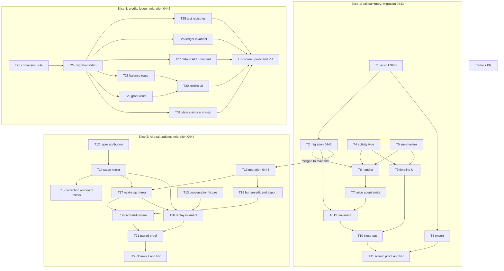

# DeskcommCRM — Implementation plan

> Tasks, order, pull requests and proof for the three slices of the Clarify-parity lane in the fork
> `jaimedhenriques/deskcommcrm`: (1) call summary into the deal timeline, (2) the AI writes deal
> stage and next step, (3) credits metering to a ledger. What and why live in `PRD.md`; how lives in
> `TRD.md`; screens in `APP_FLOW.md`; UI in `DESIGN_BRIEF.md`; tables and DDL in `BACKEND_SCHEMA.md`.
> This plan says **in what order, in which files, proven how, merged through which PR**. It copies
> the task format of `.specs/features/crm-automacao-fluxos/tasks.md` (What / Where / Depends on /
> Reuses / Requirement / Done when / Tests / Gate / Commit) and the build-order table with status
> marks of the newer specs.

---

## 0. How to read this document

- **Pinned commit.** Paths and line numbers refer to `main` at `f322ca4`. Line numbers go stale;
  Annex A gives the command that re-measures each one (CLAUDE.md DoD 16, `CLAUDE.md:735-742`).
- **Evidence tags.** `CONFIRMED` = the writer opened the file at `f322ca4` and read the cited lines.
  `INFERRED` = deduced from code or docs, not proven by a test or by running the product
  (`AGENTS.md:544-551`, "Regra final — não invente"). `RELAYED` = measured by the lane and passed to
  this writer, not re-measured here (this writer made no network call).
- **Requirement IDs** are the PRD's: `CALL-01`…`CALL-12`, `DEAL-01`…`DEAL-10`, `CRED-01`…`CRED-14`
  (`PRD.md` §4.4). §7 maps every ID to tasks.
- **Lane decisions D1–D3** (call summary, AI deal updates, credits ledger), the migration numbers
  `0443`/`0444`/`0445` and the four branch names are binding. Where a sibling doc proposes a default
  for an open question, this plan names the question and gates the task on it rather than choosing.
- **Status marks** (same glyphs as the spec 16/17 build-order tables): ⬜ not started · 🟨 in
  progress (branch has commits) · 🟦 in draft PR · ✅ proven (verifier verdict pinned to a commit) ·
  ⛔ blocked on a decision. Every task starts ⬜ today.
- **Gate levels** (the source format's `quick`/`full`): `quick` = runs with `node_modules` only
  (`pnpm vitest run …`, `pnpm cercas`, `pnpm typecheck`, `pnpm lint`); `full` = needs Docker and an
  image pull (`pnpm test:db …`) or a local Supabase plus Playwright browsers. Neither `full`
  prerequisite is cached in the lane's clone (INFERRED from the lane's repo map; re-measure with
  `docker images` and `ls ~/.cache/ms-playwright`).
- **No invented numbers.** No price, SLA, quota or volume appears here. Test-count floors in the
  source format are replaced by named cases, because a count would be a number nobody decided.

---

## 1. Build order and status

One draft PR per slice, smallest first. Status is the truth for this lane; update it in the same
PR that moves a task (§11).

| #   | Task                                                                      | Slice | Depends on                    | Branch                            | Gate  | Status |
| --- | ------------------------------------------------------------------------- | ----- | ----------------------------- | --------------------------------- | ----- | ------ |
| T0  | Publish the six `docs/project/` docs as a draft PR                        | docs  | —                             | `claude/deskcomm-project-docs`    | quick | ⬜     |
| T1  | Repro: transcript survives redaction and is missing from the export       | 1     | —                             | `claude/deskcomm-call-summary`    | full  | ⬜     |
| T2  | Migration 0443: cascade nulls the transcript; one summary per call        | 1     | T1                            | `claude/deskcomm-call-summary`    | full  | ⬜     |
| T3  | Access export carries the transcript and the summary                      | 1     | T1                            | `claude/deskcomm-call-summary`    | quick | ⬜     |
| T4  | Activity type `call_summarized`, never collapsed                          | 1     | —                             | `claude/deskcomm-call-summary`    | quick | ⬜     |
| T5  | Pure summariser module and fixtures                                       | 1     | —                             | `claude/deskcomm-call-summary`    | quick | ⬜     |
| T6  | Summary handler, AI purpose, handler registration                         | 1     | T2, T4, T5                    | `claude/deskcomm-call-summary`    | quick | ⬜     |
| T7  | Voice agent emits `voice_call.summary_requested`                          | 1     | T6                            | `claude/deskcomm-call-summary`    | quick | ⬜     |
| T8  | DB invariant: fixture transcript to one AI row on the deal                | 1     | T2, T6, T7                    | `claude/deskcomm-call-summary`    | full  | ⬜     |
| T9  | Timeline renders the summary (surface A)                                  | 1     | T4, T5                        | `claude/deskcomm-call-summary`    | quick | ⬜     |
| T10 | Slice 1 close-out: map, fragment, state claims, destination               | 1     | T8, T9                        | `claude/deskcomm-call-summary`    | quick | ⬜     |
| T11 | Slice 1 screen proof and draft PR                                         | 1     | T3, T10                       | `claude/deskcomm-call-summary`    | full  | ⬜     |
| T12 | Repro: AI stage move is `system`, keys `de`/`para`, harness ignores scope | 2     | —                             | `claude/deskcomm-ai-deal-updates` | full  | ⬜     |
| T13 | Recorded-conversation fixture                                             | 2     | —                             | `claude/deskcomm-ai-deal-updates` | quick | ⬜     |
| T14 | Attributed, scoped stage mirror                                           | 2     | T12, decision TRD §7 Q1       | `claude/deskcomm-ai-deal-updates` | quick | ⬜     |
| T15 | Correction check on board and bulk moves                                  | 2     | T14, decision APP_FLOW §8 A6  | `claude/deskcomm-ai-deal-updates` | quick | ⬜     |
| T16 | Migration 0444: `crm_leads.next_step`; cascade nulls it                   | 2     | T2 merged to `main`           | `claude/deskcomm-ai-deal-updates` | full  | ⬜     |
| T17 | Next-step mirror and `next_step_set`                                      | 2     | T14, T16                      | `claude/deskcomm-ai-deal-updates` | quick | ⬜     |
| T18 | Human edit of the next step; export carries it                            | 2     | T16                           | `claude/deskcomm-ai-deal-updates` | quick | ⬜     |
| T19 | Card and dossier show the next step (surfaces B1, B2)                     | 2     | T17, T18                      | `claude/deskcomm-ai-deal-updates` | quick | ⬜     |
| T20 | DB invariant: recorded conversation replayed through the turn             | 2     | T13, T14, T17                 | `claude/deskcomm-ai-deal-updates` | full  | ⬜     |
| T21 | Paired proof by screen (prova em par)                                     | 2     | T19, T20, decision §12 P3     | `claude/deskcomm-ai-deal-updates` | full  | ⬜     |
| T22 | Slice 2 close-out and draft PR                                            | 2     | T20, T21                      | `claude/deskcomm-ai-deal-updates` | full  | ⬜     |
| T23 | Credit conversion rule (pure TS)                                          | 3     | —                             | `claude/deskcomm-credit-ledger`   | quick | ⬜     |
| T24 | Migration 0445: ledger, policies, immutability, metering, balance         | 3     | T23, decision PRD §10 Q2      | `claude/deskcomm-credit-ledger`   | full  | ⬜     |
| T25 | Register the ledger in the isolation and vocabulary invariants            | 3     | T24                           | `claude/deskcomm-credit-ledger`   | full  | ⬜     |
| T26 | DB invariant: debits, idempotency, null cost, balance                     | 3     | T24                           | `claude/deskcomm-credit-ledger`   | full  | ⬜     |
| T27 | DB invariant: append-only under the Supabase default ACL                  | 3     | T24                           | `claude/deskcomm-credit-ledger`   | full  | ⬜     |
| T28 | Balance read route with the unpriced count                                | 3     | T24                           | `claude/deskcomm-credit-ledger`   | quick | ⬜     |
| T29 | Grant and adjustment route                                                | 3     | T24, decision TRD §7 Q2       | `claude/deskcomm-credit-ledger`   | quick | ⬜     |
| T30 | Credits card and grant dialog (surfaces C, D)                             | 3     | T28, T29, decision PRD §10 Q4 | `claude/deskcomm-credit-ledger`   | quick | ⬜     |
| T31 | State claims (DoD 16) and the budget architecture map                     | 3     | T24                           | `claude/deskcomm-credit-ledger`   | quick | ⬜     |
| T32 | Slice 3 screen proof, fragment and draft PR                               | 3     | T25, T26, T27, T30, T31       | `claude/deskcomm-credit-ledger`   | full  | ⬜     |

A task whose "Depends on" names a decision can be drafted, but its behaviour must not ship until
the question is answered (PRD §10: "none means the slice must not ship that behaviour until
answered"). It turns ⛔ once everything else it needs is done and only the decision is missing.



### 1.1 Parallel execution map

```text
Phase 0:  T0
Slice 1:  T1 → T2 ─┬→ T6 → T7 → T8 ─┬→ T10 → T11
          T1 → T3 ─┼─────────────────┼────────┘
          T4 [P] ──┤                 │
          T5 [P] ──┴→ T9 ────────────┘
Slice 2:  T12 → T14 → T15
          T13 [P]
          (T2 merged) → T16 ─┬→ T17 → T19 → T21 → T22
                             └→ T18 ─┘
          T13 + T14 + T17 → T20 → T21
Slice 3:  T23 → T24 ─┬→ T25 [P] ─┐
                     ├→ T26 [P] ─┤
                     ├→ T27 [P] ─┤
                     ├→ T28 ─┬→ T30 ─┼→ T32
                     ├→ T29 ─┘       │
                     └→ T31 [P] ─────┘
```

`[P]` = can run in parallel with its siblings. No task with a `full` gate is parallel-safe on one
machine: `scripts/test-db.sh` starts its own container (`:144`) and `vitest.db.config.ts` sets
`fileParallelism: false` (`vitest.db.config.ts:21`; CONFIRMED by opening both).

### 1.2 Cross-slice rules

1. **The LGPD cascade is redefined by slices 1 and 2.** Both migrations replace
   `fn_lgpd_cascade_redact_contact`, whose last definition is at `supabase/baseline.sql:35136`
   (CONFIRMED; ten definitions in the file). If slice 2's block is built from `:35136` while slice 1
   is unmerged, merging slice 2 after slice 1 silently drops `transcript = null` again. Rule: T16
   starts only after T2 is merged to `main` by someone other than the maker; slice 2 then merges
   `origin/main` into its branch (`CLAUDE.md:563-564`) and builds 0444 from 0443's body. The slice 2
   invariant asserts both nulls (`transcript` and `next_step`), so a regression of either fails.
2. **Shared files, one at a time.** `lib/leads/activity-vocabulary.ts`, `lib/leads/timeline-grouping.ts`
   and `lib/lgpd/export-collector.ts` change in slices 1 and 2; `supabase/baseline.sql` and
   `supabase/migrations/MANIFEST.md` change in all three (MANIFEST is `merge=union`, `.gitattributes:10`,
   CONFIRMED; the baseline is not). Each slice merges `origin/main` before leaving draft, keeps its baseline block in migration
   order, and re-runs `pnpm checar:colisao-de-migration`.
3. **Slice 3 is independent in code** of slices 1 and 2 and may be drafted in parallel with
   slice 2. It debits every priced, successful `llm_calls` row, including those of slice 1's new
   `call_summary` purpose.
4. **Base branch is `main` for every slice PR.** `e2e.yml` and `perf.yml` trigger only on pull
   requests to `main` (`.github/workflows/e2e.yml:34-38`, `.github/workflows/perf.yml:3-7`,
   CONFIRMED), so a PR stacked on another slice branch would never run those checks.
5. **Bugs start with a repro.** T1 and T12 write the failing or defect-documenting test before
   any fix; their output is quoted in the PR body.

---

## 2. Phase 0 — the docs PR

### T0: Publish the six docs as a draft PR

**What:** Open one draft PR with `docs/project/PRD.md`, `TRD.md`, `APP_FLOW.md`, `DESIGN_BRIEF.md`,
`BACKEND_SCHEMA.md` and this plan. Docs only.
**Where:** `docs/project/*.md` on `claude/deskcomm-project-docs` (from `main` at `f322ca4`).
**Depends on:** None.
**Reuses:** PR template `.github/PULL_REQUEST_TEMPLATE.md` (destination: documentation).
**Requirement:** none (process; the source of truth for all 36 requirements).

**Done when:**

- [ ] All six files exist and pass `pnpm exec prettier --check docs/project/*.md`
- [ ] `pnpm vitest run tests/unit/sem-identificador-de-producao.test.ts` is green (it scans `docs/`,
      `:28`, CONFIRMED)
- [ ] Mermaid blocks render (paste each into a renderer, or let GitHub render the PR diff)
- [ ] Draft PR opened against `main`; CI state written in the PR body as measured (§9.1), never as
      assumed green
- [ ] No edit outside `docs/project/` (the PR is the cheapest way to see whether Actions run on the
      fork at all: `scripts/pr-alcanca-o-e2e.sh:38-40` skips the e2e parts for `docs/*`, and the
      pg15 leg runs only for `supabase/*` and a few scripts, `scripts/pr-mexe-no-piso-do-postgres.sh:31`,
      CONFIRMED)

**Tests:** structural guards only.
**Gate:** quick

**Commit:** `docs(project): seis documentos da lane DeskcommCRM (PRD, TRD, fluxo, design, schema, plano)`

---

## 3. Slice 1 — call summary into the deal timeline

Branch `claude/deskcomm-call-summary`, migration `0443`, requirements `CALL-01`…`CALL-12`. Design:
`TRD.md` §4; screens: `APP_FLOW.md` §2; UI: `DESIGN_BRIEF.md` §4; DDL: `BACKEND_SCHEMA.md`.

**Restated problem.** The SIP voice agent stores the whole call transcript in
`voice_calls.transcript` and nothing reads it; its own header says post-call summarisation waits
"até existir consumidor real" (`workers/voice-agent/index.ts:36-39`, CONFIRMED). The latest LGPD
cascade no longer clears that transcript and the access export does not include it (§3 T1). The
slice adds one consumer: an AI summary on the deal timeline, with the erasure hole closed first.

### Execution plan

```text
Phase 1A (LGPD first):   T1 → T2, T1 → T3
Phase 1B (pieces):       T4 [P], T5 [P]
Phase 1C (wire):         T2 + T4 + T5 → T6 → T7 → T8
Phase 1D (screen):       T4 + T5 → T9
Phase 1E (close):        T8 + T9 → T10 → T11 (with T3)
```

### T1: Repro — transcript survives redaction and is missing from the export

**What:** Write the failing cases before the fix. (a) After `fn_lgpd_cascade_redact_contact` runs for
a contact, that contact's `voice_calls.transcript` is still not null. (b) The access export's
`voice_calls` select has no `transcript` column.
**Where:** `tests/invariants/resumo-da-chamada-na-timeline.test.ts` (new; the cascade cases of the
file TRD §4.15 names), a new column-level export test under `tests/unit/` (name chosen in the PR).
**Depends on:** None.
**Reuses:** seed pattern of `tests/invariants/voz-ponte-de-eventos.test.ts` (`pg.Pool` on
`TEST_DB_PORT`); the table-level guard `tests/unit/lgpd-exporta-o-que-redige.test.ts`, which proves a
table is visited but not which columns (its header says so, CONFIRMED), hence the new column test.
**Requirement:** CALL-09, CALL-10

**Done when:**

- [ ] Case (a) fails on `f322ca4`: the last cascade (`supabase/baseline.sql:35136`) updates
      `voice_calls` without `transcript` (`:35388-35394`, CONFIRMED)
- [ ] Case (b) fails on `f322ca4`: the select at `lib/lgpd/export-collector.ts:1046-1049` lists no
      `transcript` (CONFIRMED)
- [ ] The red output is pasted into the PR body; T1 and T2/T3 are pushed together so no pushed head
      is red
- [ ] Gate: `pnpm test:db tests/invariants/resumo-da-chamada-na-timeline.test.ts` (red, recorded)

**Tests:** integration + unit
**Gate:** full

**Commit:** `test(lgpd): repro — transcrição da chamada sobrevive à anonimização e falta no export`

---

### T2: Migration 0443 — cascade nulls the transcript; one summary per call

**What:** New last definition of `fn_lgpd_cascade_redact_contact`, copied from the body at
`supabase/baseline.sql:35136` with `transcript = null` restored in the `voice_calls` block and its ACL
kept. Partial unique index on `crm_lead_activities (organization_id, source_id) where type =
'call_summarized'` (TRD §4.6 layer 3). DDL is in `BACKEND_SCHEMA.md`.
**Where:** `supabase/migrations/<UTC timestamp>_0443_<slug>.sql`, a block in `supabase/baseline.sql`
before `-- ---- VARREDURA anon:` (`:39296`, CONFIRMED), a row in `supabase/migrations/MANIFEST.md`.
**Depends on:** T1
**Reuses:** the 0348 definition that still had the null (TRD §4.1); migration doctrine
`CLAUDE.md:571-670`; `rfind` reading of the baseline.
**Requirement:** CALL-09, CALL-05

**Done when:**

- [ ] `pnpm checar:colisao-de-migration` exits 0 with `0443` and a fresh `date -u +%Y%m%d%H%M%S`
      timestamp; renumber both together if `main` moved
- [ ] Block is idempotent, has no `BEGIN`/`COMMIT`, and keeps `revoke … from public, anon` (C3 in
      TRD §3)
- [ ] T1 case (a) is green; a second application of the baseline (`pnpm test:db` applies it twice)
      and `pnpm test:db:update` pass
- [ ] Gate: `pnpm vitest run tests/unit/manifest-x-migrations.test.ts tests/unit/varredura-anon-e-o-ultimo-bloco.test.ts`
      and `pnpm test:db tests/invariants/resumo-da-chamada-na-timeline.test.ts`

**Tests:** integration
**Gate:** full

**Commit:** `fix(lgpd): 0443 — anonimização volta a apagar a transcrição; um resumo por chamada`

---

### T3: Access export carries the transcript and the summary

**What:** Add `transcript` to the `voice_calls` select and row type; export the `call_summarized`
summary from `crm_lead_activities.payload` (today activities are exported without payload, TRD §4.12).
**Where:** `lib/lgpd/export-collector.ts` (`:1046-1049` and the activities block TRD §4.2 cites).
**Depends on:** T1
**Reuses:** existing org-filtered admin selects in the same file (`.eq("organization_id", …)`,
CONFIRMED at `:1050`).
**Requirement:** CALL-10

**Done when:**

- [ ] T1 case (b) is green
- [ ] `tests/unit/lgpd-exporta-o-que-redige.test.ts` stays green
- [ ] Gate: `pnpm vitest run tests/unit/lgpd-exporta-o-que-redige.test.ts` plus the new column test

**Tests:** unit
**Gate:** quick

**Commit:** `fix(lgpd): export do titular inclui transcrição e resumo da chamada`

---

### T4: Activity type `call_summarized`, never collapsed

**What:** Add `call_summarized` to `ActivityType` and to the exhaustive `ACTIVITY_LABELS` (label text
from `DESIGN_BRIEF.md` §4.5); add it to `NUNCA_COLAPSA` and widen that set's comment, whose stated
criterion today is "contêm decisão humana, não relato" (`lib/leads/timeline-grouping.ts:26`,
CONFIRMED).
**Where:** `lib/leads/activity-vocabulary.ts`, `lib/leads/timeline-grouping.ts`,
`tests/unit/timeline-grouping.test.ts` (existing, extended), `lib/i18n/dicionario.ts`.
**Depends on:** None.
**Reuses:** the never-collapse set at `lib/leads/timeline-grouping.ts:27-50` (CONFIRMED).
**Requirement:** CALL-07, CALL-04

**Done when:**

- [ ] `call_summarized` stays its own block in fine grouping and in day grouping
- [ ] The DB `type` column needs no CHECK change (open vocabulary, TRD C11)
- [ ] Spanish entry exists for the new label (`tests/unit/i18n-espanhol-cobre-a-tela.test.ts`)
- [ ] Gate: `pnpm vitest run tests/unit/timeline-grouping.test.ts` and `pnpm typecheck`

**Tests:** unit
**Gate:** quick

**Commit:** `feat(timeline): tipo call_summarized, sempre visível na linha do tempo`

---

### T5: Pure summariser module and fixtures

**What:** One module with the output Zod schema (strict object: summary, key points, customer
commitments, suggested next step; named maxima), the prompt builder that quotes every transcript turn
as data with its speaker, JSON extraction, `safeParse`, and the payload schema the UI parses. No DB,
no network. Fixtures: a fictional SIP transcript (including one line that addresses the system, to
prove it stays quoted) and the scripted model outputs (valid, invalid).
**Where:** `lib/voip/resumo-da-chamada.ts` (new, TRD §4.2), `tests/unit/resumo-da-chamada.test.ts`
(new), `tests/fixtures/calls/` (new, D1).
**Depends on:** None.
**Reuses:** checkpoint JSON extraction precedent (`lib/agent-engine/agent/inbound-turn.ts:555`,
`:1400-1406`, CONFIRMED); labelling rule of `lib/escalacao/briefing-da-passagem.ts:19-30` (AI
readings marked "segundo a IA — confira").
**Requirement:** CALL-03, CALL-08

**Done when:**

- [ ] Schema accepts the valid fixture and rejects extra keys, oversized strings and missing fields
- [ ] The injection line of the fixture appears only inside the quoted block of the prompt
- [ ] Fixtures use only synthetic identifiers (`tests/unit/sem-identificador-de-producao.test.ts`)
      and fictional names
- [ ] Gate: `pnpm vitest run tests/unit/resumo-da-chamada.test.ts`

**Tests:** unit
**Gate:** quick

**Commit:** `feat(voz): resumo da chamada — schema, prompt e fixtures fictícias`

---

### T6: Summary handler, AI purpose, handler registration

**What:** `summarizeVoiceCall(row)`: load the call by `(organization_id, id)`; skip when not `sip`,
not ended, no transcript, no contact, or already summarised; call `runModelCall` with purpose
`call_summary` and an injectable registry; validate with T5; write one row through
`emitAgentActivityForContact` with `type: 'call_summarized'`, agent id, `evidence.llm_call_ids` from
the returned `callId`, `source_module 'voice_calls'`, `source_id` = the call, payload per T5; treat
`23505` as `ok`. Register the purpose and the handler.
**Where:** `workers/call-summary-worker.ts`, `workers/call-summary-worker.handler.ts` (new),
`lib/event-log/register-handlers.ts`, `lib/ai/pontos/registro.ts`.
**Depends on:** T2, T4, T5
**Reuses:** handler shape of `workers/media-derive-worker.handler.ts` (8 lines, CONFIRMED);
registration next to `registerHandler(mediaDeriveHandler)` (`lib/event-log/register-handlers.ts:66`,
CONFIRMED, after the DB-only handlers as the ordering comments require); purpose entry shaped like
`checkpoint` (`lib/ai/pontos/registro.ts:417-427`, `registraEm: "llm_calls"`, CONFIRMED);
`runModelCall` returns `callId` (`lib/agent-engine/edge/llm/run-model-call.ts:786-788`, CONFIRMED);
`createFakeRegistry` (`lib/agent-engine/edge/llm/providers.ts:342`, CONFIRMED);
`emitAgentActivityForContact` (`lib/leads/agent-activity.ts:50`, CONFIRMED).
**Requirement:** CALL-02, CALL-03, CALL-04, CALL-05, CALL-06, CALL-11

**Done when:**

- [ ] Registry entry and its caller land in the same commit
      (`tests/unit/pontos-de-ia-completude.test.ts` fails in both directions, TRD §4.5)
- [ ] Budget refusal returns `skipped` with a reason; provider error and Zod failure return `error`
      (TRD §4.9)
- [ ] Logs carry ids only, through `lib/logger.ts`; no transcript or summary text in logs or errors
- [ ] Gate: `pnpm vitest run tests/unit/pontos-de-ia-completude.test.ts tests/unit/evento-comando-tem-consumidor.test.ts`
      and `pnpm typecheck`

**Tests:** unit (gates); behaviour proven in T8
**Gate:** quick

**Commit:** `feat(voz): handler do resumo da chamada grava a atividade da IA no negócio`

---

### T7: Voice agent emits `voice_call.summary_requested`

**What:** After a successful finalize `UPDATE` with a non-empty transcript, call
`supabaseAdmin.rpc("emit_event", { p_event_type: "voice_call.summary_requested", … })` with
`entity_kind 'voice_call'`, `entity_id` = the call, empty payload. Add the organization to the
in-memory call record and filter the finalize `UPDATE` by it (default of `PRD.md` §10 Q7). Write
`ai_agent_id` on the connected update. Rewrite the header claim. New log lines use `lib/logger.ts`.
WaCalls code is not touched.
**Where:** `workers/voice-agent/index.ts` (record type `:189-194`, finalize `:208-228`, header
`:36-39`; all CONFIRMED).
**Depends on:** T6 (the command must have a consumer in the same PR,
`tests/unit/evento-comando-tem-consumidor.test.ts`)
**Reuses:** the `emit_event` RPC; command naming `*_requested` like `media.derive_requested`
(`workers/media-derive-worker.handler.ts`, CONFIRMED).
**Requirement:** CALL-01, CALL-12

**Done when:**

- [ ] The finalize `UPDATE` filters `organization_id` as well as `id` (today `.eq("id", …)` only,
      CONFIRMED at `:227`)
- [ ] `lib/wacalls/client.ts` still never sends `record` (`:126-127`, CONFIRMED) and the WaCalls
      bridge emits no `voice_call.summary_requested`
- [ ] No `console.log` added (DoD 8)
- [ ] Gate: `pnpm vitest run tests/unit/evento-comando-tem-consumidor.test.ts`, `pnpm typecheck`,
      `pnpm lint`

**Tests:** unit (gates); behaviour proven in T8
**Gate:** quick

**Commit:** `feat(voz): agente SIP pede o resumo ao encerrar a chamada, escopado pela organização`

---

### T8: DB invariant — fixture transcript to one AI row on the deal

**What:** Complete the T1 file: seed org, contact, one open deal, a `voice_calls` row with the
fixture transcript and the T7 event; run the handler with the scripted provider.
**Where:** `tests/invariants/resumo-da-chamada-na-timeline.test.ts`.
**Depends on:** T2, T6, T7
**Reuses:** `tests/invariants/voz-ponte-de-eventos.test.ts` (`pg.Pool`, self-contained seed);
`tests/pg-como-supabase.ts` where handler code expects a Supabase client.
**Requirement:** CALL-01, CALL-02, CALL-04, CALL-05, CALL-06, CALL-09, CALL-11, CALL-12

**Done when:**

- [ ] One `call_summarized` row with `actor_kind = 'ai'` (asserted, never only existence: an `ai` row
      without evidence is silently demoted, `lib/leads/activity-emitter.ts:82-109`), `actor_agent_id`
      set, `evidence.llm_call_ids` = the new `llm_calls.id` of purpose `call_summary`
- [ ] Second run: no new activity and no new `llm_calls` row
- [ ] Two open deals: no row, one `agent.activity_unrouted`
- [ ] Event pointing at another organization's call: `skipped`, no row
- [ ] Empty transcript: no model call, no row
- [ ] WaCalls `call-ended` produces no `voice_call.summary_requested`
- [ ] After the cascade: `transcript is null` and the row's `payload = '{}'`
- [ ] Unique ids and slugs per run (files run shuffled on a fresh clone)
- [ ] Gate: `pnpm test:db tests/invariants/resumo-da-chamada-na-timeline.test.ts`, then the full
      `pnpm test:db` once before leaving draft

**Tests:** integration
**Gate:** full

**Commit:** `test(db): resumo da chamada chega ao negócio uma vez, como IA, e some na anonimização`

---

### T9: Timeline renders the summary (surface A)

**What:** In `Linha`, a `call_summarized` row shows the label and a per-row expand that reuses the
component's expand state; expanded, it shows the summary parsed with T5's payload schema, labelled as
the AI's reading. Invalid payload: label only. Anonymised payload (`{}`): the line from
`DESIGN_BRIEF.md` §4.4. `reason` stays PII-free.
**Where:** `components/kanban/LeadTimeline.tsx` (`Linha` at `:54`, `abertos` at `:98`, `t(item.reason)`
at `:79`; CONFIRMED), `lib/i18n/dicionario.ts`, `tests/unit/lead-timeline-resumo.test.tsx` (new).
**Depends on:** T4, T5
**Reuses:** existing expand state (no shadcn Collapsible exists in `components/ui`, per TRD §4.2);
Phosphor icons only through `lib/ui/icons.ts`; copy and states from `DESIGN_BRIEF.md` §4.
**Requirement:** CALL-07, CALL-08

**Done when:**

- [ ] Test queries by visible text and role and expands with `@testing-library/user-event`
- [ ] No Lucide import, no `Sparkle`, no gradient (DESIGN_BRIEF §3.2)
- [ ] Gate: `pnpm vitest run tests/unit/lead-timeline-resumo.test.tsx tests/unit/i18n-espanhol-cobre-a-tela.test.ts`

**Tests:** unit (jsdom)
**Gate:** quick

**Commit:** `feat(timeline): resumo da chamada expansível, marcado como leitura da IA`

---

### T10: Slice 1 close-out — map, fragment, state claims, destination

**What:** (a) New voice-call architecture map with at least two edges (call → event → summary →
deal timeline); no voice map exists today (CONFIRMED by listing `docs/architecture/`). (b)
`.changes/<kebab>.md` fragment declaring the operator effect. (c) DoD 16: fix the state claims this
slice falsifies, starting with the voice agent header (done in T7) and any authority doc that says
nothing consumes the transcript. (d) Living System Checklist answered in the PR body with concrete
artefacts. (e) Destination per DoD 18 answered (PRD §10 Q10).
**Where:** `docs/architecture/<voice>.architecture.json` (name chosen in the PR), `.changes/`,
the PR body.
**Depends on:** T8, T9
**Reuses:** `docs/architecture/README.md` (JSON is the source); `lib/release/fragmento.ts` form;
`docs/doctrine/sistema-vivo.md` checklist (`:93`); `docs/doctrine/extensoes.md:26` question.
**Requirement:** CALL-07 (visible log), process

**Done when:**

- [ ] Gate: `pnpm vitest run tests/unit/mapas-de-arquitetura.test.ts tests/unit/fragmentos-de-release.test.ts`
- [ ] `pnpm release:conferir` prints the computed next version (it exits 1 with no fragment)

**Tests:** structural
**Gate:** quick

**Commit:** `docs(voz): mapa vivo da chamada, fragmento de release e afirmações de estado`

---

### T11: Slice 1 screen proof and draft PR

**What:** Playwright spec on a fresh local install: open a seeded deal (fixture summary row), expand
it, read the AI-reading label. Evidence PNGs and an index. Open the draft PR (§9).
**Where:** `tests/e2e/resumo-da-chamada-no-negocio.spec.ts` (new), listed in
`.github/workflows/e2e.yml` under `SPECS_PARTE_*` or `FORA_DO_CI` with its reason
(`tests/unit/e2e-cobertura-completa.test.ts`); `evidence/resumo-da-chamada/NN-slug.png` plus
`evidence/resumo-da-chamada.md`; `docs/testing/user-journey-map.md`.
**Depends on:** T3, T10
**Reuses:** `tests/qa-helpers.ts` (`guardaEvidencia`); login through the UI, no direct URLs
(`evidence/README.md`).
**Requirement:** CALL-07

**Done when:**

- [ ] Spec green locally against `next start` on a fresh Supabase from `baseline.sql`; never against
      production (`playwright.config.ts:34-35` refuses a non-local Supabase URL, CONFIRMED)
- [ ] Every PNG cited by the index (`tests/unit/evidencia-citada.test.ts:237`, CONFIRMED)
- [ ] The index names the commit and states what is not proven: real model quality, live Asterisk
      capture, WhatsApp calls (TRD §4.15)
- [ ] Draft PR opened per §9.2 with the DoD table of §10 filled in

**Tests:** e2e
**Gate:** full

**Commit:** `test(e2e): resumo da chamada visível e expansível no dossiê do negócio`

---

## 4. Slice 2 — AI writes deal stage and next step

Branch `claude/deskcomm-ai-deal-updates`, migration `0444`, requirements `DEAL-01`…`DEAL-10`. Design:
`TRD.md` §5; screens: `APP_FLOW.md` §3; UI: `DESIGN_BRIEF.md` §5.

**Restated problem.** The agent already moves deal cards without approval when the tenant mapped
`agent_stage_hint`, but the move is recorded as a `webhook_source` actor with payload keys
`de`/`para` (`lib/leads/agent-stage-sync.ts:402`, `:407`, CONFIRMED), while the human-correction
check reads `from_stage_id`/`to_stage_id` (`app/api/v1/leads/_handler.ts:1119-1150`, CONFIRMED) and
requires the last move to be actor `ai` (`lib/leads/correcao-humana.ts:79`, CONFIRMED). The harness
mirror passes no pipeline scope (`lib/agent-engine/edge/crm/move-lead-stage.ts:248-252`, CONFIRMED).
The next step is per contact and waits for approval. The slice makes the AI's stage move attributed,
scoped and correctable, and writes the next step on the deal.

### Execution plan

```text
Phase 2A (repro + data):   T12 [P], T13 [P]
Phase 2B (stage):          T12 → T14 → T15
Phase 2C (next step):      (T2 merged) → T16 → T17, T16 → T18 → T19
Phase 2D (proof):          T13 + T14 + T17 → T20 → T21 → T22
```

### T12: Repro — AI stage move is `system`, keys `de`/`para`, harness ignores scope

**What:** On real Postgres, run today's mirror and assert the defect: the `stage_changed` row is not
`ai`, its payload has `de`/`para`, a human move back yields no `agent_move_corrected`, and a deal in
a pipeline outside the agent's scope still moves on the harness path. Expected to pass on `f322ca4`
(it documents the defect); T14 and T20 invert the assertions.
**Where:** `tests/invariants/ia-move-etapa-e-proximo-passo.test.ts` (new, TRD §5.15).
**Depends on:** None.
**Reuses:** `tests/pg-como-supabase.ts` as `crmCfg.supabase` (the existing turn harness passes `{}`,
`tests/invariants/handoff-avisa-o-lead.test.ts:116`, CONFIRMED); `tests/unit/agent-stage-sync.test.ts`
fixtures.
**Requirement:** DEAL-01, DEAL-02, DEAL-03

**Done when:**

- [ ] The four defect assertions pass on `f322ca4` and their output is pasted into the PR body
- [ ] Gate: `pnpm test:db tests/invariants/ia-move-etapa-e-proximo-passo.test.ts`

**Tests:** integration
**Gate:** full

**Commit:** `test(db): repro — movimento de etapa da IA sai como sistema e ignora o escopo de funil`

---

### T13: Recorded-conversation fixture

**What:** A fictional WhatsApp conversation as JSON: inbound messages with synthetic identifiers,
the scripted model steps per turn (`update_lead_state` with stage, `next_action`, reason;
`send_message`), and the expected end state (stage hint, next step text, actor). One open deal per
contact; a pipeline with mapped hints inside the agent's scope.
**Where:** `tests/fixtures/conversas/` (new, D2).
**Depends on:** None.
**Reuses:** `createFakeRegistry` (`lib/agent-engine/edge/llm/providers.ts:342`); the transition table
`LEAD_STAGE_TRANSITIONS` (`lib/agent-engine/agent/lead-state.ts:35-43`, CONFIRMED).
**Requirement:** DEAL-09

**Done when:**

- [ ] Every step is a legal transition of the fixed graph; no loss stage (that needs a human reason)
- [ ] `tests/unit/sem-identificador-de-producao.test.ts` green; names are fictional
- [ ] Gate: `pnpm vitest run tests/unit/sem-identificador-de-producao.test.ts`

**Tests:** structural
**Gate:** quick

**Commit:** `test(fixture): conversa gravada fictícia que leva o negócio uma etapa e define o próximo passo`

---

### T14: Attributed, scoped stage mirror

**What:** `update_lead_state.execute` passes the agent id, the evidence and `escopoDeFunis`
(`agentConfig.pipelineIds`, empty list moves nothing) to `mirrorLeadStageToCrm`, which forwards
them to `sincronizaEstagioDoAgente`. There: actor `{ type: "ai_agent", … }` when an agent id is
given, evidence passed to the emitter, payload `{ from_stage_id, to_stage_id, passo_do_agente }`,
`organization_id` added to the stage `UPDATE`, agent id in the `lead.stage_changed` metadata.
`applyLeadStateUpdate` reports whether `next_action` was written (used by T17).
**Where:** `lib/agent-engine/agent/inbound-turn.ts` (`:3629-3660`, CONFIRMED),
`lib/agent-engine/edge/crm/move-lead-stage.ts` (`:237-256`, CONFIRMED), `lib/leads/agent-stage-sync.ts`
(`:218-222`, `:358-372`, `:398-407`, CONFIRMED), `lib/agent-engine/agent/lead-state.ts`,
`tests/unit/agent-stage-sync.test.ts` (extended).
**Depends on:** T12; **decision** TRD §7 Q1 (evidence kind: D2 says `llm_call_ids`, but the turn's
call id does not exist yet when the tool runs, TRD §5.5; TRD default `trace_ids: [job_id]`).
**Reuses:** `podeOperarNoFunil` (`lib/leads/escopo-de-funil.ts:193`, CONFIRMED) already applied when
`escopoDeFunis` is defined (`agent-stage-sync.ts:275-277`, CONFIRMED); refusal vocabulary unchanged.
**Requirement:** DEAL-01, DEAL-02, DEAL-03, DEAL-04

**Done when:**

- [ ] Row has `actor_kind = 'ai'` with the evidence kind decided under TRD §7 Q1
- [ ] Out-of-scope pipeline: `fora_do_escopo`, no move, and the harness mirror's existing
      `fora_do_escopo` Central item opens (`lib/agent-engine/edge/crm/move-lead-stage.ts:120-130`);
      the MCP path only returns a refusal to the model (`lib/ai/runtime/tools.ts:222-235`)
- [ ] `perda_sem_motivo`, `campos_obrigatorios`, `human_conflict`, `not_configured` unchanged
- [ ] Gate: `pnpm vitest run tests/unit/agent-stage-sync.test.ts tests/unit/etapa-de-perda-do-agente.test.ts`
      and `pnpm typecheck`

**Tests:** unit
**Gate:** quick

**Commit:** `fix(agente): movimento de etapa da IA atribuído à IA, com evidência e escopo de funil`

---

### T15: Correction check on board and bulk moves

**What:** Run the human-correction check also on the board-drag move route and the bulk move route,
so a person undoing an AI move through the UI writes `agent_move_corrected`. Today it runs only inside
`moveLeadHandler` (APP_FLOW §8 A6).
**Where:** the move and bulk routes under `app/api/v1/leads/` (paths named in APP_FLOW §8 A6),
`lib/leads/correcao-humana.ts` (reused, not changed).
**Depends on:** T14; **decision** APP_FLOW §8 A6 (recommended in scope; D2 is silent).
**Reuses:** `ehCorrecaoDeMovimentoDaIa` in `lib/leads/correcao-humana.ts`; the existing call site in
`app/api/v1/leads/_handler.ts:1119-1150`.
**Requirement:** DEAL-02

**Done when:**

- [ ] A drag back after an AI move writes one `agent_move_corrected` row attributed to the user
- [ ] A drag after a human move writes none
- [ ] Gate: route unit tests for both routes, `pnpm typecheck`

**Tests:** unit
**Gate:** quick

**Commit:** `fix(crm): desfazer pela tela o movimento da IA conta como correção`

---

### T16: Migration 0444 — `crm_leads.next_step`; cascade nulls it

**What:** `crm_leads.next_step text` and `crm_leads.next_step_updated_at timestamptz` (`add column if
not exists`); a new last definition of `fn_lgpd_cascade_redact_contact` built from 0443's body that
also nulls `next_step`; regenerate `lib/database.types.ts`. DDL in `BACKEND_SCHEMA.md`.
**Where:** `supabase/migrations/<UTC timestamp>_0444_<slug>.sql`, `supabase/baseline.sql`,
`supabase/migrations/MANIFEST.md`, `lib/database.types.ts`.
**Depends on:** T2 merged to `main` (§1.2 rule 1).
**Reuses:** 0443's cascade body; migration doctrine `CLAUDE.md:571-670`.
**Requirement:** DEAL-05, CALL-09 (kept)

**Done when:**

- [ ] `pnpm checar:colisao-de-migration` exits 0 with `0444`
- [ ] The cascade nulls both `voice_calls.transcript` and `crm_leads.next_step` (asserted in T20)
- [ ] Gate: `pnpm vitest run tests/unit/manifest-x-migrations.test.ts tests/unit/varredura-anon-e-o-ultimo-bloco.test.ts`,
      `pnpm test:db` and `pnpm test:db:update`

**Tests:** integration
**Gate:** full

**Commit:** `feat(db): 0444 — próximo passo no negócio, apagado na anonimização`

---

### T17: Next-step mirror and `next_step_set`

**What:** When `update_lead_state` wrote `next_action`, route it to the contact's single active deal
in scope and update `next_step` and `next_step_updated_at` org-scoped `where next_step is distinct
from` the new text; write one `next_step_set` activity (actor `ai`, evidence per T14) only when a row
changed. Refusals `sem_negocio`, `ambiguo`, `fora_do_escopo` log a warning and write nothing. Add the
type, label and its grouping per the answer to PRD §10 Q9 (TRD default: never collapse).
**Where:** `lib/leads/proximo-passo-do-agente.ts` (new, TRD §5.2) plus its unit test,
`lib/agent-engine/agent/inbound-turn.ts`, `lib/leads/activity-vocabulary.ts`,
`lib/leads/timeline-grouping.ts`, `lib/i18n/dicionario.ts`.
**Depends on:** T14, T16
**Reuses:** `resolveActiveLeadForContact` (`lib/leads/active-lead.ts:43`, CONFIRMED);
`podeOperarNoFunil`; the contact-level proposal flow stays (`app/api/v1/leads/[id]/next-action/route.ts`).
**Requirement:** DEAL-05, DEAL-06, DEAL-08

**Done when:**

- [ ] Same text twice writes one activity; two open deals write nothing
- [ ] `lead_state.next_action` and `next_action_seq` still written (DEAL-08)
- [ ] Null or empty `next_action` keeps the existing `next_step` (PRD §10 Q8 lane default) until
      answered otherwise
- [ ] Gate: the new unit test, `pnpm vitest run tests/unit/timeline-grouping.test.ts`, `pnpm typecheck`

**Tests:** unit
**Gate:** quick

**Commit:** `feat(agente): IA escreve o próximo passo no negócio, sem aprovação, com rastro`

---

### T18: Human edit of the next step; export carries it

**What:** The lead patch accepts `next_step` (Zod, same max length as the AI side), sets
`next_step_updated_at`, emits the usual edit activity attributed to the user. The access export adds
`next_step` to the `crm_leads` select.
**Where:** `app/api/v1/leads/_handler.ts` (patch fields), `lib/lgpd/export-collector.ts`.
**Depends on:** T16
**Reuses:** existing patch validation and audit of the lead route (INFERRED that the edit is audited
today; the PR confirms by test).
**Requirement:** DEAL-07

**Done when:**

- [ ] A user edit writes the field and one row attributed to that user
- [ ] Gate: route unit test and `pnpm vitest run tests/unit/lgpd-exporta-o-que-redige.test.ts`

**Tests:** unit
**Gate:** quick

**Commit:** `feat(crm): pessoa edita o próximo passo do negócio; export do titular o inclui`

---

### T19: Card and dossier show the next step (surfaces B1, B2)

**What:** Band ③ of the kanban card and a dossier section show `next_step` as written by the
assistant, editable in the dossier, with precedence and copy from `DESIGN_BRIEF.md` §5 (open:
DESIGN_BRIEF §12 Q1 on the proposal shown for a step already applied).
**Where:** `components/kanban/KanbanCard.tsx` (`:250-287`), `components/kanban/LeadDossier.tsx`,
`lib/kanban/card-state.ts`, the board route read, `lib/i18n/dicionario.ts`, jsdom tests.
**Depends on:** T17, T18
**Reuses:** `DESIGN_BRIEF.md` §5 anatomy and copy; Phosphor via `lib/ui/icons.ts`.
**Requirement:** DEAL-05, DEAL-07

**Done when:**

- [ ] `resolveCardState` table test covers each precedence pair (DESIGN_BRIEF §11)
- [ ] Edit, save and cancel driven with `user-event`; queries by text and role
- [ ] Gate: the new jsdom tests and `pnpm vitest run tests/unit/i18n-espanhol-cobre-a-tela.test.ts`

**Tests:** unit (jsdom)
**Gate:** quick

**Commit:** `feat(kanban): próximo passo no card e no dossiê, escrito pela IA e editável`

---

### T20: DB invariant — recorded conversation replayed through the turn

**What:** Replay the T13 fixture through `createInboundTurnHandler` with `createFakeRegistry` and
`crmCfg.supabase` = the `tests/pg-como-supabase.ts` adapter, so the mirrors run for real. Invert the
T12 assertions.
**Where:** `tests/invariants/ia-move-etapa-e-proximo-passo.test.ts`.
**Depends on:** T13, T14, T17
**Reuses:** `createInboundTurnHandler` (`lib/agent-engine/agent/inbound-turn.ts:4929`, CONFIRMED);
harness of `tests/invariants/limite-de-envios-por-turno.test.ts` and
`tests/invariants/handoff-avisa-o-lead.test.ts`.
**Requirement:** DEAL-01, DEAL-02, DEAL-03, DEAL-04, DEAL-05, DEAL-06, DEAL-08, DEAL-09

**Done when:**

- [ ] `crm_leads.stage_id`, `next_step`, `next_step_updated_at` match the fixture
- [ ] `stage_changed` and `next_step_set` rows have `actor_kind = 'ai'` and evidence
- [ ] Out-of-scope pipeline: no move, one Central item; loss: no move; two open deals: nothing
- [ ] A human move after the AI move writes `agent_move_corrected`
- [ ] The cascade nulls `transcript` and `next_step` (rule 1 of §1.2)
- [ ] Gate: `pnpm test:db tests/invariants/ia-move-etapa-e-proximo-passo.test.ts`, then full
      `pnpm test:db` once

**Tests:** integration
**Gate:** full

**Commit:** `test(db): conversa gravada move a etapa e escreve o próximo passo como IA`

---

### T21: Paired proof by screen (prova em par)

**What:** The agent side of the pair: in a fresh local install, the fixture's raw text sent through
the inbound path with a real model, then board → card → dossier. The direct side is T20 with the same
raw text. Proof counts only when both agree (`docs/doctrine/prova-em-par.md`, CONFIRMED).
**Where:** `tests/e2e/ia-atualiza-o-negocio.spec.ts` (new, listed in `e2e.yml` or `FORA_DO_CI` with
reason: it needs a model key), `evidence/ia-atualiza-o-negocio/` plus `evidence/ia-atualiza-o-negocio.md`,
`docs/testing/user-journey-map.md`.
**Depends on:** T19, T20; **decision** §12 P3 (who supplies the model key and its spend for the
agent side).
**Reuses:** `scripts/e2e-chega-mensagem.ts` (injects one inbound message through ingestion,
CONFIRMED header; INFERRED, not checked, that it also triggers a turn, TRD §5.15).
**Requirement:** DEAL-10

**Done when:**

- [ ] Both sides recorded with the same raw text; disagreement is reported as a model measurement,
      not as a pass
- [ ] The key is read from the local environment at run time and never written to a file, log,
      screenshot or commit
- [ ] Evidence index names the commit and cites every PNG

**Tests:** e2e (outside CI)
**Gate:** full

**Commit:** `test(e2e): prova em par — tela pelo agente e ferramenta direta concordam`

---

### T22: Slice 2 close-out and draft PR

**What:** Extend `docs/architecture/crm-vivo.architecture.json` (next step node, attribution edge);
`.changes/` fragment; DoD 16 claims (spec 17 §7 step 5 marks the correction loop done; the
`next-action` route header); Living System Checklist; destination (PRD §10 Q10); draft PR per §9.
**Where:** `docs/architecture/crm-vivo.architecture.json`, `.changes/`, the PR body.
**Depends on:** T20, T21
**Reuses:** as T10.
**Requirement:** process

**Done when:**

- [ ] Gate: `pnpm vitest run tests/unit/mapas-de-arquitetura.test.ts tests/unit/fragmentos-de-release.test.ts`,
      `pnpm release:conferir`, `pnpm cercas`, `pnpm typecheck`, `pnpm lint`
- [ ] Draft PR opened with the §10 table filled

**Tests:** structural
**Gate:** full

**Commit:** `docs(agente): mapa vivo do próximo passo, fragmento e afirmações de estado`

---

## 5. Slice 3 — credits metering to a ledger

Branch `claude/deskcomm-credit-ledger`, migration `0445`, requirements `CRED-01`…`CRED-14`. Design:
`TRD.md` §6; screens: `APP_FLOW.md` §4; UI: `DESIGN_BRIEF.md` §6–7; DDL: `BACKEND_SCHEMA.md`.

**Restated problem.** Spend exists only as US cents in `llm_calls.cost_cents`, summed by the single
function `fn_gasto_de_ia_do_mes` (`supabase/baseline.sql:13125`, CONFIRMED). No credit, ledger or
usage table exists. The slice meters every priced, successful model call as a credit debit in an
append-only ledger. It does not price, bill or block. The unit (1 credit = 1 US cent of recorded cost,
rounded up per call) is a provisional lane rule pending owner confirmation (`PRD.md` §10 Q1).

### Execution plan

```text
Phase 3A (rule):        T23
Phase 3B (schema):      T23 → T24
Phase 3C (proof in DB): T24 → T25 [P], T26 [P], T27 [P]
Phase 3D (surface):     T24 → T28, T24 → T29 → T30 (gated by PRD Q4)
Phase 3E (close):       T24 → T31 [P]; all → T32
```

### T23: Credit conversion rule (pure TS)

**What:** The named constant and `creditosDaChamada(costCents)`: ceiling per call, null for null
cost, no debit for negative cost; zero per the answer to PRD §10 Q2.
**Where:** `lib/creditos/conversao.ts`, `lib/creditos/conversao.test.ts` (both new, TRD §6.2, §6.16).
**Depends on:** None.
**Reuses:** test style of `lib/agent-engine/edge/llm/pricing.test.ts` (CONFIRMED to exist).
**Requirement:** CRED-08, CRED-04

**Done when:**

- [ ] Fractional, whole, minimal positive, zero, null and negative inputs each map to the documented
      result
- [ ] No price per credit anywhere in the module or its comments
- [ ] Gate: `pnpm vitest run lib/creditos/conversao.test.ts`

**Tests:** unit
**Gate:** quick

**Commit:** `feat(creditos): regra de conversão de custo em créditos, isolada numa constante`

---

### T24: Migration 0445 — ledger, policies, immutability, metering, balance

**What:** Table `credit_ledger` (signed bigint `delta`, `kind` CHECK `debit_llm_call | grant |
adjustment`, sign tied to kind, `idempotency_key` unique per organization, `llm_call_id` on delete set
null, `source_cost_cents`, `source_currency`, `created_at`); RLS on with one SELECT policy;
revoke `update, delete, truncate` from `public, anon, authenticated, service_role` and `insert` from
`anon, authenticated`; owner immutability trigger with the organization-deletion exemption;
AFTER INSERT trigger on `llm_calls` for `status = 'ok'` and non-null cost, `on conflict do nothing`;
`fn_saldo_de_creditos` (sum in the DB, `service_role` only); the SQL twin of T23's constant. DDL in
`BACKEND_SCHEMA.md`. `fn_gasto_de_ia_do_mes` untouched.
**Where:** `supabase/migrations/<UTC timestamp>_0445_<slug>.sql`, `supabase/baseline.sql` (one block
before `-- ---- VARREDURA anon:`, `:39296`), `supabase/migrations/MANIFEST.md`, `lib/database.types.ts`,
a unit test that reads the SQL constant from the labelled block and compares it to T23's.
**Depends on:** T23; **decision** PRD §10 Q2 (zero-cost row; TRD §6.6 proposes a zero-delta row).
**Reuses:** `loyalty_ledger` shape (`supabase/baseline.sql:33695`, CONFIRMED); append-only migration
`supabase/migrations/20260915140000_0258_audit_log_so_recebe_linha.sql` (CONFIRMED, baseline label at
`:25024`); `fn_lancamento_pago_e_imutavel` (`:33723`, CONFIRMED); `trg_llm_calls_budget`
(`:9526-9527`, CONFIRMED); `fn_saldo_de_fidelidade` (`:34153`, CONFIRMED).
**Requirement:** CRED-01, CRED-02, CRED-03, CRED-04, CRED-05, CRED-06, CRED-07, CRED-09, CRED-10, CRED-11

**Done when:**

- [ ] `pnpm checar:colisao-de-migration` exits 0 with `0445`
- [ ] The trigger never raises on expected input (every status and cost shape inserts cleanly)
- [ ] No code path reads the balance to gate a model call (CRED-06)
- [ ] Gate: `pnpm vitest run tests/unit/orcamento-uma-regua-de-gasto.test.ts tests/unit/manifest-x-migrations.test.ts tests/unit/varredura-anon-e-o-ultimo-bloco.test.ts`
      plus the constant-identity test, then `pnpm test:db` and `pnpm test:db:update`

**Tests:** unit + integration
**Gate:** full

**Commit:** `feat(db): 0445 — livro de créditos só de inclusão, medido a cada chamada de IA`

---

### T25: Register the ledger in the isolation and vocabulary invariants

**What:** Add `credit_ledger` to `TABLES` in the isolation invariant with a seed, and the `kind` CHECK
to the vocabulary pairs. These are additive edits to existing invariant files, which the repo freezes
by convention (`loop/hooks/freeze-invariants.sh`, valve `DESKCOMM_GOV_INVARIANTS_EDIT=1`, CONFIRMED);
the PR body justifies the edit.
**Where:** `tests/invariants/rls-isolation.test.ts`, `tests/invariants/vocabulario-banco-x-typescript.test.ts`.
**Depends on:** T24
**Reuses:** the `loyalty_ledger` seed (`tests/invariants/rls-isolation.test.ts:449-452`, CONFIRMED);
`tests/helpers/baseline-check.ts`.
**Requirement:** CRED-11

**Done when:**

- [ ] Gate: `pnpm test:db tests/invariants/rls-isolation.test.ts tests/invariants/rls-completude-varredura.test.ts tests/invariants/rbac-config-ia-canais.test.ts tests/invariants/hardening-definer-varredura.test.ts tests/invariants/vocabulario-banco-x-typescript.test.ts`

**Tests:** integration
**Gate:** full

**Commit:** `test(db): livro de créditos nas varreduras de isolamento e vocabulário`

---

### T26: DB invariant — debits, idempotency, null cost, balance

**What:** Insert `llm_calls` rows of every shape and assert the ledger.
**Where:** `tests/invariants/creditos-no-livro.test.ts` (new, TRD §6.16).
**Depends on:** T24
**Reuses:** `tests/invariants/orcamento-nasce-desarmado.test.ts` style (psql transport).
**Requirement:** CRED-01, CRED-02, CRED-03, CRED-04, CRED-05, CRED-06, CRED-10

**Done when:**

- [ ] Priced `ok` insert: one debit with the converted delta, `llm_call_id`, `source_cost_cents`,
      `source_currency = 'USD'`
- [ ] Same key again: still one; `erro` and null-cost rows: no debit, and the unpriced count is one
- [ ] Negative cost: no row; balance equals the sum of deltas
- [ ] Deleting the organization cascades its ledger rows
- [ ] Gate: `pnpm test:db tests/invariants/creditos-no-livro.test.ts`

**Tests:** integration
**Gate:** full

**Commit:** `test(db): cada chamada de IA com preço debita uma vez; sem preço é contada, não zerada`

---

### T27: DB invariant — append-only under the Supabase default ACL

**What:** Apply the labelled 0445 block over the simulated default ACL and probe `update`, `delete`,
`truncate` for every PostgREST role, with a control case; owner `UPDATE` raises outside an
organization deletion.
**Where:** `tests/invariants/creditos-sob-o-default-acl-do-supabase.test.ts` (new).
**Depends on:** T24
**Reuses:** `tests/invariants/audit-log-sob-o-default-acl-do-supabase.test.ts` (CONFIRMED to exist).
**Requirement:** CRED-09, CRED-10

**Done when:**

- [ ] Control case without the block shows the default ACL would allow the write
- [ ] Gate: `pnpm test:db tests/invariants/creditos-sob-o-default-acl-do-supabase.test.ts`

**Tests:** integration
**Gate:** full

**Commit:** `test(db): livro de créditos não se reescreve, nem pelo PostgREST nem pelo dono`

---

### T28: Balance read route with the unpriced count

**What:** GET, manager and above: balance via `fn_saldo_de_creditos` with the service client and the
organization from the session, plus the unpriced-call count. A failed read is an error, never zero.
**Where:** route path per `APP_FLOW.md` §4 and TRD §6.2; route unit test.
**Depends on:** T24
**Reuses:** `app/api/v1/ai/usage/route.ts` role pattern; `ok()`/`fail()`.
**Requirement:** CRED-04, CRED-05

**Done when:**

- [ ] Agent role refused; manager reads; organization never taken from the request body or query
- [ ] Gate: route unit test, `pnpm typecheck`

**Tests:** unit
**Gate:** quick

**Commit:** `feat(creditos): leitura do saldo e das chamadas sem preço`

---

### T29: Grant and adjustment route

**What:** POST with `requireSupportWrite()` then `requireRole("admin")` before any effect, Zod body,
`Idempotency-Key` through `comIdempotencia`, ledger key derived from it, `audit()` with codes appended
at the end of `AUDIT_ACTIONS`. Body shape per DESIGN_BRIEF §12 Q7.
**Where:** route path per `APP_FLOW.md` §4.4; `lib/audit/actions.ts`; route unit test.
**Depends on:** T24; **decision** TRD §7 Q2 (organization admin per D3, or platform admin).
**Reuses:** `app/api/v1/ai/budget/route.ts:99-105` (support guard then role, CONFIRMED);
`comIdempotencia` (`lib/api/idempotency.ts:189`, CONFIRMED); precedent codes `ai.budget_*`
(`lib/audit/actions.ts:534-536`, CONFIRMED).
**Requirement:** CRED-12, CRED-13, CRED-14

**Done when:**

- [ ] Non-admin: refused, no row, no effect audit; support mode: refused before any effect
- [ ] Replayed key: first receipt, no second row
- [ ] Gate: route unit test, `pnpm typecheck`, `pnpm lint`

**Tests:** unit
**Gate:** quick

**Commit:** `feat(creditos): concessão e ajuste por admin, idempotentes e auditados`

---

### T30: Credits card and grant dialog (surfaces C, D)

**What:** On `/app/ai/usage`, between `BudgetCard` and the usage dashboard: balance, unpriced count,
unmetered sources named; admin-only grant dialog with one idempotency key per submit. Unit not shown
until PRD §10 Q1 is confirmed (DESIGN_BRIEF §12 Q5).
**Where:** `app/app/ai/usage/page.tsx` (`:58-69`), new components, `lib/i18n/dicionario.ts`, jsdom tests.
**Depends on:** T28, T29; **decision** PRD §10 Q4 (PRD default: API and DB only; APP_FLOW A3 and
DESIGN_BRIEF Q4 default: `/app/ai/usage`).
**Reuses:** `DESIGN_BRIEF.md` §6–7; `lib/money.ts` only for the USD source cost, never for credits.
**Requirement:** CRED-12, CRED-13 (UI side), sistema-vivo invariant 6

**Done when:**

- [ ] Error state is not zero; no currency symbol on credits; double submit sends one key
- [ ] No new nav entry (the screen exists, `lib/navigation/catalogo.ts:569`, CONFIRMED)
- [ ] Gate: jsdom tests and `pnpm vitest run tests/unit/i18n-espanhol-cobre-a-tela.test.ts`

**Tests:** unit (jsdom)
**Gate:** quick

**Commit:** `feat(uso): saldo de créditos e concessão na tela de uso de IA`

---

### T31: State claims (DoD 16) and the budget architecture map

**What:** Add the DoD 16 note D3 requires to `docs/doctrine/operacao-de-agentes.md` (a ledger now
meters; nothing bills; the measuring grep at `:103-107` still returns 0 because `credit_ledger` does
not match it); update the `/app/ai/usage` catalog description if T30 lands (APP_FLOW §6); extend
`docs/architecture/teto-de-orcamento.architecture.json`.
**Where:** those three files.
**Depends on:** T24
**Reuses:** the doctrine's own grep (CONFIRMED at `docs/doctrine/operacao-de-agentes.md:103-107`).
**Requirement:** CRED-07 (single ruler kept), process

**Done when:**

- [ ] The grep in the doctrine still prints 0 after the migration
- [ ] The note records that the fork overrides §4 item 2 in part (PRD §6.1), without rewriting the rule
- [ ] Gate: `pnpm vitest run tests/unit/mapas-de-arquitetura.test.ts`

**Tests:** structural
**Gate:** quick

**Commit:** `docs(creditos): nota de estado na doutrina e mapa vivo do teto com o livro`

---

### T32: Slice 3 screen proof, fragment and draft PR

**What:** Playwright: insert priced, unpriced and failed `llm_calls` rows in a fresh install, open
`/app/ai/usage` as manager and as admin, grant twice with a double click. Evidence, fragment,
Living System Checklist, destination, draft PR.
**Where:** `tests/e2e/creditos-no-uso-de-ia.spec.ts` (new, listed in `e2e.yml`),
`evidence/creditos-no-livro/` plus `evidence/creditos-no-livro.md`, `.changes/`,
`docs/testing/user-journey-map.md`.
**Depends on:** T25, T26, T27, T30, T31
**Reuses:** as T11.
**Requirement:** CRED-12, CRED-13 (by screen), process

**Done when:**

- [ ] If PRD §10 Q4 is still open, the PR ships API and DB only and its DoD table marks DoD 12 and
      DoD 13 ("aparece na tela") as **not met — blocked by Q4**, not as N/A
- [ ] Draft PR opened with the §10 table filled

**Tests:** e2e
**Gate:** full

**Commit:** `test(e2e): saldo de créditos e concessão única vistos pela tela`

---

## 6. Proof plan per slice

The standing rule is that done means proven on the real product; "it compiles" is not evidence.
Each slice's proof has three layers: DB invariants on real Postgres, behaviour tests in jsdom, and a
screen walk in a fresh VPS-like environment (DoD 12). Paid model calls appear only where the agent
itself is the thing measured (slice 2's agent side).

| Slice | Fixtures                                                                          | Test files (new unless marked)                                                                                                                                                                                                                                        | Evidence directory                                                      | Pair rule                                                                                           |
| ----- | --------------------------------------------------------------------------------- | --------------------------------------------------------------------------------------------------------------------------------------------------------------------------------------------------------------------------------------------------------------------- | ----------------------------------------------------------------------- | --------------------------------------------------------------------------------------------------- |
| 1     | `tests/fixtures/calls/` (fictional transcript; scripted valid and invalid output) | `tests/unit/resumo-da-chamada.test.ts`, `tests/unit/timeline-grouping.test.ts` (extended), `tests/unit/lead-timeline-resumo.test.tsx`, export column test, `tests/invariants/resumo-da-chamada-na-timeline.test.ts`, `tests/e2e/resumo-da-chamada-no-negocio.spec.ts` | `evidence/resumo-da-chamada/` + `evidence/resumo-da-chamada.md`         | Not required: the summariser is not an agent turn (PRD §6.2). Generation in DB, rendering on screen |
| 2     | `tests/fixtures/conversas/` (fictional conversation, scripted tool calls)         | `tests/invariants/ia-move-etapa-e-proximo-passo.test.ts`, `tests/unit/agent-stage-sync.test.ts` (extended), next-step mirror unit test, route tests, card and dossier jsdom tests, `tests/e2e/ia-atualiza-o-negocio.spec.ts`                                          | `evidence/ia-atualiza-o-negocio/` + `evidence/ia-atualiza-o-negocio.md` | Required (DEAL-10): T20 is the direct side, T21 the agent side, same raw text                       |
| 3     | Inline seeds in the invariants (no content, no contact)                           | `lib/creditos/conversao.test.ts`, constant-identity test, `tests/invariants/creditos-no-livro.test.ts`, `tests/invariants/creditos-sob-o-default-acl-do-supabase.test.ts`, registry edits (T25), route tests, jsdom tests, `tests/e2e/creditos-no-uso-de-ia.spec.ts`  | `evidence/creditos-no-livro/` + `evidence/creditos-no-livro.md`         | Not applicable: no agent in the path                                                                |

Rules for every evidence index: it names the commit the PNGs were taken against, says what each
image proves and what stayed red, and cites every image (`tests/unit/evidencia-citada.test.ts`).
Captures come from user-like navigation (`evidence/README.md`). The verifier is a fresh agent on a
different model family; its verdict pins one commit and is pasted into the PR. A verdict on an older
commit does not carry over to a newer head.

**What no slice proves** (stated in each PR): real model summary quality and live Asterisk capture
(slice 1); that a real model chooses the right stage, outside the paired run (slice 2); spend that
never reaches `llm_calls` — transcription, Realtime voice, embeddings — and history before 0445
(slice 3).

---

## 7. Requirement mapping

| ID      | Tasks            | ID      | Tasks              | ID      | Tasks              |
| ------- | ---------------- | ------- | ------------------ | ------- | ------------------ |
| CALL-01 | T7, T8           | DEAL-01 | T12, T14, T20      | CRED-01 | T24, T26           |
| CALL-02 | T6, T8           | DEAL-02 | T12, T14, T15, T20 | CRED-02 | T24, T26           |
| CALL-03 | T5, T6           | DEAL-03 | T12, T14, T20      | CRED-03 | T24, T26           |
| CALL-04 | T4, T6, T8       | DEAL-04 | T14, T20           | CRED-04 | T23, T24, T26, T28 |
| CALL-05 | T2, T6, T8       | DEAL-05 | T16, T17, T19, T20 | CRED-05 | T24, T26, T28      |
| CALL-06 | T6, T8           | DEAL-06 | T17, T20           | CRED-06 | T24, T26           |
| CALL-07 | T4, T9, T10, T11 | DEAL-07 | T18, T19           | CRED-07 | T24, T31           |
| CALL-08 | T5, T9           | DEAL-08 | T17, T20           | CRED-08 | T23                |
| CALL-09 | T1, T2, T8, T16  | DEAL-09 | T13, T20           | CRED-09 | T24, T27           |
| CALL-10 | T1, T3           | DEAL-10 | T21                | CRED-10 | T24, T26, T27      |
| CALL-11 | T6, T8           |         |                    | CRED-11 | T24, T25           |
| CALL-12 | T7, T8           |         |                    | CRED-12 | T29, T30, T32      |
|         |                  |         |                    | CRED-13 | T29, T30, T32      |
|         |                  |         |                    | CRED-14 | T29                |

**Coverage:** 36 of 36 requirements mapped (12 CALL, 10 DEAL, 14 CRED).

---

## 8. Task granularity and co-location check

| Task              | Scope                                        | Layer      | Test level            | Status                                              |
| ----------------- | -------------------------------------------- | ---------- | --------------------- | --------------------------------------------------- |
| T1, T12           | One test file each, defect first             | db         | integration           | ✅                                                  |
| T2, T16           | Migration triple, must ship together         | schema     | integration           | ⚠️                                                  |
| T24               | Migration triple plus constant identity test | schema     | unit + integration    | ⚠️                                                  |
| T3, T18           | One module plus one route each               | lib / API  | unit                  | ✅                                                  |
| T4, T23           | One module each                              | lib        | unit                  | ✅                                                  |
| T5, T13           | One module or fixture plus its test          | lib / test | unit / structural     | ✅                                                  |
| T6                | Worker, handler, registry, registration      | worker     | unit gates; T8 proves | ⚠️ cohesive: registry and caller must land together |
| T7                | One file                                     | worker     | unit gates; T8 proves | ✅                                                  |
| T14               | Four files on one call chain                 | agent      | unit                  | ⚠️ cohesive: the arguments travel the chain         |
| T15, T17          | One concept each                             | API / lib  | unit                  | ✅                                                  |
| T9, T19, T30      | UI surface plus jsdom tests                  | UI         | unit (jsdom)          | ✅                                                  |
| T8, T20, T26, T27 | One invariant file each                      | db         | integration           | ✅                                                  |
| T25               | Two additive edits to frozen invariant files | db         | integration           | ⚠️ justify in PR                                    |
| T28, T29          | One route each                               | API        | unit                  | ✅                                                  |
| T10, T22, T31     | Docs, maps, fragments                        | docs       | structural            | ✅                                                  |
| T11, T21, T32     | One spec plus evidence each                  | UI journey | e2e                   | ✅                                                  |

---

## 9. Pull requests and CI

### 9.1 CI state is reported as measured

- **Fork Actions runs: 0** at 2026-10-12 (RELAYED by the lane; not re-measured by this writer, who
  made no network call). Re-measure before every report:
  `gh api repos/jaimedhenriques/deskcommcrm/actions/runs --jq .total_count`.
- **Fork branch protection: unmeasured** (only the upstream list is documented in `CLAUDE.md`).
  Re-measure: `gh api repos/jaimedhenriques/deskcommcrm/branches/main/protection --jq '.required_status_checks.contexts|join(", ")'`.
- Workflows that would trigger on a slice PR to `main`, from the repo's own files (CONFIRMED):
  `ci.yml` on every `pull_request` (`.github/workflows/ci.yml:3-6`), `e2e.yml` and `perf.yml` on pull
  requests to `main`, `publish-image.yml` on `pull_request` (`:53`). Upstream's required check names
  are `verify`, `build-and-size`, `invariants`, `e2e`, `imagens-ok` (`CLAUDE.md:282-284`, CONFIRMED
  as text; measured upstream, never on the fork).
- **Reporting rule.** Each PR body states, per check name, one of: `passed at <sha>`,
  `failed at <sha>`, `not run (0 runs on the fork)`, or `not reached` (path filters). "Not run" is
  never written as green. When Actions do not run, the PR also lists the local gates that were run,
  with their exit codes and the commit they ran against. `pnpm gov:verify` is not proof: it skips `test:db` and
  e2e (`package.json:38`, CONFIRMED).

### 9.2 One draft PR per slice

| Slice | Branch                            | Base   | Title (pt-BR, user's view)                                       | Path reach (CONFIRMED scripts)                                                                                        |
| ----- | --------------------------------- | ------ | ---------------------------------------------------------------- | --------------------------------------------------------------------------------------------------------------------- |
| docs  | `claude/deskcomm-project-docs`    | `main` | Documentos da lane: PRD, TRD, fluxo, design, schema e plano      | e2e parts skipped for `docs/*`; pg17 leg only                                                                         |
| 1     | `claude/deskcomm-call-summary`    | `main` | Resumo da chamada SIP na linha do tempo do negócio               | touches `supabase/*` → pg15 and pg17 legs; touches app code → e2e parts; worker images change → image jobs (INFERRED) |
| 2     | `claude/deskcomm-ai-deal-updates` | `main` | IA move a etapa e escreve o próximo passo do negócio, com rastro | same as slice 1                                                                                                       |
| 3     | `claude/deskcomm-credit-ledger`   | `main` | Créditos medidos num livro só de inclusão                        | `supabase/*` → both Postgres legs; app code → e2e parts                                                               |

Every slice PR:

1. Starts from an up-to-date branch: `git fetch origin && git merge origin/main` before the first
   commit (`CLAUDE.md:563-564`); never `reset --hard` or force-push to update.
2. Is opened as **draft** and stays draft until the decisions named in its tasks' "Depends on" are
   answered and its proof is attached. The maker never merges; merging to the fork's `main` publishes images and opens a
   release PR (RELAYED from the lane's map of `publish-image.yml` and `release.yml`), so it is a
   release act, not a code act.
3. Fills `.github/PULL_REQUEST_TEMPLATE.md`: what it does for the user, destination (DoD 18), and the
   checklist; plus the DoD table of §10, the repro output (slices 1, 2), the CI report of §9.1, the
   evidence index link, and the verifier verdict with its pinned commit.
4. Re-runs `pnpm checar:colisao-de-migration` and, when the PR number exists,
   `bash triagem/scripts/complemento.sh <pr-number>` (merge preview, migration triple, RLS, definer
   revokes, `console.log`, env vars, fragment).
5. Commits carry no secret, no key, no real customer data, and no production identifier.

---

## 10. Definition of Done per slice

Rows are `CLAUDE.md` DoD items 1–18 (`CLAUDE.md:710-763`, CONFIRMED). "N/A" carries its reason.

| DoD                                         | Slice 1                                                                                                               | Slice 2                                                                   | Slice 3                                                               |
| ------------------------------------------- | --------------------------------------------------------------------------------------------------------------------- | ------------------------------------------------------------------------- | --------------------------------------------------------------------- |
| 1 `pnpm typecheck`                          | T6, T7, T11                                                                                                           | T14, T17, T22                                                             | T24, T28, T29, T32                                                    |
| 2 `pnpm lint`                               | T7, T11                                                                                                               | T22                                                                       | T29, T32                                                              |
| 3 Tests exist and pass                      | §6 row 1                                                                                                              | §6 row 2                                                                  | §6 row 3                                                              |
| 4 RLS tested                                | No new table; cross-org case in T8                                                                                    | No new table; scope and org filter in T14, T20                            | T25 isolation entry, T27                                              |
| 5 Audit on relevant mutation                | N/A: no user-initiated mutation (TRD §4.8); trail is event, `llm_calls`, activity                                     | Human edit through the audited patch route (T18, INFERRED until its test) | T29 audit codes appended                                              |
| 6 Rate limit on public route                | N/A: no new route                                                                                                     | N/A: no new public route                                                  | N/A: both routes need a session and a role                            |
| 7 Zod on external input                     | Model output and payload schema (T5)                                                                                  | Patch body (T18); tool input whitelist unchanged                          | Grant body (T29)                                                      |
| 8 No `console.log`                          | T7 (voice agent uses `lib/logger.ts` for new lines)                                                                   | grep in T22                                                               | grep in T32                                                           |
| 9 Env vars in `.env.example` + `lib/env.ts` | N/A: none new (TRD §4.11)                                                                                             | N/A: none new (TRD §5.11)                                                 | N/A: none new (TRD §6.12)                                             |
| 10 Doc updated if contract changed          | `docs/project/*` status and markers (§11)                                                                             | same                                                                      | same                                                                  |
| 11 Migration + MANIFEST                     | 0443 (T2)                                                                                                             | 0444 (T16)                                                                | 0445 (T24)                                                            |
| 12 Proven by screen, fresh env              | T11                                                                                                                   | T21, paired                                                               | T32 (blocked by PRD Q4 if no surface)                                 |
| 13 Living System Checklist + map            | T10, new voice map                                                                                                    | T22, `crm-vivo` map                                                       | T31, `teto-de-orcamento` map; screen part blocked by PRD Q4           |
| 14 New screen has a nav entry               | N/A: no new screen (APP_FLOW §6)                                                                                      | N/A: no new screen                                                        | N/A if T30 lands on `/app/ai/usage`; re-check if Q4 picks a new route |
| 15 Docker, compose, kit reach installs      | No such file edited; the voice-agent and agent-worker images change content, so run `pnpm test:shell` (INFERRED need) | No such file edited                                                       | No such file edited                                                   |
| 16 State claims                             | Voice agent header (T7), any authority doc saying nothing consumes the transcript (T10)                               | Spec 17 §7 step 5, next-action route header (T22)                         | `operacao-de-agentes.md` note, `/app/ai/usage` description (T31)      |
| 17 `.changes/` fragment                     | T10                                                                                                                   | T22                                                                       | T32                                                                   |
| 18 Destination declared                     | PR body; open (PRD §10 Q10)                                                                                           | same                                                                      | same                                                                  |

---

## 11. Keeping `docs/project/` current

These six docs are the lane's source of truth only while they are true. The rules below keep them
so; each is cheap and runs in the same PR as the change.

1. **Status moves with the work.** The PR that starts, drafts or proves a task edits its row in §1
   (⬜ → 🟨 → 🟦 → ✅) and the matching rows of `PRD.md` §4.4 (`Planned` → `In PR #n` →
   `Proven at <sha>`). ✅ requires the verifier's verdict pinned to a commit; merged-but-unverified
   stays 🟦.
2. **Markers flip with evidence.** When code lands, `PROPOSED` in `TRD.md`, `APP_FLOW.md` and
   `DESIGN_BRIEF.md` becomes `CONFIRMED` with the new path and line, and the DDL sketch in
   `BACKEND_SCHEMA.md` gives way to the migration file name. An `INFERRED` claim becomes `CONFIRMED`
   only by a test or by opening the file; otherwise it stays `INFERRED`.
3. **Decisions are logged, never edited away.** When someone with authority answers a question in
   `PRD.md` §10, `TRD.md` §7, `APP_FLOW.md` §8, `DESIGN_BRIEF.md` §12 or §12 below, the row records the
   answer, who gave it and the date, and the decision leaves the task's "Depends on" in §1 in the
   same PR.
4. **Numbers are commands.** Do not refresh a line number by hand; re-run Annex A (and the annexes of
   the sibling docs) at the start of each slice, update the pinned commit in §0 of each doc, and fix
   what moved. A number that cannot become a command is labelled with the commit it was read at.
5. **Upstream docs are not rewritten to hide a divergence.** DoD 16 edits to upstream authority docs
   are limited to state claims the slice falsified (T10, T22, T31). The divergence itself stays in
   `PRD.md` §6.
6. **Index entry.** `docs/index.md` has no entry for `docs/project/` today (CONFIRMED by grep). Adding
   one is optional and must list only paths that exist, because
   `tests/unit/documentacao-aponta-para-o-que-existe.test.ts` treats `docs/index.md` as an authority
   doc (CONFIRMED). Whether `docs/project/` gets a precedence position is §12 P5.
7. **Staleness check** before any report: `git log -1 --format=%h` against each doc's pinned commit,
   and `grep -c 'PROPOSED' docs/project/*.md` to see how much of the design is still unbuilt.
8. **Formatting and scans:** `pnpm exec prettier --check docs/project/*.md` and
   `pnpm vitest run tests/unit/sem-identificador-de-producao.test.ts` on every docs edit.

---

## 12. Decisions this plan could not make

Questions already open in the sibling docs are referenced in §1 by their own ids; only new ones are
listed here.

| #   | Question                                                                                                                                              | Plan default                                                    | Who decides      |
| --- | ----------------------------------------------------------------------------------------------------------------------------------------------------- | --------------------------------------------------------------- | ---------------- |
| P1  | Are Actions enabled on the fork, and will someone approve the first workflow run? With zero runs, no PR can report a check as passed                  | Report `not run` and the local gates (§9.1)                     | Fork owner       |
| P2  | Who merges each slice PR (the maker never does), and in what order, given rule 1 of §1.2 (slice 1 before slice 2's migration)?                        | Slice order 1, 2, 3; slice 2 waits on slice 1's merge for T16   | Fork owner       |
| P3  | The agent side of slice 2's paired proof needs a real model key and spends real money in a local install. Who provides the key and accepts the spend? | T21 does not run until answered; the key never enters the repo  | Fork owner       |
| P4  | Should the lane also mirror these slices into `.specs/features/<slice>/` and `.specs/project/STATE.md`, or keep `docs/project/` as the single copy?   | Single copy in `docs/project/`; no `.specs` duplicate           | Lane             |
| P5  | Should `docs/index.md` list `docs/project/` and give it a precedence position relative to `docs/specs/` and `docs/prd/`?                              | Not listed; PRD §0 states the lane-scoped precedence            | Fork owner, lane |
| P6  | Next-slice order (§13): metering first, or the LGPD fix for `messages.media_derived_text` (PRD §10 Q11) first?                                        | §13 order, with the LGPD fix as its own small PR before slice 5 | Lane, DPO        |

---

## 13. The next three slices

Not planned in detail; each gets its own PRD/TRD section and tasks before work starts. Order is by
dependency: unblocked first, consent-blocked last. Branch names and migration numbers are assigned
when the slice starts (`pnpm checar:colisao-de-migration`).

### Slice 4 — meter transcription and voice minutes

- **Why next.** Slice 3 meters only what reaches `llm_calls`. Transcription, image vision,
  embeddings and token counting are registry entries with `registraEm: "nenhum"`
  (`lib/ai/pontos/registro.ts:446`, `:462`, `:493`, `:505`, `:577`; `transcricao_de_audio` at `:467`;
  CONFIRMED), the SIP voice agent's Realtime session writes no `llm_calls` row
  (`workers/voice-agent/audioSocketBridge.ts`, INFERRED from TRD §6.5), and spec 18 already names
  "billing de minutos" as a future consumer of call events
  (`docs/specs/18-spec-voice-calls-wacalls.md:217`, CONFIRMED). No consent dependency.
- **Shape.** Route transcription and vision through a recorded seam so each call writes an
  `llm_calls` row (null cost while the model has no price in
  `lib/agent-engine/edge/llm/pricing.ts`, which has no `whisper` or Realtime entry, CONFIRMED by grep:
  counted as unpriced, never zero). Meter voice minutes from
  `voice_calls.duration_ms` (column at `supabase/baseline.sql:23810`, CONFIRMED) as a **quantity**.
- **Open before start.** Any credits-per-minute rate is a price-like number: none may be invented
  (`AGENTS.md:544-551`); the owner sets it or minutes stay a quantity. Whether this is where business
  rule B-01's `usage_events` is finally built (PRD §10 Q13).

### Slice 5 — meeting recording upload

- **Why.** "Meeting" today is only a Google Meet link on an appointment (`lib/agenda/google/meet.ts`
  reads `conferenceData`, CONFIRMED); no recording or transcript is fetched anywhere. Uploading a
  recording to a deal reuses what exists: the Whisper-compatible transcriber
  (`lib/messaging/media/transcription.ts`), the private media bucket path helper
  (`lib/messaging/media/types.ts:52-53`, CONFIRMED), slice 1's summariser and `call_summarized`-style
  timeline row, and slice 4's metering.
- **Open before start.** Who may upload and with what participant consent (LGPD); where the audio and
  its transcript live and how the cascade and export reach them; retention (the media retention job
  queues expired files, RELAYED from the lane's map). The `media_derived_text` erasure gap
  (PRD §10 Q11) should be closed first, since this slice produces more derived text (§12 P6).

### Slice 6 — WhatsApp call recording with consent

- **Why last.** Recording stays off by decision (`docs/specs/18-spec-voice-calls-wacalls.md:29`,
  CONFIRMED; `lib/wacalls/client.ts:126-127` never sends `record`, CONFIRMED), and the server never
  holds WaCalls audio. A browser path exists in principle: the call runs on an `RTCPeerConnection`
  (`hooks/voice/useVoiceCallSession.ts`, CONFIRMED) and the composer already records with
  `MediaRecorder` (`components/inbox/composer/AudioRecorder.tsx:13-14`, CONFIRMED).
- **Open before start.** The consent design for voice (PRD §10 Q6): announcement, opt-out, storage,
  redaction and export, decided by the product owner and the DPO. No code before that decision.

---

## Annex A — Re-measure commands (DoD 16)

Run from the repository root. Each answers a number this plan deliberately does not freeze.

```bash
# Commit this plan was measured against, and the current head
git log -1 --format=%h

# Next free migration number and collision check (before T2, T16, T24)
git fetch origin
git ls-tree -r --name-only origin/main -- supabase/migrations | sed 's#.*/##' \
  | sed -nE 's#^[0-9]{14}_([0-9]{4})_.*#\1#p' | sort -n | tail -1
pnpm checar:colisao-de-migration

# Last definition of the LGPD cascade (T2 and T16 build from it)
python3 -c "s=open('supabase/baseline.sql').read(); i=s.rfind('CREATE OR REPLACE FUNCTION \"public\".\"fn_lgpd_cascade_redact_contact\"'); print(s.count(chr(10),0,i)+1)"

# Where function blocks must go (before the anon sweep)
grep -n '^-- ---- VARREDURA anon:' supabase/baseline.sql

# Voice agent finalize still filters by id only (T7 changes this)
grep -n '\.eq("id", call.callRowId)' workers/voice-agent/index.ts

# Never-collapse set (T4, T17)
sed -n '/const NUNCA_COLAPSA/,/\]);/p' lib/leads/timeline-grouping.ts

# AI stage row attribution and payload keys (T12, T14)
grep -n 'webhook_source\|de: lead.stage_id' lib/leads/agent-stage-sync.ts

# Production callers passing pipeline scope to the stage mirror (empty before T14; the
# definition lives in lib/leads/agent-stage-sync.ts and is filtered out)
grep -rn "escopoDeFunis" lib app --include=*.ts | grep -v '\.test\.' \
  | grep -v 'lib/leads/agent-stage-sync.ts'

# AI purposes that write no llm_calls row (slice 4 scope)
grep -n 'registraEm: "nenhum"' lib/ai/pontos/registro.ts

# Doctrine billing-table ruler (must still print 0 after T24)
grep -oiE 'create table (if not exists )?public\.[a-z_]+' supabase/baseline.sql \
  | grep -icE 'invoice|^create table (if not exists )?public\.(billing|plans|subscriptions|quota|credits)$'

# Fork CI and protection (network; never assume)
gh api repos/jaimedhenriques/deskcommcrm/actions/runs --jq .total_count
gh api repos/jaimedhenriques/deskcommcrm/branches/main/protection \
  --jq '.required_status_checks.contexts|join(", ")'

# Local prerequisites for full gates
docker images
ls ~/.cache/ms-playwright
```
