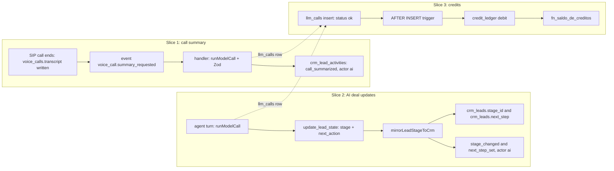

# DeskcommCRM — Clarify-parity PRD

> Product requirements for three slices that close the top Clarify-parity gaps in the fork
> `jaimedhenriques/deskcommcrm`: (1) call summary into the deal timeline, (2) the AI writes deal
> stage and next step, (3) credits metering to a ledger. Authority: the CEO directive relayed on
> 2026-10-12 and the lane decisions D1–D3 that implement it. Sibling docs in `docs/project/`:
> `TRD.md` (how), `APP_FLOW.md` (screens and flows), `DESIGN_BRIEF.md` (UI and copy),
> `BACKEND_SCHEMA.md` (tables, functions, migrations), `IMPLEMENTATION_PLAN.md` (tasks and order).
> This PRD says **what** and **why**; where it touches a schema or a flow it names the requirement
> and leaves the shape to those docs.

---

## 0. How to read this document

- **Pinned commit.** Every path and line number refers to `main` at `f322ca4` of the fork. Line
  numbers go stale; Annex B gives the command that re-measures each one (CLAUDE.md DoD 16).
- **Evidence tags.** `CONFIRMED` means the writer opened the file at `f322ca4` and read the cited
  lines. `INFERRED` means it is deduced from code or docs and has not been proven by a test or by
  running the product (AGENTS.md "Regra final — não invente").
- **Baseline citations** name the **last** definition in `supabase/baseline.sql`, because the
  appendix redefines functions many times and only the last one is live (CLAUDE.md migration
  doctrine).
- **Precedence.** `docs/index.md:22-25` orders `CLAUDE.md` > `docs/specs/` > `docs/prd/` >
  `HANDOFF-*.md` > README; `docs/project/` has no entry there yet. For the three slices, the six
  `docs/project/` docs are the lane's source of truth. Where they diverge from upstream doctrine,
  §6 records the divergence instead of editing the upstream doc.
- **No invented numbers.** This PRD contains no price, SLA, quota or volume. The one unit rule it
  carries (the credit unit in §4.3) is a provisional lane decision marked for owner confirmation
  (§10, Q1).

---

## 1. Context and positioning

Positioning is not restated here. The source is `VISION.md` (the one-line positioning at
`VISION.md:51-55`, the pillars at `VISION.md:33-43`, and the project model at `VISION.md:59-63`)
and the PRD master: §0 for the move from e-commerce CRM to AI Sales OS
(`docs/prd/00-prd-master.md:16-25`), §1 for the target tenant (`:29-45`) and §3 for the personas
(`:69-100`). The fork directive describes the product as the WhatsApp-first AI sales OS, which is
the same positioning.

What this PRD adds is a **comparison frame**. Clarify is an AI-native CRM whose public pitch is that
the CRM fills itself from the seller's conversations. Three of its capabilities were named in the
directive as launch gaps: call and meeting notes landing on the deal, the AI keeping deal fields
current without manual data entry, and AI usage measured in credits. DeskcommCRM's channels are
different (WhatsApp chat, SIP calls through the voice agent, WhatsApp calls through WaCalls), so
parity here means **the same outcome on Deskcomm's own channels**, not a copy of Clarify's
email/calendar pipeline.

Personas used in the stories below, all from PRD master §3: the service operator (§3.1), the
platform super-admin (§3.2), the tenant manager (§3.3), the end customer who never uses the UI
(§3.4) and the LGPD auditor (§3.6).

---

## 2. Clarify-parity gap table

Clarify column: `INFERRED`. It paraphrases the capabilities the directive names and Clarify's public
positioning in general terms. It was not re-read in this session (no network calls were allowed),
and it must be re-verified against Clarify's public pages before any public comparison (§10, Q12).

| #   | Capability                         | Clarify (public, general terms)                                       | DeskcommCRM today at `f322ca4` (evidence)                                                                                                                                                                                                                                                                                                                                                                                                       | Slice that closes it                     | Status                     |
| --- | ---------------------------------- | --------------------------------------------------------------------- | ----------------------------------------------------------------------------------------------------------------------------------------------------------------------------------------------------------------------------------------------------------------------------------------------------------------------------------------------------------------------------------------------------------------------------------------------- | ---------------------------------------- | -------------------------- |
| G1  | Call transcript captured           | Calls and meetings are recorded and transcribed                       | SIP calls: the voice agent writes `voice_calls.transcript` as `[{speaker,text,ts}]` when the call ends (`workers/voice-agent/index.ts:208-228`, CONFIRMED). WhatsApp calls: no audio reaches the server and `record` is never sent (`lib/wacalls/client.ts:127`, CONFIRMED; spec 18 §1.2 item 2). Meetings: only a Google Meet link (`lib/agenda/google/meet.ts`); no recording code in `lib/`, `app/`, `workers/` (CONFIRMED by grep)          | Slice 1 uses the SIP transcript only     | Partial — SIP only; see §9 |
| G2  | Call summary on the deal timeline  | An AI summary of each call or meeting is attached to the deal/contact | None. No activity type for a summary (`lib/leads/activity-vocabulary.ts:20-169`, CONFIRMED). The voice agent defers summarisation "até existir consumidor real" (`workers/voice-agent/index.ts:36-39`, CONFIRMED)                                                                                                                                                                                                                               | Slice 1                                  | Open — no PR at `f322ca4`  |
| G3  | AI moves the deal stage            | Deal fields are updated from conversations without manual entry       | Works through `update_lead_state` → `mirrorLeadStageToCrm` → `sincronizaEstagioDoAgente`, but the row is attributed to `webhook_source`, which is stored as `system` with no agent id (`lib/leads/agent-stage-sync.ts:402`; `lib/leads/activity-emitter.ts:140-141`, CONFIRMED), payload keys are `de`/`para` (`:407`, CONFIRMED) and the harness call passes no pipeline scope (`lib/agent-engine/agent/inbound-turn.ts:3649-3655`, CONFIRMED) | Slice 2                                  | Open — no PR at `f322ca4`  |
| G4  | AI writes the deal's next step     | Next step kept current on the deal by the AI                          | Next step is per **contact** in `lead_state.next_action` (`supabase/baseline.sql:6527-6538`, CONFIRMED), shown as an Aprovar/Ignorar proposal (`components/kanban/NextActionSlot.tsx:53-73`, CONFIRMED). `crm_leads` has no next-step column (grep for `next_step` in `baseline.sql` returns nothing, CONFIRMED)                                                                                                                                | Slice 2                                  | Open — no PR at `f322ca4`  |
| G5  | Usage metered in credits           | AI usage is expressed and metered in credits                          | Per-call cost exists in `llm_calls.cost_cents` (USD cents, null when unpriced; `supabase/baseline.sql:6483-6499`, CONFIRMED). No credits, ledger, plan or `usage_events` table (CONFIRMED by grep; business rule B-01 at `docs/business-rules/00-business-rules-catalog.md:468-473` is unimplemented)                                                                                                                                           | Slice 3                                  | Open — no PR at `f322ca4`  |
| G6  | Credit purchase, price and payment | Credits are bought on a plan                                          | None. Billing page is a "Em breve — Fase 2" placeholder (`app/app/settings/billing/page.tsx:35-37`, CONFIRMED)                                                                                                                                                                                                                                                                                                                                  | None — out of scope by doctrine (§6, §9) | Not planned                |
| G7  | Usage enforcement                  | AI actions stop or degrade when credits run out                       | A USD budget ladder `off`/`avisar`/`bloquear` exists (`lib/agent-engine/edge/llm/orcamento.ts:57`, CONFIRMED); nothing reads credits                                                                                                                                                                                                                                                                                                            | None — slice 3 meters only (§10, Q5)     | Not planned                |
| G8  | Voice-note transcript for humans   | Transcripts are readable by the team                                  | Voice notes are transcribed into `messages.media_derived_text`, but no component under `components/` or `app/app/` reads it (CONFIRMED by grep)                                                                                                                                                                                                                                                                                                 | None — out of scope (§9)                 | Not planned                |

---

## 3. Scope per slice

One draft PR per slice, in priority order, smallest first. Branches and migration numbers are fixed
by the lane decisions; numbers are re-checked with `pnpm checar:colisao-de-migration` before each PR.



### 3.1 Slice 1 — call summary into the deal timeline

Branch `claude/deskcomm-call-summary`, migration `0443`.

**In:**

- A new command event `voice_call.summary_requested`, emitted by the SIP voice agent after the
  transcript write, with a registered handler. The `*_requested` name is required by
  `tests/unit/evento-comando-tem-consumidor.test.ts` (CONFIRMED).
- A summariser that reads the call scoped by `organization_id`, calls the model through
  `runModelCall` under a new purpose registered in `lib/ai/pontos/registro.ts`, and validates the
  output with Zod: summary, key points, customer commitments, suggested next step.
- One `crm_lead_activities` row of new type `call_summarized`, written through
  `emitAgentActivityForContact` (`lib/leads/agent-activity.ts:50`, CONFIRMED), actor `ai`, with
  `evidence.llm_call_ids`. `runModelCall` returns the `callId` needed for that evidence
  (`lib/agent-engine/edge/llm/run-model-call.ts:787`, CONFIRMED).
- Timeline rendering of the summary from `payload` in `components/kanban/LeadTimeline.tsx`, behind
  the existing expand state (`abertos`, `:98`, CONFIRMED), with AI readings labelled as in
  `lib/escalacao/briefing-da-passagem.ts:19-30` (CONFIRMED). `call_summarized` joins the
  never-collapse set in `lib/leads/timeline-grouping.ts:27` (CONFIRMED location).
- LGPD: restore `transcript = null` in the redaction cascade, prove `call_summarized` payloads are
  cleared, and add the transcript to the access export (§5.1).
- Proof with a fictional transcript fixture under `tests/fixtures/calls/` and a scripted model
  provider; no paid model call.

**Out:** WhatsApp call recording or transcription, meeting recording or upload, voice-note
transcript display, metering of transcription, call sentiment. See §9.

### 3.2 Slice 2 — AI writes deal stage and next step

Branch `claude/deskcomm-ai-deal-updates`, migration `0444`.

**In:**

- The stage path stays single: `update_lead_state` → `applyLeadStateUpdate` →
  `mirrorLeadStageToCrm` → `sincronizaEstagioDoAgente`. The mirror receives the agent id and the
  turn's `llm_call_ids`, so the `stage_changed` row is actor `ai`; the payload carries
  `from_stage_id` and `to_stage_id`, which is what the human-correction check reads
  (`app/api/v1/leads/_handler.ts:1119-1150`, CONFIRMED). That check runs only inside
  `moveLeadHandler` (MCP tool and automations), not on the board drag or bulk routes (CONFIRMED;
  §10 Q14, APP_FLOW §8 A6); the harness path passes the agent's
  pipeline scope, so an out-of-scope move fails closed as it already does on the MCP path.
- Next step on the deal: new `crm_leads.next_step` and `crm_leads.next_step_updated_at`, written by
  the mirror from `update_lead_state.next_action` to the routed active deal, with a `next_step_set`
  activity (actor `ai`, evidence). No human approval is needed; humans can still edit it.
- Guards kept as they are: loss needs a human reason (`perda_sem_motivo`), required fields, stage
  unchanged since read (`human_conflict`), ambiguous deal routing refuses.
- Proof by a recorded-conversation fixture under `tests/fixtures/conversas/`, replayed through
  `createInboundTurnHandler` (`lib/agent-engine/agent/inbound-turn.ts:4929`, CONFIRMED) with a
  scripted provider on `pnpm test:db`, using `tests/pg-como-supabase.ts` so the mirror really runs.

**Out:** removing the contact-level approve/dismiss flow (it stays), the Operator-role mode,
AI-created `crm_tasks`, resetting `lead_state` for reopened deals. See §9.

### 3.3 Slice 3 — credits metering to a ledger

Branch `claude/deskcomm-credit-ledger`, migration `0445`.

**In:**

- Table `credit_ledger`: signed bigint `delta`, `kind` (`debit_llm_call` | `grant` | `adjustment`),
  `idempotency_key` unique per organization, `llm_call_id` (on delete set null),
  `source_cost_cents`, `source_currency`, `created_at`. Append-only for the PostgREST roles, owner
  immutability trigger with the organization-deletion exemption, RLS with a SELECT-only policy. The
  name is `credit_ledger`, not `credits`, so the measuring grep in
  `docs/doctrine/operacao-de-agentes.md:105-107` keeps its meaning.
- Metering hook: an AFTER INSERT trigger on `llm_calls` that debits only `status = 'ok'` rows with a
  non-null cost. Unpriced calls are counted and surfaced, never debited as zero.
- Balance: `fn_saldo_de_creditos`, a sum computed in the database, `service_role` only.
- Grants and adjustments: an admin route (role admin, support-write guard, Zod, `Idempotency-Key`,
  audit codes appended).
- Metering only. Nothing is blocked by the balance.

**Out:** price per credit, purchase, payment provider, invoices, plans, enforcement, backfill of
historical `llm_calls`, metering of transcription, Realtime voice and embeddings, any change to
`fn_gasto_de_ia_do_mes`. See §9.

---

## 4. User stories and acceptance criteria

Format follows `.specs/features/crm-automacao-fluxos/spec.md`: user story, why this priority,
numbered WHEN/THEN/SHALL criteria, an independent test. Each criterion carries its traceability ID.
Priorities are within a slice; the slices themselves ship in order 1, 2, 3.

### 4.1 Slice 1 — CALL

#### P1: The call summary lands on the deal ⭐ MVP

**User Story:** As a service operator (PRD master §3.1), I want a summary of each SIP call the AI
handled to appear on the deal's timeline so that I can pick up the conversation without listening
to anything or reading the full transcript.

**Why P1:** The transcript already exists and is stored (G1); nothing consumes it (G2). This is the
smallest change that turns stored data into something an operator reads.

**Acceptance Criteria:**

1. **CALL-01** WHEN a SIP call ends and the voice agent writes a non-empty
   `voice_calls.transcript` THEN the system SHALL emit exactly one `voice_call.summary_requested`
   event for that `voice_calls.id`, in a status the event-log drain picks up, with a handler
   registered in `lib/event-log/register-handlers.ts`.
2. **CALL-02** WHEN the handler runs THEN it SHALL load the call filtered by both `id` and
   `organization_id`, and SHALL summarise through `runModelCall` under a purpose registered in
   `lib/ai/pontos/registro.ts`, so that one `llm_calls` row records the cost and purpose.
3. **CALL-03** WHEN the model output is returned THEN the system SHALL validate it against one Zod
   schema (summary, key points, customer commitments, suggested next step) and SHALL write nothing
   to the timeline if validation fails.
4. **CALL-04** WHEN the output is valid and the call's contact routes to exactly one active deal
   THEN the system SHALL write one `crm_lead_activities` row with `type = 'call_summarized'`,
   `actor_kind = 'ai'`, `evidence.llm_call_ids` containing the summary call,
   `source_module = 'voice_calls'`, `source_id` = the call id, and a `payload` carrying the
   structured summary and the `voice_calls` id.
5. **CALL-05** WHEN the same `voice_call.summary_requested` is processed more than once (retry or
   duplicate) THEN the system SHALL NOT create a second `call_summarized` row for that call id.
6. **CALL-06** WHEN the contact has no active deal or more than one THEN the system SHALL NOT guess
   a deal and SHALL record `agent.activity_unrouted`, as `emitAgentActivityForContact` already does
   (`lib/leads/agent-activity.ts:40-49`, CONFIRMED).
7. **CALL-07** WHEN an operator opens the deal timeline THEN the `call_summarized` row SHALL stay
   visible as its own row (never folded into a group) and SHALL show the summary from `payload`
   when expanded, with AI readings labelled "segundo a IA — confira".
8. **CALL-08** WHEN the row is written THEN `reason` SHALL carry no customer content; the summary
   SHALL live only in `payload`.

**Independent Test:** On `pnpm test:db`, seed an organization, contact, one open deal and a
`voice_calls` row with the fixture transcript; run the handler with a scripted provider; assert one
`call_summarized` row with actor `ai` and `llm_call_ids`; run it again and assert still one row. A
unit test renders `LeadTimeline` with that row and finds the summary text and the AI label.

#### P1: The summary is erased and exported with the contact ⭐ MVP

**User Story:** As the LGPD auditor (PRD master §3.6), I want call transcripts and summaries to be
erased by the contact's redaction and included in the contact's access export so that the new
feature does not create personal data the existing rights flow misses.

**Why P1:** A summary is personal data derived from voice. Shipping it on top of a redaction
cascade that no longer clears the transcript (§5.1) would widen a known erasure gap. It ships in the
same PR as the summary.

**Acceptance Criteria:**

1. **CALL-09** WHEN `fn_lgpd_cascade_redact_contact` runs for a contact THEN it SHALL set
   `voice_calls.transcript` to null for that contact's calls and SHALL clear `payload` of that
   contact's `call_summarized` rows.
2. **CALL-10** WHEN an access export runs for a contact THEN the `voice_calls` section SHALL
   include `transcript`.
3. **CALL-11** WHEN the handler runs for a call whose transcript is null or empty (including after
   redaction) THEN it SHALL make no model call and write no activity.

**Independent Test:** On `pnpm test:db`, seed a call with a transcript and a `call_summarized` row,
run the cascade, assert `transcript is null` and `payload = '{}'`. A unit test on
`lib/lgpd/export-collector.ts` asserts `transcript` is selected.

#### P2: WhatsApp calls stay unrecorded

**User Story:** As the platform super-admin (PRD master §3.2), I want WhatsApp calls to keep
producing no audio and no transcript so that the recording decision in spec 18 §1.2 item 2 is not
reversed by a side effect of this slice.

**Why P2:** Guards a decision rather than adding behaviour; cheap to assert.

**Acceptance Criteria:**

1. **CALL-12** WHEN a WaCalls call ends THEN the system SHALL NOT emit
   `voice_call.summary_requested` and SHALL NOT send `record` to WaCalls.

**Independent Test:** The existing WaCalls bridge invariant pattern
(`tests/invariants/voz-ponte-de-eventos.test.ts`) asserts no `voice_call.summary_requested` row
after a `call-ended` event.

#### Edge cases (slice 1)

- WHEN the call has no `contact_id` THEN the handler SHALL finish without a model call and without
  an activity.
- WHEN the organization's AI budget refuses the call (`bloquear`) THEN the handler SHALL write no
  activity; the refusal is recorded by `runModelCall` as it is for every purpose (INFERRED from
  `lib/agent-engine/edge/llm/run-model-call.ts`; TRD confirms).
- WHEN the transcript contains instructions addressed to the system THEN the summariser SHALL have
  no tools and its output SHALL only reach `payload`, labelled as the AI's reading.
- WHEN the handler keeps failing THEN the event SHALL follow the drain's retry and dead-letter
  policy (`MAX_ATTEMPTS` in `lib/event-log/drain.ts:17`, CONFIRMED constant).

### 4.2 Slice 2 — DEAL

#### P1: AI stage moves are attributed, scoped and correctable ⭐ MVP

**User Story:** As a tenant manager (PRD master §3.3), I want every stage move the AI makes to show
on the deal as made by the AI, with its evidence, so that I can trust it, undo it, and have the undo
counted.

**Why P1:** The AI already moves cards without approval (G3). What is missing is that the move is
recorded as the AI's, stays inside the agent's pipelines on every path, and that a human undo is
detected. Without this, "AI writes the stage" is unauditable.

**Acceptance Criteria:**

1. **DEAL-01** WHEN the agent calls `update_lead_state` with a valid next stage and the mirror moves
   the card THEN the `stage_changed` row SHALL have `actor_kind = 'ai'`, `actor_agent_id` = the
   agent, and `evidence.llm_call_ids` from the turn.
2. **DEAL-02** WHEN the mirror writes `stage_changed` THEN `payload` SHALL contain
   `from_stage_id` and `to_stage_id` (keeping `passo_do_agente`), and WHEN a human moves the card
   back through `moveLeadHandler`, or through `/api/v1/leads/[id]/move` or `/api/v1/leads/bulk` if
   APP_FLOW §8 A6 / IMPLEMENTATION_PLAN T15 is taken, THEN an `agent_move_corrected` row SHALL be
   written. Today the correction check (`ehCorrecaoDeMovimentoDaIa`) runs only inside
   `moveLeadHandler` (`app/api/v1/leads/_handler.ts:43`, `:1118-1160`, CONFIRMED); the lead PATCH
   (`updateLeadHandler`, `:616`), the board drag route (`app/api/v1/leads/[id]/move/route.ts:267-268`
   says it bypasses `moveLeadHandler`) and the bulk route do not run it (CONFIRMED, grep).
3. **DEAL-03** WHEN the deal's pipeline is outside the agent's `ai_agent_versions.pipeline_ids`
   THEN the harness path SHALL refuse with `fora_do_escopo`, move nothing, and open the harness
   mirror's existing `fora_do_escopo` Central item
   (`lib/agent-engine/edge/crm/move-lead-stage.ts:120-130`, CONFIRMED; unreachable today because the
   harness passes no scope). The MCP path only returns a refusal to the model
   (`lib/ai/runtime/tools.ts:222-235`, CONFIRMED) and opens no Central item.
4. **DEAL-04** WHEN the target stage is a loss stage, required fields are missing, the stage
   changed since it was read, or the hint is unmapped THEN the system SHALL keep today's outcomes
   (`perda_sem_motivo`, `campos_obrigatorios`, `human_conflict`, `not_configured`) unchanged.

**Independent Test:** First a repro: on `pnpm test:db`, run the current mirror and assert the row
is `actor_kind = 'system'` with `de`/`para` keys (expected to pass on `f322ca4`, documenting the
defect). Then the fix turns it into `ai` with `from_stage_id`/`to_stage_id`, and a human POST to
`/api/v1/leads/[id]/move` back to the old stage produces the `agent_move_corrected` row (requires
§10 Q14 / APP_FLOW §8 A6; without it, drive the undo through `moveLeadHandler`).

#### P1: The AI writes the deal's next step without approval ⭐ MVP

**User Story:** As a service operator (PRD master §3.1), I want the next step the AI agreed with
the customer to be written on the deal itself so that the card always says what happens next
without anyone clicking Aprovar.

**Why P1:** This is the "without human edit" half of the directive. Today the value lives per
contact and waits for approval (G4).

**Acceptance Criteria:**

1. **DEAL-05** WHEN `update_lead_state` carries a non-empty `next_action` and the contact routes to
   exactly one active deal THEN the system SHALL write it to that deal's `crm_leads.next_step`, set
   `next_step_updated_at`, and write one `next_step_set` activity with `actor_kind = 'ai'` and
   evidence.
2. **DEAL-06** WHEN the contact has no active deal or more than one THEN the system SHALL write
   `next_step` on no deal.
3. **DEAL-07** WHEN a human edits `next_step` on the deal THEN the system SHALL save it and record a
   timeline row attributed to that user.
4. **DEAL-08** WHEN the AI writes `next_step` THEN the contact-level proposal flow
   (`lead_state.next_action`, `next_action_seq`, `POST /api/v1/leads/[id]/next-action`) SHALL keep
   working as before.

**Independent Test:** The recorded-conversation replay below asserts `crm_leads.next_step`, the
`next_step_set` row with actor `ai`, and that `lead_state.next_action` is still written.

#### P1: Proven on a recorded conversation ⭐ MVP

**User Story:** As the lane's verifier, I want a recorded conversation replayed through the real
inbound turn so that "the AI updated the deal" is shown end to end, not inferred from units.

**Why P1:** The standing rule is that done means proven on the real product; the turn harness with
a scripted provider is the closest repeatable proof, and DoD 12 adds the screen side.

**Acceptance Criteria:**

1. **DEAL-09** WHEN the fixture conversation is replayed through `createInboundTurnHandler` with a
   scripted provider and `tests/pg-como-supabase.ts` as the CRM client THEN the deal's `stage_id`,
   `next_step`, and the `stage_changed` and `next_step_set` rows (actor `ai`, with evidence) SHALL
   match the fixture's expected values.
2. **DEAL-10** WHEN the same raw text is checked through the UI path and through a direct call of
   the stage and next-step functions THEN both SHALL agree, per `docs/doctrine/prova-em-par.md`.

**Independent Test:** `pnpm test:db` runs the replay; the paired screen proof is captured in a
fresh environment under `evidence/<delivery>/` (DoD 12).

#### Edge cases (slice 2)

- WHEN the Operator role is on and owns either `crm_move_lead_stage` or `crm_update_lead` THEN
  `update_lead_state` is removed from the conversational agent
  (`lib/agent-engine/agent/entrega-de-capacidade.ts:119-123`, CONFIRMED `.some`), so this slice's
  path does not run; that mode is out of scope.
- WHEN the contact's `lead_state.stage` is already `won` or `lost` THEN no further transition is
  valid (`lib/agent-engine/agent/lead-state.ts:41-42`, CONFIRMED), so a second deal for that contact
  is not advanced (INFERRED consequence).
- WHEN `next_action` is null or empty THEN behaviour for an existing `next_step` is undecided
  (§10, Q8).

### 4.3 Slice 3 — CRED

The credit unit in this slice is the lane's provisional rule: **1 credit = 1 US cent of provider
cost as recorded in `llm_calls.cost_cents`, rounded up per call to a whole credit.** It is a unit of
measure, not a price; it lives in one named constant and is pending owner confirmation (§10, Q1).
No price per credit exists or is implied.

#### P1: Every priced model call debits the ledger ⭐ MVP

**User Story:** As a tenant manager (PRD master §3.3), I want each AI call my organization makes to
be recorded as a credit debit so that usage is measured in one unit with a traceable source.

**Why P1:** Every model call already lands in `llm_calls` with a cost (G5). A trigger there is the
single metering point that covers all writers, including `lib/ai/log-invocation.ts:85` (CONFIRMED
writer).

**Acceptance Criteria:**

1. **CRED-01** WHEN a row is inserted into `llm_calls` with `status = 'ok'` and a non-null positive
   `cost_cents` THEN exactly one `credit_ledger` row SHALL be written for that organization with
   `kind = 'debit_llm_call'`, a negative `delta` computed by the named conversion rule,
   `llm_call_id`, `source_cost_cents` and `source_currency = 'USD'`.
2. **CRED-02** WHEN a debit for the same `llm_calls.id` is attempted again THEN the per-organization
   unique `idempotency_key` SHALL prevent a second row.
3. **CRED-03** WHEN the `llm_calls` row has `status = 'erro'` THEN no debit SHALL be written.
4. **CRED-04** WHEN `cost_cents` is null THEN no debit SHALL be written and the call SHALL be
   counted as unpriced in a measure the server can return alongside the balance.
5. **CRED-05** WHEN the balance is requested THEN `fn_saldo_de_creditos` SHALL return the sum of
   `delta` computed in the database, executable by `service_role` only.
6. **CRED-06** WHEN any model call is attempted THEN the credit balance SHALL NOT block or degrade
   it; the `ai_budgets` ladder stays the only gate.
7. **CRED-07** WHEN the slice is merged THEN `fn_gasto_de_ia_do_mes` SHALL be unchanged and
   `tests/unit/orcamento-uma-regua-de-gasto.test.ts` SHALL pass.
8. **CRED-08** WHEN the conversion rule is unit-tested THEN fractional, whole and minimal positive
   costs SHALL each map to the documented credit amount.

**Independent Test:** On `pnpm test:db`: insert an `ok` row with a cost, assert one debit; insert
it again by key, assert still one; insert `erro` and null-cost rows, assert no debit and an
unpriced count of one.

#### P1: The ledger cannot be rewritten ⭐ MVP

**User Story:** As the LGPD auditor (PRD master §3.6), I want the credit ledger to be append-only
and isolated per organization so that usage history cannot be edited after the fact or read across
tenants.

**Why P1:** A ledger that can be updated is a balance with extra steps. The repo has the precedent
(migration `0258` for `api_audit_log`) and the test pattern
(`tests/invariants/audit-log-sob-o-default-acl-do-supabase.test.ts`).

**Acceptance Criteria:**

1. **CRED-09** WHEN `anon`, `authenticated` or `service_role` tries UPDATE, DELETE or TRUNCATE on
   `credit_ledger` under the Supabase default table ACL THEN the database SHALL refuse.
2. **CRED-10** WHEN the table owner tries UPDATE or DELETE outside an organization deletion THEN a
   trigger SHALL refuse; WHEN the organization is deleted THEN its rows SHALL cascade.
3. **CRED-11** WHEN a member of organization A selects from `credit_ledger` THEN only A's rows SHALL
   be returned, and `authenticated` SHALL have no INSERT.

**Independent Test:** The default-ACL invariant pattern above, plus an entry in
`tests/invariants/rls-isolation.test.ts`.

#### P2: An admin can grant or adjust credits

**User Story:** As a tenant manager with the admin role, I want to record a grant or an adjustment
with a reason so that the balance can be corrected without editing history.

**Why P2:** Without it, the only movements are debits; corrections would need SQL against the
database, which the lane forbids on live systems.

**Acceptance Criteria:**

1. **CRED-12** WHEN an admin posts a grant or adjustment with an `Idempotency-Key` THEN the route
   SHALL require role admin, pass the support-write guard before any effect, validate the body with
   Zod, write one `credit_ledger` row, and emit an audit code appended at the end of
   `lib/audit/actions.ts`.
2. **CRED-13** WHEN the same `Idempotency-Key` is replayed THEN no second row SHALL be written.
3. **CRED-14** WHEN a non-admin calls the route THEN it SHALL be refused with no row and no audit
   of an effect.

**Independent Test:** A route test modelled on `app/api/v1/ai/budget/route.ts` (which uses
`requireRole` at `:104` and `requireSupportWrite` at `:100`, CONFIRMED).

#### Edge cases (slice 3)

- WHEN `cost_cents = 0` THEN whether a zero-delta row is written is undecided (§10, Q2).
- WHEN a legacy writer records an unknown model THEN `lib/ai/cost.ts:118` returns `0`, not null
  (CONFIRMED), so the call is metered as zero cost rather than unpriced; tests and docs SHALL state
  this under-count.
- WHEN audio transcription, Realtime voice or embeddings run THEN no `llm_calls` row exists
  (transcription registry entry `registraEm: "nenhum"` at `lib/ai/pontos/registro.ts:467-494`,
  CONFIRMED), so no credit is debited; the exclusion SHALL be stated in the slice's tests and docs.

### 4.4 Requirement traceability

| ID      | Story                                        | Slice | Status  |
| ------- | -------------------------------------------- | ----- | ------- |
| CALL-01 | Summary event emitted after transcript write | 1     | Planned |
| CALL-02 | Handler org-scoped, model call via seam      | 1     | Planned |
| CALL-03 | Zod-validated summary                        | 1     | Planned |
| CALL-04 | `call_summarized` row, actor `ai`, evidence  | 1     | Planned |
| CALL-05 | Idempotent per call                          | 1     | Planned |
| CALL-06 | No guessing on ambiguous routing             | 1     | Planned |
| CALL-07 | Visible, expandable, labelled in timeline    | 1     | Planned |
| CALL-08 | `reason` free of customer content            | 1     | Planned |
| CALL-09 | Redaction clears transcript and summary      | 1     | Planned |
| CALL-10 | Export includes transcript                   | 1     | Planned |
| CALL-11 | No model call on empty transcript            | 1     | Planned |
| CALL-12 | WhatsApp calls stay unrecorded               | 1     | Planned |
| DEAL-01 | AI stage move attributed `ai` with evidence  | 2     | Planned |
| DEAL-02 | Payload keys enable correction detection     | 2     | Planned |
| DEAL-03 | Pipeline scope on the harness path           | 2     | Planned |
| DEAL-04 | Existing guards unchanged                    | 2     | Planned |
| DEAL-05 | `next_step` written on the routed deal       | 2     | Planned |
| DEAL-06 | No write on ambiguous routing                | 2     | Planned |
| DEAL-07 | Human edit recorded                          | 2     | Planned |
| DEAL-08 | Contact-level proposal flow intact           | 2     | Planned |
| DEAL-09 | Recorded-conversation replay                 | 2     | Planned |
| DEAL-10 | Paired proof (UI and direct)                 | 2     | Planned |
| CRED-01 | Debit per priced `ok` call                   | 3     | Planned |
| CRED-02 | Debit idempotency                            | 3     | Planned |
| CRED-03 | No debit on error rows                       | 3     | Planned |
| CRED-04 | Null cost counted, not debited               | 3     | Planned |
| CRED-05 | Balance summed in DB, service_role only      | 3     | Planned |
| CRED-06 | No enforcement                               | 3     | Planned |
| CRED-07 | Single spend ruler untouched                 | 3     | Planned |
| CRED-08 | Conversion rule unit-tested                  | 3     | Planned |
| CRED-09 | Append-only under default ACL                | 3     | Planned |
| CRED-10 | Owner immutability with org-deletion exempt  | 3     | Planned |
| CRED-11 | RLS isolation, no client INSERT              | 3     | Planned |
| CRED-12 | Admin grant/adjust route                     | 3     | Planned |
| CRED-13 | Grant idempotency                            | 3     | Planned |
| CRED-14 | Non-admin refused                            | 3     | Planned |

**Coverage:** 36 requirements (12 CALL, 10 DEAL, 14 CRED). `IMPLEMENTATION_PLAN.md` maps each to
tasks.

### 4.5 Success criteria per slice

- [ ] **Slice 1:** fixture transcript to `call_summarized` row on `pnpm test:db`; cascade and export
      tests green; `LeadTimeline` unit test green; screen proof of the summary on a deal in a fresh
      environment (DoD 12); no paid model call in any test.
- [ ] **Slice 2:** repro test showing today's `system` attribution, then the replay asserting actor
      `ai`, `next_step` and correction detection; paired proof per `prova-em-par.md`.
- [ ] **Slice 3:** ledger invariants (debit, idempotency, null cost, append-only under default ACL,
      RLS isolation) and conversion unit tests green; `orcamento-uma-regua-de-gasto` green.
- [ ] **Every slice:** draft PR only, `.changes/` fragment, destination declared (DoD 18), CI
      checks read from the fork, verification by a fresh agent on a different model family pinned to
      one commit; the maker never merges.

---

## 5. Non-functional requirements

### 5.1 LGPD

- **Transcript erasure regression (slice 1 fixes it).** The last `fn_lgpd_cascade_redact_contact`
  (`supabase/baseline.sql:35136`) updates `voice_calls` with `peer_phone`, `owner_user_id`,
  `created_by` and `updated_at` only (`:35388-35394`, CONFIRMED). The `transcript = null` line
  exists only in the earlier definition at `:32547` (line `:32732`, CONFIRMED). SIP transcripts
  therefore survive anonymisation today.
- **Summaries in activities.** The last cascade already clears `payload`, `metadata` and `reason` of
  the contact's `crm_lead_activities` (`:35245-35252`, CONFIRMED). Slice 1 adds a test that this
  covers `call_summarized`.
- **Access export.** `lib/lgpd/export-collector.ts:1046-1049` selects `voice_calls` without
  `transcript` (CONFIRMED). Slice 1 adds it.
- **`reason` stays PII-free.** It is shown on screen through `t()` (`LeadTimeline.tsx:79`,
  CONFIRMED). Summaries go in `payload` only.
- **Consent.** WhatsApp call recording stays off (spec 18 §1.2 item 2). No consent announcement was
  found in `asterisk/extensions.conf` for SIP calls (INFERRED from grep), so the SIP transcript the
  slice consumes is captured today without a documented consent step; this is recorded as a risk
  and an open decision (§8, §10 Q6), not solved by this slice.
- **Ledger.** `credit_ledger` holds no contact id and no message content, so it needs no redaction.
- **Fixtures.** Transcript and conversation fixtures are fictional, with synthetic identifiers only
  (`tests/unit/sem-identificador-de-producao.test.ts` scans `tests/` and `docs/`).

### 5.2 Tenancy

- Every read and write is filtered by `organization_id`, including the summary handler's load of
  the call (CALL-02). The existing finalize UPDATE in the voice agent filters by `id` only
  (`workers/voice-agent/index.ts:218-228`, CONFIRMED); see §10 Q7.
- `credit_ledger` gets RLS with a SELECT-only tenancy policy, never an ALL policy, and an entry in
  the RLS isolation invariant.
- Contact-to-deal routing never guesses: `resolveActiveLeadForContact` refuses ambiguous targets and
  both slices 1 and 2 inherit that.

### 5.3 Audit and attribution

- AI-written timeline rows carry `actor_kind = 'ai'`, the agent id and `evidence.llm_call_ids`. The
  database enforces evidence for `ai` rows (`crm_lead_activities_ai_needs_evidence`,
  `supabase/baseline.sql:8282-8287`, CONFIRMED); tests assert `actor_kind`, not only row existence.
- Human corrections of AI stage moves are recorded as corrections (DEAL-02).
- Credit grants and adjustments emit audit codes appended at the end of `lib/audit/actions.ts`;
  existing codes are never renamed.

### 5.4 Cost visibility

- The summary's model call is a normal `llm_calls` row, so it counts in `fn_gasto_de_ia_do_mes`
  (`supabase/baseline.sql:13125-13135`, sum of `cost_cents` over `llm_calls` for the month,
  CONFIRMED) and is subject to the budget ladder.
- Credits are a second **unit**, not a second **spend ruler**: the monthly USD spend stays defined
  only by `fn_gasto_de_ia_do_mes`, and the balance is a ledger sum.
- Unpriced calls are counted and returned, never shown as zero (CRED-04). Known unmetered sources
  (transcription, Realtime voice, embeddings, legacy zero-cost path) are listed wherever credits
  are reported.

### 5.5 Product and UI constraints

- UI copy in pt-BR per `docs/design-system/08-voice-and-tone.md`; every new string through `t()`
  with a Spanish entry in `lib/i18n/dicionario.ts` (guarded by
  `tests/unit/i18n-espanhol-cobre-a-tela.test.ts`).
- The UI bar (21st.dev and shadcn patterns) is applied inside design system v1.0: Phosphor icons via
  `lib/ui/icons.ts`, no `Sparkle` for AI (`docs/design-system/09-anti-patterns.md` §6). Details in
  `DESIGN_BRIEF.md`.
- Any new screen is declared in `lib/navigation/catalogo.ts` (DoD 14). Slices 1 and 2 add no screen;
  slice 3's surface is an open decision (§10, Q4).
- No performance number is set here. The summary runs asynchronously off the call path; the
  metering trigger adds one insert inside the `llm_calls` transaction and makes no HTTP call.

---

## 6. Doctrine divergence

The CEO directive rules for this fork. The upstream rules it overrides are quoted below verbatim
(pt-BR, as the repo has them), with what is overridden, what is kept, and how each slice stays
inside the rest of the doctrine. No upstream doctrine file is edited to hide a divergence.

### 6.1 The rules and what the directive does to each

| Rule (quoted)                                                                                                                                                                                                                                                                                                  | Source                                                         | Effect of the directive                                                                                                                                                                                                                                                                       |
| -------------------------------------------------------------------------------------------------------------------------------------------------------------------------------------------------------------------------------------------------------------------------------------------------------------- | -------------------------------------------------------------- | --------------------------------------------------------------------------------------------------------------------------------------------------------------------------------------------------------------------------------------------------------------------------------------------- |
| "**Não caçar paridade de funcionalidade sem cliente que a pague.** Campanhas com template oficial e canais adicionais entram quando um cliente pagante os pedir, não antes."                                                                                                                                   | `docs/doctrine/operacao-de-agentes.md:123-124` (§4 item 6)     | **Overridden for the whole lane.** The directive asks for Clarify parity before a paying customer asks for it. Limited to three slices, each built on substrate that already exists (§2); no new channel, no campaign work.                                                                   |
| "**Não construir faturamento antes do primeiro operador que paga.** Sem cliente pagante, o desenho do medidor é adivinhação."                                                                                                                                                                                  | `docs/doctrine/operacao-de-agentes.md:117-118` (§4 item 2)     | **Overridden in part (slice 3).** The lane builds the meter, which is exactly what the rule calls a guess. It does not build invoices, plans, payment or enforcement. The meter design is declared provisional until a paying operator validates it.                                          |
| "**Não inventar preço, SLA nem número.** O primeiro cliente real define os três."                                                                                                                                                                                                                              | `docs/doctrine/operacao-de-agentes.md:120` (§4 item 4)         | **Kept.** No price, SLA or volume appears in any doc or slice. The one number the lane carries, the credit unit (§4.3), is a unit conversion, isolated in one constant and flagged for owner confirmation (§10, Q1).                                                                          |
| "**Unidade de cobrança: retainer por cliente operado** (dono do produto, 2026-09-13). O trabalho imediato é **este console**, não um medidor de consumo — cobro por consumo exigiria construir medidor → fatura antes do primeiro real, e não existe nenhuma tabela de plano, fatura ou assinatura no schema." | `docs/specs/19-spec-console-de-agencia.md:37-40` (§1.2 item 1) | **Overridden in part (slice 3).** The fork builds a consumption meter, which the decision ranked below the agency console. The retainer decision itself is not revoked: credits charge nobody in this lane, and no plan, invoice or subscription table is added.                              |
| "**O software é 100% open source (MIT), completo, sem versão paga.** Não vendemos assinatura. Não existe feature travada."                                                                                                                                                                                     | `VISION.md:61`                                                 | **Pressure, kept in this lane.** "Credits-based billing" points toward selling usage. The lane keeps the code MIT and complete and gates no feature on credits (CRED-06). Turning enforcement on would lock a feature behind payment and needs an owner decision against this line (§10, Q5). |
| "**Gravação de chamada (`record: true` da API do WaCalls) fica DESLIGADA no MVP desta feature.** Grava voz = dado sensível LGPD, exige consentimento e entrada no cascade de redact (`fn_lgpd_cascade_redact_contact`). Decisão de ligar fica pra depois, separada."                                           | `docs/specs/18-spec-voice-calls-wacalls.md:29` (§1.2 item 2)   | **Kept.** "Call/meeting transcription" in the directive is met for SIP calls only, whose transcript shipping code already stores. WhatsApp recording stays off (CALL-12). The slice does the cascade part the rule names as a precondition (CALL-09). Consent remains open (§10, Q6).         |

Related, not in the directive's list: `docs/doctrine/operacao-de-agentes.md:138-139` (§5 item 2)
says nothing after "um cliente real" advances without it. The lane advances before that phase is
met; the directive overrides it the same way as §4 item 6.

### 6.2 How each slice stays inside the rest of the doctrine

| Doctrine                                                                                                  | Slice 1 (call summary)                                                                    | Slice 2 (AI deal updates)                                                                                                                                                                                                    | Slice 3 (credits)                                                                       |
| --------------------------------------------------------------------------------------------------------- | ----------------------------------------------------------------------------------------- | ---------------------------------------------------------------------------------------------------------------------------------------------------------------------------------------------------------------------------- | --------------------------------------------------------------------------------------- |
| `docs/doctrine/sistema-vivo.md` invariants 1 and 3 (two connections; visible log)                         | Input: the stored transcript. Output: a timeline row on the deal                          | Input: the turn. Output: card stage, `next_step`, two timeline rows                                                                                                                                                          | Input: `llm_calls`. Output: ledger and balance; the on-screen surface is open (§10, Q4) |
| `sistema-vivo.md` invariant 2 (AI↔human continuity)                                                       | Operator reads what the AI heard                                                          | Human can edit `next_step` and move the card back; both are recorded                                                                                                                                                         | Admin grant/adjust is the human side of the meter                                       |
| `sistema-vivo.md` invariant 6 (every configuration has a surface)                                         | No new configuration                                                                      | Stage mapping has a settings screen (`app/app/settings/tenant/pipelines/_mapping.tsx`); pipeline scope is set on the agent form (`app/app/ai/agents/[id]/_components/AgentForm.tsx` reads `pipeline_ids`, CONFIRMED by grep) | Grants have an API but no screen yet: open (§10, Q4)                                    |
| `sistema-vivo.md` invariant 7 and the time rule (`:83-87`: never faster than a human can interrupt)       | Summary is read-only text; nothing acts on it automatically                               | Card moves and `next_step` are reversible; loss stays human (`perda_sem_motivo`); an undo becomes a correction signal (DEAL-02)                                                                                              | Metering only; nothing is blocked (CRED-06)                                             |
| `docs/specs/17-spec-conversa-vira-lead.md` §4b ("O Operador PROPÕE; um humano CONFIRMA" for contact data) | Writes no contact field                                                                   | Writes deal fields only (`stage_id`, `next_step`), never contact data                                                                                                                                                        | Not applicable                                                                          |
| `docs/doctrine/prova-em-par.md` (DoD 12 amendment)                                                        | The summariser is not an agent turn; screen proof plus handler test                       | Paired proof required (DEAL-10)                                                                                                                                                                                              | No agent in the path                                                                    |
| CLAUDE.md DoD 11 (migration + baseline appendix + MANIFEST)                                               | `0443`                                                                                    | `0444`                                                                                                                                                                                                                       | `0445`                                                                                  |
| CLAUDE.md DoD 13 (architecture map with at least two edges)                                               | No voice-call map exists in `docs/architecture/` (CONFIRMED by listing); slice 1 adds one | Extend `docs/architecture/crm-vivo.architecture.json`                                                                                                                                                                        | Extend the budget map (`docs/architecture/teto-de-orcamento.architecture.json`)         |
| CLAUDE.md DoD 17 and 18 (`.changes/` fragment; core vs extension)                                         | Fragment required; destination open (§10, Q10)                                            | Fragment required; destination open (§10, Q10)                                                                                                                                                                               | Fragment required; destination open (§10, Q10)                                          |

---

## 7. Dependencies

- **Slice 1** depends on the SIP voice agent writing `voice_calls.transcript`
  (`workers/voice-agent/index.ts:208-228`) and on the event-log drain running in the agent worker or
  the cron route (the voice agent process does not drain; INFERRED from its header and the map).
- **Slice 2** depends on tenant configuration: `crm_stages.agent_stage_hint`
  (`supabase/baseline.sql:8929`, CONFIRMED) mapped for the pipeline and the pipeline listed in
  `ai_agent_versions.pipeline_ids` (`:11751`, CONFIRMED). Without them the card does not move, by
  design. Demo and fixture data must seed both, with exactly one open deal per contact.
- **Slice 3** depends on `llm_calls` being written for every priced model call (true for
  `runModelCall` and `lib/ai/log-invocation.ts`; not for transcription, Realtime or embeddings).
- **Slices 1 and 2 feed slice 3**: their model calls produce `llm_calls` rows that the meter debits.
- **All slices** depend on `pnpm test:db` (Docker, `pgvector/pgvector` image) and, for DoD 12, a
  fresh environment with Playwright; neither is available offline (INFERRED from the map).

---

## 8. Risks

| #   | Risk                                                                                                                                                                                                                                                                     | Slice | Mitigation                                                                                                             |
| --- | ------------------------------------------------------------------------------------------------------------------------------------------------------------------------------------------------------------------------------------------------------------------------ | ----- | ---------------------------------------------------------------------------------------------------------------------- |
| R1  | The fork diverges from upstream doctrine (§6); a later upstream sync or upstream reviewer rejects the slices                                                                                                                                                             | All   | Divergence written here; upstream docs untouched; slices kept small and removable                                      |
| R2  | A summary is a paraphrase of customer words and a prompt-injection surface                                                                                                                                                                                               | 1     | No tools in the summariser; output only in `payload`; "segundo a IA — confira" label; Zod schema                       |
| R3  | SIP transcripts are captured with no consent step found (INFERRED)                                                                                                                                                                                                       | 1     | Not widened by this slice; erasure and export fixed; consent design open (§10, Q6)                                     |
| R4  | AI rows silently become `system` when evidence is missing (`buildLeadActivityRow` demotes, `lib/leads/activity-emitter.ts:93`, CONFIRMED), so a row "written by the AI" can pass a test that only checks existence                                                       | 1, 2  | Tests assert `actor_kind = 'ai'`                                                                                       |
| R5  | Timeline grouping folds AI rows: the never-collapse set's stated criterion is "contêm decisão humana, não relato" (`lib/leads/timeline-grouping.ts:26`, CONFIRMED); adding `call_summarized` widens it, and AI stage moves would fold with the same turn's `ai_turn` row | 1, 2  | Slice 1 updates the comment to the widened criterion; slice 2 decides set membership or a visibility test (§10, Q9)    |
| R6  | The correction loop may already be dead for AI moves: spec 17 §7 step 5 marks it ✅, but the mirror writes `system` and `de`/`para` (INFERRED mismatch)                                                                                                                  | 2     | Repro test first (DEAL-01 independent test), then the fix                                                              |
| R7  | Stage moves depend on tenant mapping and scope; an unmapped tenant sees nothing happen                                                                                                                                                                                   | 2     | Fixture seeds mapping; `not_configured` stays visible as today                                                         |
| R8  | Per-call ceiling makes any priced call cost at least one credit, however small its `cost_cents`                                                                                                                                                                          | 3     | Rule isolated in one constant; owner confirmation (§10, Q1)                                                            |
| R9  | Credits under-count real spend: null cost, legacy zero cost (`lib/ai/cost.ts:118`), and no `llm_calls` for transcription, Realtime voice or embeddings                                                                                                                   | 3     | Unpriced count surfaced; exclusions stated in tests and docs                                                           |
| R10 | `llm_calls` carries a tenancy-only ALL policy listed as known debt, so a member could insert rows through PostgREST and trigger debits (INFERRED from the map, not measured)                                                                                             | 3     | TRD measures it; the ledger itself stays server-written and append-only                                                |
| R11 | Migration numbers `0443`–`0445` collide with upstream or open PRs                                                                                                                                                                                                        | All   | `pnpm checar:colisao-de-migration` before each PR; renumber NNNN and timestamp together                                |
| R12 | 21st.dev and shadcn defaults bring Lucide, gradients and `Sparkle`, which the design system forbids                                                                                                                                                                      | 1, 2  | Re-skin per `DESIGN_BRIEF.md`; icons only through `lib/ui/icons.ts`                                                    |
| R13 | "Done" claimed on compile or unit tests alone                                                                                                                                                                                                                            | All   | Success criteria in §4.5 require DB invariants and screen proof; verification by a fresh agent on another model family |

---

## 9. Out of scope

| Item                                                                         | Why                                                                                                                                                                                      |
| ---------------------------------------------------------------------------- | ---------------------------------------------------------------------------------------------------------------------------------------------------------------------------------------- |
| WhatsApp call recording or transcription (WaCalls `record`)                  | Spec 18 §1.2 item 2; needs a consent design                                                                                                                                              |
| Browser-side capture of WaCalls audio                                        | Same consent decision; a later path                                                                                                                                                      |
| Meeting recording, upload or Google Meet transcript fetch                    | No substrate exists; meetings are a Meet link only                                                                                                                                       |
| WAHA `call.*` events                                                         | Not subscribed or dispatched today; separate work                                                                                                                                        |
| Voice-note transcript display to operators                                   | Not in the directive's three slices (G8)                                                                                                                                                 |
| Clearing `messages.media_derived_text` in the redaction cascade              | Real LGPD gap (last cascade's `messages` block at `supabase/baseline.sql:35228-35237` does not clear it, CONFIRMED), but outside the three slices; flagged for a separate fix (§10, Q11) |
| Call sentiment                                                               | Not requested                                                                                                                                                                            |
| Price per credit, purchase, payment provider, invoices, plans, subscriptions | Doctrine (§6) and no owner decision                                                                                                                                                      |
| Enforcement on credit balance                                                | VISION.md:61 and owner decision (§10, Q5)                                                                                                                                                |
| Backfill of historical `llm_calls` into the ledger                           | Business decision (§10, Q3)                                                                                                                                                              |
| Metering of transcription, Realtime voice and embeddings                     | They write no `llm_calls` row; needs its own seam                                                                                                                                        |
| Any change to `fn_gasto_de_ia_do_mes`                                        | Guarded by `tests/unit/orcamento-uma-regua-de-gasto.test.ts:125-145`                                                                                                                     |
| AI writing `crm_tasks`                                                       | Alternative next-step carrier (`supabase/baseline.sql:18106`); the lane chose a deal column                                                                                              |
| Operator-role mode for stage moves                                           | Removes `update_lead_state`; one mode per demo                                                                                                                                           |
| Resetting `lead_state` for reopened deals                                    | Separate behaviour change                                                                                                                                                                |
| Removing the contact-level approve/dismiss flow                              | Kept by D2                                                                                                                                                                               |

---

## 10. Decisions deferred

Questions this PRD could not close. "Lane default" is what the slices do until someone with
authority answers; "none" means the slice must not ship that behaviour until answered.

| #   | Question                                                                                                                                                                                                                                         | Lane default                                           | Who decides         |
| --- | ------------------------------------------------------------------------------------------------------------------------------------------------------------------------------------------------------------------------------------------------ | ------------------------------------------------------ | ------------------- |
| Q1  | Confirm the credit unit: 1 credit = 1 US cent of recorded provider cost, rounded up per call? Or accumulate fractions and round on the balance?                                                                                                  | Per-call ceiling, in one named constant (D3)           | Product owner       |
| Q2  | For `cost_cents = 0`, write a zero-delta debit row or skip?                                                                                                                                                                                      | None                                                   | Lane, then owner    |
| Q3  | Backfill historical `llm_calls` into the ledger?                                                                                                                                                                                                 | No backfill                                            | Product owner       |
| Q4  | Where do the balance and the unpriced count appear on screen (`/app/ai/usage`, `lib/navigation/catalogo.ts:569`, or the billing placeholder at `:851`)? Without a screen, slice 3 misses sistema-vivo invariant 6 and DoD 13's "aparece na tela" | None — API and DB only                                 | Product owner, lane |
| Q5  | Will a credit balance ever block or degrade AI usage, and how does that square with `VISION.md:61`?                                                                                                                                              | Never in this lane                                     | Product owner       |
| Q6  | Consent design for voice: WhatsApp call recording (spec 18 §1.2 item 2) and the SIP transcript already captured without a consent step found                                                                                                     | Recording off; SIP unchanged                           | Product owner, DPO  |
| Q7  | Slice 1 edits `finalizeAudioSocketCall`; does it also add the `organization_id` filter to its UPDATE (`workers/voice-agent/index.ts:218-228`)?                                                                                                   | Recommended yes, as part of slice 1                    | Lane                |
| Q8  | When `update_lead_state` sends a null or empty `next_action`, is `crm_leads.next_step` cleared or kept?                                                                                                                                          | Kept (no write)                                        | Lane, then owner    |
| Q9  | AI stage moves and `next_step_set` on the timeline: join the never-collapse set, or prove they stay visible inside the expanded group?                                                                                                           | None                                                   | Lane (with design)  |
| Q10 | DoD 18 destination for each slice: core, extension, both or infrastructure?                                                                                                                                                                      | None                                                   | Lane                |
| Q11 | Fix the `messages.media_derived_text` erasure gap in its own PR now, or record it as known debt?                                                                                                                                                 | Recorded here only                                     | Lane, DPO           |
| Q12 | Re-verify the Clarify column (§2) against Clarify's public pages before any public comparison                                                                                                                                                    | Treat as INFERRED                                      | Lane                |
| Q13 | Business rule B-01 names `usage_events`; does `credit_ledger` satisfy it, or does B-01 stay open?                                                                                                                                                | B-01 stays open; `credit_ledger` covers LLM calls only | Product owner       |

---

## Annex A — Claim index

Every code claim above, with the file the writer opened at `f322ca4`. All are CONFIRMED unless the
row says otherwise.

| Claim                                                                                       | Path:lines                                                                                                                                |
| ------------------------------------------------------------------------------------------- | ----------------------------------------------------------------------------------------------------------------------------------------- |
| SIP voice agent defers summarisation and publishes no event                                 | `workers/voice-agent/index.ts:36-39`                                                                                                      |
| SIP transcript written at call end; UPDATE filtered by `id` only                            | `workers/voice-agent/index.ts:208-228`                                                                                                    |
| WaCalls never sends `record`                                                                | `lib/wacalls/client.ts:127`                                                                                                               |
| `voice_call.ended` inserted as `done`; activity via `emitAgentActivityForContact`           | `lib/wacalls/events-bridge.ts:420-421`, `:430`                                                                                            |
| Activity vocabulary union and exhaustive labels; no summary type                            | `lib/leads/activity-vocabulary.ts:20`, `:171`, `:259-261`                                                                                 |
| Contact-to-deal routing logs `agent.activity_unrouted` instead of guessing                  | `lib/leads/agent-activity.ts:40-70`                                                                                                       |
| Never-collapse set and its criterion                                                        | `lib/leads/timeline-grouping.ts:26-50`                                                                                                    |
| Timeline shows label and `reason` via `t()`; expand state `abertos`                         | `components/kanban/LeadTimeline.tsx:70`, `:79`, `:98`                                                                                     |
| Timeline query selects `payload`                                                            | `lib/leads/timeline-query.ts:15-25`                                                                                                       |
| "segundo a IA — confira" labelling rule                                                     | `lib/escalacao/briefing-da-passagem.ts:19-30`                                                                                             |
| Transcription purpose is fixed to whisper-1 and not recorded                                | `lib/ai/pontos/registro.ts:467-494`                                                                                                       |
| `runModelCall` inserts `llm_calls` and returns `callId`                                     | `lib/agent-engine/edge/llm/run-model-call.ts:737-743`, `:787`                                                                             |
| `*_requested` naming rule for command events                                                | `tests/unit/evento-comando-tem-consumidor.test.ts:17-30`                                                                                  |
| Event handlers registry (media handlers as precedent)                                       | `lib/event-log/register-handlers.ts:65-66`                                                                                                |
| Drain retry constant                                                                        | `lib/event-log/drain.ts:17`                                                                                                               |
| `voice_calls` table and 0348 columns (`lead_id`, `transcript`, `metadata`)                  | `supabase/baseline.sql:23790`, `:32472-32480`                                                                                             |
| Last redaction cascade; `voice_calls` block without `transcript`                            | `supabase/baseline.sql:35136`, `:35388-35394`                                                                                             |
| `transcript = null` only in the earlier definition                                          | `supabase/baseline.sql:32547`, `:32732`                                                                                                   |
| Cascade clears activity `payload`, `metadata`, `reason`                                     | `supabase/baseline.sql:35245-35252`                                                                                                       |
| Cascade's `messages` block does not clear `media_derived_text`                              | `supabase/baseline.sql:35228-35237`, column at `:7496`                                                                                    |
| Access export selects `voice_calls` without `transcript`                                    | `lib/lgpd/export-collector.ts:1046-1049`                                                                                                  |
| SIP transcript viewer exists on the calls screen                                            | `app/app/calls/_client.tsx:212-214`, `app/api/v1/calls/route.ts:40`                                                                       |
| No consent announcement in the Asterisk dialplan (INFERRED, grep)                           | `asterisk/extensions.conf`                                                                                                                |
| `update_lead_state` tool definition                                                         | `lib/agent-engine/agent/inbound-turn.ts:233-257`                                                                                          |
| Harness mirror call passes no scope, agent or evidence                                      | `lib/agent-engine/agent/inbound-turn.ts:3649-3655`                                                                                        |
| Mirror forwards org, contact and step only                                                  | `lib/agent-engine/edge/crm/move-lead-stage.ts:237`, `:248-252`                                                                            |
| Scope optional; actor `webhook_source`; payload `de`/`para`                                 | `lib/leads/agent-stage-sync.ts:222`, `:275-280`, `:402`, `:407`                                                                           |
| Correction check reads `from_stage_id`/`to_stage_id` and requires actor `ai`                | `app/api/v1/leads/_handler.ts:1119-1150`, `lib/leads/correcao-humana.ts:79`                                                               |
| Fixed seven-step graph, `won`/`lost` terminal                                               | `lib/agent-engine/agent/lead-state.ts:23-43`                                                                                              |
| Next action per contact; `next_action_seq`                                                  | `supabase/baseline.sql:6527-6538`, `:8300-8301`                                                                                           |
| Approve/dismiss route and slot                                                              | `app/api/v1/leads/[id]/next-action/route.ts:95-124`, `components/kanban/NextActionSlot.tsx:53-73`, `components/kanban/KanbanCard.tsx:260` |
| No `next_step` anywhere in the schema                                                       | `supabase/baseline.sql` (grep, no hits); `crm_leads` at `:1463`                                                                           |
| Operator capability filter uses `.some`                                                     | `lib/agent-engine/agent/entrega-de-capacidade.ts:119-123`                                                                                 |
| Turn handler entry point; scripted provider; pg adapter                                     | `lib/agent-engine/agent/inbound-turn.ts:4929`, `lib/agent-engine/edge/llm/providers.ts`, `tests/pg-como-supabase.ts`                      |
| AI rows need evidence                                                                       | `supabase/baseline.sql:8282-8287`                                                                                                         |
| `ai` without evidence demoted to `system`; `webhook_source` stored as `system`, no agent id | `lib/leads/activity-emitter.ts:93`, `:140-141`                                                                                            |
| Stage-mapping settings screen; agent form reads `pipeline_ids`                              | `app/app/settings/tenant/pipelines/_mapping.tsx`, `app/app/ai/agents/[id]/_components/AgentForm.tsx`                                      |
| Architecture maps to extend                                                                 | `docs/architecture/crm-vivo.architecture.json`, `docs/architecture/teto-de-orcamento.architecture.json`                                   |
| Stage hint column; agent pipeline scope column                                              | `supabase/baseline.sql:8929`, `:11751`                                                                                                    |
| `llm_calls` with nullable USD `cost_cents`; status `ok`/`erro`                              | `supabase/baseline.sql:6483-6499`, `:11250-11252`                                                                                         |
| Single monthly spend function                                                               | `supabase/baseline.sql:13125-13144`                                                                                                       |
| Existing AFTER INSERT trigger on `llm_calls`                                                | `supabase/baseline.sql:9526-9529`                                                                                                         |
| Single-ruler guard test                                                                     | `tests/unit/orcamento-uma-regua-de-gasto.test.ts:125-145`                                                                                 |
| Ledger precedent and DB-side balance                                                        | `supabase/baseline.sql:33695`, `:34153-34166`                                                                                             |
| Append-only precedent                                                                       | `supabase/migrations/20260915140000_0258_audit_log_so_recebe_linha.sql`                                                                   |
| Legacy pricing returns 0 for unknown price and rounds up                                    | `lib/ai/cost.ts:118`, `:122`                                                                                                              |
| Legacy writer to `llm_calls`                                                                | `lib/ai/log-invocation.ts:85`                                                                                                             |
| Media derive calls the model directly and writes no `llm_calls`                             | `workers/media-derive-worker.ts:450`; `lib/messaging/media/transcription.ts`                                                              |
| Budget ladder type                                                                          | `lib/agent-engine/edge/llm/orcamento.ts:57`                                                                                               |
| Budget route guards                                                                         | `app/api/v1/ai/budget/route.ts:91`, `:100`, `:104`                                                                                        |
| Billing page placeholder                                                                    | `app/app/settings/billing/page.tsx:35-37`                                                                                                 |
| B-01 `usage_events` rule                                                                    | `docs/business-rules/00-business-rules-catalog.md:468-473`                                                                                |
| Navigation entries for calls, usage, billing                                                | `lib/navigation/catalogo.ts:265`, `:569`, `:851`                                                                                          |
| No voice-call architecture map                                                              | `docs/architecture/` (listing)                                                                                                            |

## Annex B — Re-measure commands (DoD 16)

Run from the repository root.

```bash
# Commit these docs were measured against
git log --oneline -1

# Next free migration number and collision check
ls supabase/migrations | sed -nE 's#^[0-9]{14}_([0-9]{4})_.*#\1#p' | sort -n | tail -1
pnpm checar:colisao-de-migration

# Last definition of a baseline function (never the first grep hit)
python3 -c "s=open('supabase/baseline.sql').read(); n='fn_lgpd_cascade_redact_contact'; i=s.rfind('CREATE OR REPLACE FUNCTION \"public\".\"'+n); print(s.count(chr(10),0,i)+1)"

# Does the last cascade null voice_calls.transcript? (0 today)
python3 -c "s=open('supabase/baseline.sql').read(); i=s.rfind('CREATE OR REPLACE FUNCTION \"public\".\"fn_lgpd_cascade_redact_contact'); j=s.find('\$\$;', i); print(s[i:j].count('transcript = null'))"

# Billing-table ruler from operacao-de-agentes.md (credit_ledger does not match it)
grep -oiE 'create table (if not exists )?public\.[a-z_]+' supabase/baseline.sql \
  | grep -icE 'invoice|^create table (if not exists )?public\.(billing|plans|subscriptions|quota|credits)$'

# Production callers passing pipeline scope to the stage mirror (empty today; the
# definition itself lives in lib/leads/agent-stage-sync.ts and is filtered out)
grep -rn "escopoDeFunis" lib app workers --include=*.ts | grep -v test | grep -v "lib/leads/agent-stage-sync.ts"

# Never-collapse set contents
sed -n '/const NUNCA_COLAPSA/,/\]);/p' lib/leads/timeline-grouping.ts

# AI purposes that write no llm_calls row
grep -n 'registraEm: "nenhum"' lib/ai/pontos/registro.ts

# Any next-step column on deals (empty today)
grep -n -i 'next_step' supabase/baseline.sql

# Components that render voice-note transcripts (empty today)
grep -rln 'media_derived_text' components app/app
```
