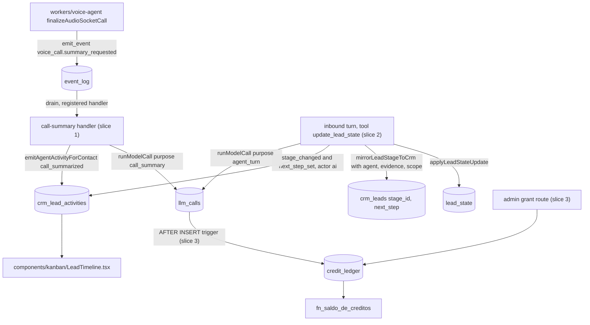
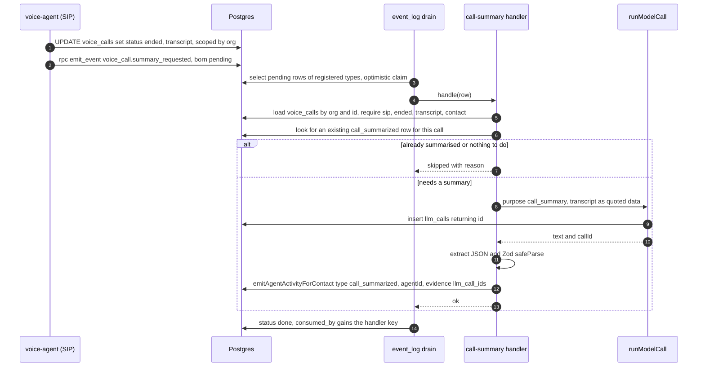
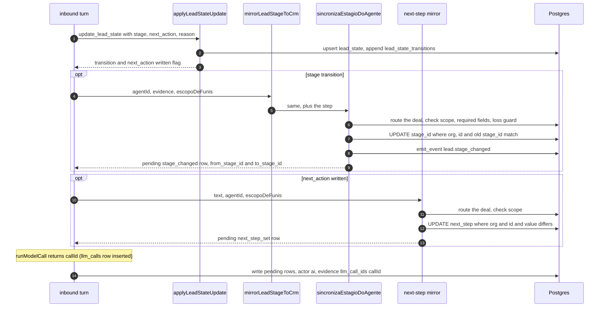
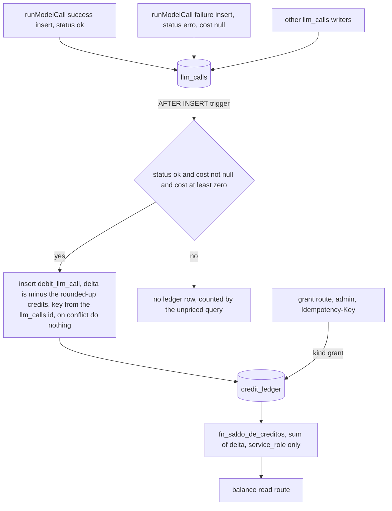

# DeskcommCRM — Technical Requirements (TRD)

| Field     | Value                                                                                                                                                                                                                        |
| --------- | ---------------------------------------------------------------------------------------------------------------------------------------------------------------------------------------------------------------------------- |
| Status    | Draft for review. Docs-only PR from branch `claude/deskcomm-project-docs`.                                                                                                                                                   |
| Base      | `main` at `f322ca4` of `jaimedhenriques/deskcommcrm`. Every line number below was read at that commit.                                                                                                                       |
| Scope     | Three Clarify-parity slices: (1) call summary into the deal timeline, (2) AI writes deal stage and next step, (3) credits metering to a ledger.                                                                              |
| Owns      | How each slice is built: components, data flow, events, AI seam, idempotency, tenancy, audit, errors, observability, config, LGPD, security, performance, tests.                                                             |
| Does not  | DDL text (in `BACKEND_SCHEMA.md`), screens and journeys (in `APP_FLOW.md`), copy and visuals (in `DESIGN_BRIEF.md`), task order (in `IMPLEMENTATION_PLAN.md`), product rationale and doctrine divergence (in `PRD.md`).      |
| Authority | Below `CLAUDE.md`, `docs/specs/` and `docs/doctrine/` (precedence in `docs/index.md:22-24`). Where this TRD and the code disagree on how the system works **today**, the code wins and this file is the one to fix (DoD 16). |

**Markers.** `CONFIRMED` means the writer opened the cited file at `f322ca4` and read the cited
lines. `INFERRED` means it follows from code or docs that were read, but nobody executed it.
`PROPOSED` marks design that does not exist in the code yet; it is what the slice PRs must build.
No business number, price or SLA appears in this document (`AGENTS.md:544-551`). Where a number
can go stale, §8 gives the command that re-measures it.

---

## 1. The decisions this TRD implements

The lane decisions are binding for all six project docs. In short:

- **D1, slice 1.** The input is the SIP voice agent's `voice_calls.transcript`. A new command event
  `voice_call.summary_requested` is emitted after the transcript write. A registered handler
  summarises the transcript through `runModelCall` under a new registered purpose, validates the
  output with Zod, and writes one `crm_lead_activities` row of new type `call_summarized` (actor
  `ai`, `evidence.llm_call_ids`). There is never a second row for the same call. The timeline
  renders the summary from `payload`, and `call_summarized` never collapses. The LGPD cascade and
  the access export are fixed in migration 0443. Out of scope: WhatsApp call recording, meeting
  recording, voice-note transcript display, metering of transcription.
- **D2, slice 2.** The single stage path stays `update_lead_state` → `applyLeadStateUpdate` →
  `mirrorLeadStageToCrm` → `sincronizaEstagioDoAgente`. It gains the agent id, evidence, the
  `from_stage_id`/`to_stage_id` payload keys and the agent's pipeline scope. The next step moves
  to the deal (`crm_leads.next_step`, `crm_leads.next_step_updated_at`, migration 0444), is
  written by the mirror without approval, and gets a `next_step_set` activity. Existing guards stay.
  The approve/dismiss route stays.
- **D3, slice 3.** 1 credit = 1 US cent of provider cost as recorded in `llm_calls.cost_cents`,
  fractional cents rounded up per call; the rule is a named constant and a decision still to be
  confirmed, not a price. Table `credit_ledger` (migration 0445), append-only for PostgREST roles,
  owner-immutable, RLS SELECT-only. Metering by an `AFTER INSERT` trigger on `llm_calls` for
  `status = 'ok'` and a non-null cost. Unpriced calls are counted and surfaced, never debited as
  zero. Balance via `fn_saldo_de_creditos`. Admin grant route. No enforcement in this slice.

Slices 1 and 3 build things that upstream doctrine says not to build yet
(`docs/doctrine/operacao-de-agentes.md:117-124`, `docs/specs/19-spec-console-de-agencia.md:35-40`).
`PRD.md` records that divergence; this TRD only says how to build them safely.

---

## 2. Architecture recap, by citation

### 2.1 What every slice stands on

| Concern                     | Source (CONFIRMED unless marked)                                                                                                                                                      | What the slices rely on                                                                                              |
| --------------------------- | ------------------------------------------------------------------------------------------------------------------------------------------------------------------------------------- | -------------------------------------------------------------------------------------------------------------------- |
| Layers                      | `ARCHITECTURE.md:7-18`                                                                                                                                                                | Next.js route handlers, Supabase Postgres with RLS, `event_log` plus workers, triggers never do HTTP.                |
| Multi-tenancy               | `ARCHITECTURE.md:20-24`, `CLAUDE.md:40-45`                                                                                                                                            | Service-role code filters `organization_id` itself, from a trusted source, never from the body.                      |
| Authenticated request flow  | `ARCHITECTURE.md:35-49`                                                                                                                                                               | Zod → guard → `resolveActiveOrg` → query → `audit()` → `ok()`/`fail()`. Used by the slice 3 routes.                  |
| Agent turn                  | `ARCHITECTURE.md:56-58`, `lib/agent-engine/agent/inbound-turn.ts:4929` (`createInboundTurnHandler`)                                                                                   | Slice 2 changes one tool inside the turn.                                                                            |
| Event bus                   | `docs/specs/07-spec-events-workers.md` §1.2 (principles), §9 (idempotency); `lib/event-log/drain.ts`; `lib/event-log/dispatcher.ts:42-57`; `lib/event-log/register-handlers.ts:34-80` | Slice 1 adds one command event and one handler.                                                                      |
| Drain runners               | `workers/agent-worker/main.ts:361-375` (loop), `app/api/v1/cron/event-log-drain/route.ts:34-36` (cron safety net)                                                                     | The voice-agent process only emits; consumption happens in the agent-worker or the cron.                             |
| Agent runtime               | `docs/specs/10-spec-ai-agents-runtime.md` §1.2, §7, §8; live code is `lib/agent-engine/`                                                                                              | Every model call goes through `runModelCall` (`lib/agent-engine/edge/llm/run-model-call.ts:510`).                    |
| Role contract               | `docs/specs/16-spec-tres-papeis-do-agente.md` §5                                                                                                                                      | Model output crossing a boundary is Zod-validated JSON, never prose. Slice 1's summary follows it.                   |
| Conversation becomes deal   | `docs/specs/17-spec-conversa-vira-lead.md` §2, §5, §7                                                                                                                                 | Agent moves cards only in pipelines in its scope (fail closed); a human undoing an AI move is a recorded signal.     |
| Voice calls                 | `docs/specs/18-spec-voice-calls-wacalls.md` §1.2 item 2, §4.2                                                                                                                         | Recording stays off for WhatsApp calls; the call bridge writes activities through `emitAgentActivityForContact`.     |
| Living system and proof bar | `docs/doctrine/sistema-vivo.md:29-78` (invariants), `:79-92` (time rule), `:93` (checklist), `docs/doctrine/prova-em-par.md`, `CLAUDE.md:706-765` (DoD)                               | Each slice answers the checklist, names its loop, and is proven by screen; agent-path acceptance is proven in pairs. |

### 2.2 Where the docs and the code disagree today

The code is what the slices build on. Each row is a fact about `f322ca4`.

| Doc says                                                                      | Code does                                                                                                                                                                        | Marker    |
| ----------------------------------------------------------------------------- | -------------------------------------------------------------------------------------------------------------------------------------------------------------------------------- | --------- |
| Spec 07 §8.1-8.2: backoff from 30 s to 2 h, 8 attempts, then `dead`.          | `lib/event-log/drain.ts:17` sets `MAX_ATTEMPTS = 5`; `:37-41` backs off by `2^n` minutes; `:226-227` and `:319-320` mark `dead` and raise a Central notice.                      | CONFIRMED |
| Spec 10 §6.3: cost comes from the `ai_models` seed.                           | `runModelCall` prices with `costCents` (`run-model-call.ts:735`), which returns `null` for an unknown model (`lib/agent-engine/edge/llm/pricing.ts:125-128`).                    | CONFIRMED |
| `ARCHITECTURE.md:17` and `:75`: model calls go through the Vercel AI Gateway. | `runModelCall` resolves the organization's own credentials and a per-purpose binding (`run-model-call.ts:513-560`, `lib/agent-engine/edge/llm/credentials.ts:287`).              | CONFIRMED |
| Spec 18 §4.2: every `call-ended` emits to `event_log` "for future consumers". | The WaCalls bridge inserts `voice_call.ended` already `done` (`lib/wacalls/events-bridge.ts:412-426`). The SIP voice agent emits nothing (`workers/voice-agent/index.ts:36-39`). | CONFIRMED |
| Spec 16 §8: steps 2-6 not started.                                            | `lib/agent-engine/agent/declaracao.ts` exists and is imported by `lib/escalacao/briefing-da-passagem.ts:44`.                                                                     | CONFIRMED |

### 2.3 The three slices on one picture



Slice 3 meters slices 1 and 2 for free: both write `llm_calls` through `runModelCall`, and the
trigger sees every insert (INFERRED; proven by the slice 3 invariant in §6.16).

---

## 3. Conventions every slice obeys

These are not new rules. Each one is cited so a reviewer can check the slice PR against it.

| #   | Convention                     | Rule and source                                                                                                                                                                                                                                                                                                                                                                                                                                                                                                   |
| --- | ------------------------------ | ----------------------------------------------------------------------------------------------------------------------------------------------------------------------------------------------------------------------------------------------------------------------------------------------------------------------------------------------------------------------------------------------------------------------------------------------------------------------------------------------------------------- |
| C1  | Migration triple               | `supabase/migrations/<UTC timestamp>_<NNNN>_<slug>.sql` + an idempotent block in `supabase/baseline.sql` labelled `-- ---- <what> (migration NNNN) ----` + a row in `supabase/migrations/MANIFEST.md` (`CLAUDE.md:571-670`, item 6 at `:624`). No `BEGIN`/`COMMIT`. Never edit an applied migration. Lane numbers: 0443, 0444, 0445; run `pnpm checar:colisao-de-migration` before each PR and renumber NNNN and timestamp together if `main` moved.                                                              |
| C2  | Read the baseline with `rfind` | The same function is defined many times; the last definition is the one installed (`CLAUDE.md:636-666`). `fn_lgpd_cascade_redact_contact` has ten definitions; the last is at `supabase/baseline.sql:35136`. Placement: blocks that create a function go before `-- ---- VARREDURA anon:` (`baseline.sql:39296`, guarded by `tests/unit/varredura-anon-e-o-ultimo-bloco.test.ts`); blocks that create a table or RLS go before the end-of-file calls at `:40065`, `:40073`, `:40085`.                             |
| C3  | Revoke `public` and `anon`     | Every new `public` function ends with `revoke execute … from public, anon` and a grant only to who needs it (`CLAUDE.md:627-634`). Guarded by `tests/invariants/hardening-definer-varredura.test.ts`.                                                                                                                                                                                                                                                                                                             |
| C4  | RLS on every org table         | Enable RLS and write the table's own policy. A new table with an `ALL` tenancy-only policy fails `tests/invariants/rbac-config-ia-canais.test.ts:226-235`. Register the table in `TABLES` of `tests/invariants/rls-isolation.test.ts` (precedent: `loyalty_ledger` at `:449-452` and `:615`), which `tests/invariants/rls-completude-varredura.test.ts:4` imports.                                                                                                                                                |
| C5  | Append-only pattern            | Copy migration 0258 (`supabase/migrations/*_0258_audit_log_so_recebe_linha.sql`, baseline label at `baseline.sql:25024`): revoke `update, delete, truncate` from `public, anon, authenticated, service_role`, because the Supabase default table ACL grants them. Prove it like `tests/invariants/audit-log-sob-o-default-acl-do-supabase.test.ts`. Revokes do not bind the owner, so add a `BEFORE UPDATE OR DELETE` trigger with the org-deletion exemption of `fn_audit_log_row` (`baseline.sql:11015-11027`). |
| C6  | Timeline evidence constraint   | An `ai` activity needs `run_ids`, `trace_ids` or `llm_call_ids` (`baseline.sql:8282-8287`). `buildLeadActivityRow` silently demotes `ai` without evidence to `system` (`lib/leads/activity-emitter.ts:82-109`). Tests assert `actor_kind`, never only that a row exists.                                                                                                                                                                                                                                          |
| C7  | Never-collapse grouping        | `lib/leads/timeline-grouping.ts:27-50` lists types that never collapse; both the fine grouping and the day grouping honour it (`:167`, `:193`). An AI row with an agent id collapses with the same turn's `ai_turn` inside 60 s (`:50`, `:84-86`), and above 12 blocks the list regroups by day (`:82`).                                                                                                                                                                                                          |
| C8  | Command-event naming           | `{entity}.{action}` snake case (spec 07 §1.2 item 3; CHECK at `baseline.sql:1560`). A command is named `*_requested` and must have a registered handler (`tests/unit/evento-comando-tem-consumidor.test.ts`, which scans `app`, `lib`, `workers` for `p_event_type: "…"`). A fact with no consumer must be listed in `fn_event_log_e_registro` (`baseline.sql:24489`) or it is born `pending` forever (`tests/unit/evento-de-fato-nao-fica-pendente.test.ts`).                                                    |
| C9  | One AI seam                    | Every model call goes through `runModelCall`, which writes one `llm_calls` row and returns `callId` (`run-model-call.ts:738-790`; failures at `:905-946`). Every `purpose:` literal must be a `PONTOS_DE_IA` entry (`lib/ai/pontos/registro.ts:41-48`, `tests/unit/pontos-de-ia-completude.test.ts`).                                                                                                                                                                                                             |
| C10 | Tenancy on service-role writes | `CLAUDE.md:40-45`, anti-pattern 10 at `CLAUDE.md:196-211`. Every `UPDATE`/`SELECT` a slice adds or touches under service role or the owner pool filters `organization_id`.                                                                                                                                                                                                                                                                                                                                        |
| C11 | Open activity vocabulary       | `crm_lead_activities.type` has no CHECK on purpose (`CLAUDE.md:184-189`). New types go into `ActivityType` and the exhaustive `ACTIVITY_LABELS` (`lib/leads/activity-vocabulary.ts:20-169`, `:171-270`); emitters use the shared constant.                                                                                                                                                                                                                                                                        |
| C12 | API hygiene                    | Zod on every external input, `ok()`/`fail()`, `audit()` on mutation, `Idempotency-Key` via `lib/api/idempotency.ts` (`comIdempotencia` at `:189`), new audit codes appended at the end of `lib/audit/actions.ts`. No `console.log`; use `lib/logger.ts`.                                                                                                                                                                                                                                                          |
| C13 | LGPD first-class               | Any new store of personal data enters the redact cascade and the access export, each with a test (today's export gaps: `lib/lgpd/export-collector.ts:921-922`, `:1043-1050`).                                                                                                                                                                                                                                                                                                                                     |
| C14 | Synthetic identifiers          | Fixtures and docs use the synthetic phone, LID and IP values documented at the top of `tests/unit/sem-identificador-de-producao.test.ts`, which scans `docs/` and `tests/` (`:28`).                                                                                                                                                                                                                                                                                                                               |
| C15 | Process DoD per slice PR       | `.changes/<kebab>.md` fragment (DoD 17), destination core/extension (DoD 18), architecture map with at least two edges (DoD 13), nav entry for any new screen (DoD 14), screen proof in a fresh VPS-like env with evidence in `evidence/<delivery>/` cited by a doc (DoD 12, `tests/unit/evidencia-citada.test.ts`), and the pair rule when the path crosses the agent.                                                                                                                                           |

---

## 4. Slice 1 — call summary into the deal timeline

### 4.1 The problem, restated

The SIP voice agent stores the whole call transcript in `voice_calls.transcript` as
`[{speaker, text, ts}]` and then nothing reads it: no event, no summary, no timeline row
(`workers/voice-agent/index.ts:36-39`, `:208-228`; CONFIRMED). A seller opening the deal sees
nothing about the call. The smallest honest slice turns that existing transcript into one AI
summary on the deal, without touching live capture.

Three defects sit on this path today (all CONFIRMED):

- `finalizeAudioSocketCall` updates `voice_calls` filtered only by `id`
  (`workers/voice-agent/index.ts:218-227`), and the in-memory call record has no organization id
  (`:189-194`).
- No code writes `voice_calls.ai_agent_id` (column added at `baseline.sql:32476`; the only
  `ai_agent_id` in the voice agent is the routing default at `workers/voice-agent/index.ts:154`).
  The agent is known at `workers/voice-agent/index.ts:243`. Without it,
  `emitAgentActivityForContact` falls back to a `webhook_source` actor, which is recorded as
  `system` (`lib/leads/agent-activity.ts:98-104`).
- The latest LGPD cascade does not null `voice_calls.transcript` (`baseline.sql:35376-35396`;
  the 0348 definition did, at `:32731-32732`), and the access export does not select it
  (`lib/lgpd/export-collector.ts:1043-1050`).

### 4.2 Components touched

| Path                                                | Change                                                                                                                                                                                                                                                                                                                                                                                                                                                        | Marker   |
| --------------------------------------------------- | ------------------------------------------------------------------------------------------------------------------------------------------------------------------------------------------------------------------------------------------------------------------------------------------------------------------------------------------------------------------------------------------------------------------------------------------------------------- | -------- |
| `workers/voice-agent/index.ts`                      | Add `organizationId` to `ActiveAudioSocketCall` (`:189-194`, set at `:292`). Scope the finalize `UPDATE` by organization (`:218-227`). After a successful update with a non-empty transcript, call `supabaseAdmin.rpc("emit_event", { p_event_type: "voice_call.summary_requested", … })`. Write `ai_agent_id: agent.id` in the `connected` update (`:294-297`), scoped by organization. Update the header (`:36-39`). New lines log through `lib/logger.ts`. | PROPOSED |
| `workers/call-summary-worker.ts` (new)              | `summarizeVoiceCall(row: EventRow)`. Lazy `pg.Pool` exactly as `workers/media-derive-worker.ts:36-43` does with `SUPABASE_DB_URL`.                                                                                                                                                                                                                                                                                                                            | PROPOSED |
| `workers/call-summary-worker.handler.ts` (new)      | `EventHandler` with a stable `key` and `events: ["voice_call.summary_requested"]`, shaped like `workers/media-derive-worker.handler.ts:1-8`.                                                                                                                                                                                                                                                                                                                  | PROPOSED |
| `lib/event-log/register-handlers.ts`                | `registerHandler(callSummaryHandler)` next to `mediaDeriveHandler` (`:66`): it calls a model, so it stays after the short DB-only handlers, as the ordering comments at `:36-78` require.                                                                                                                                                                                                                                                                     | PROPOSED |
| `lib/voip/resumo-da-chamada.ts` (new, pure)         | The output Zod schema, the prompt builder, the JSON extraction and `safeParse` (precedent: `inbound-turn.ts:555`, `:1400-1406`), and the payload schema the UI parses. No DB, no network.                                                                                                                                                                                                                                                                     | PROPOSED |
| `lib/ai/pontos/registro.ts`                         | New `PontoDeIa` entry (proposed id `call_summary`, `papel: "lembrar"`, `registraEm: "llm_calls"`, `emissor` = the worker file), shaped like `checkpoint` at `:417-427`. It also appears on the providers screen.                                                                                                                                                                                                                                              | PROPOSED |
| `lib/leads/activity-vocabulary.ts`                  | `call_summarized` in `ActivityType` and `ACTIVITY_LABELS` (label text from `DESIGN_BRIEF.md`).                                                                                                                                                                                                                                                                                                                                                                | PROPOSED |
| `lib/leads/timeline-grouping.ts`                    | Add `call_summarized` to `NUNCA_COLAPSA` (`:27-50`).                                                                                                                                                                                                                                                                                                                                                                                                          | PROPOSED |
| `components/kanban/LeadTimeline.tsx`                | `Linha` (`:54-87`) renders the summary for `call_summarized` behind a per-row expand that reuses the component's existing expand state (`abertos`, `:98`), parsed with the exported schema; a payload that fails to parse falls back to the label only. No shadcn Collapsible (none exists in `components/ui`).                                                                                                                                               | PROPOSED |
| `lib/i18n/dicionario.ts`                            | `es` entries for every new `t('<pt>')` string.                                                                                                                                                                                                                                                                                                                                                                                                                | PROPOSED |
| `lib/lgpd/export-collector.ts`                      | Add `transcript` to the `voice_calls` select (`:1046-1049`) and its row type; export the `call_summarized` summary from `crm_lead_activities.payload` (today the activity select at `:921-922` exports no payload).                                                                                                                                                                                                                                           | PROPOSED |
| Migration 0443 + baseline block + MANIFEST row      | Redefine `fn_lgpd_cascade_redact_contact` from the body at `baseline.sql:35136` with `transcript = null` restored in the `voice_calls` block; keep its ACL (`:35676-35677`). Partial unique index for idempotency (§4.6). Block placed before the anon sweep (C2).                                                                                                                                                                                            | PROPOSED |
| `tests/fixtures/calls/` (new)                       | A fictional transcript `[{speaker, text, ts}]` plus the scripted model output. Synthetic identifiers only (C14).                                                                                                                                                                                                                                                                                                                                              | PROPOSED |
| `docs/architecture/<voice>.architecture.json` (new) | No map for voice calls exists today; DoD 13 needs one with at least two edges (call → event → summary → deal timeline). JSON is the source (`docs/architecture/README.md`).                                                                                                                                                                                                                                                                                   | PROPOSED |

### 4.3 Data flow



The handler re-reads everything from the database. The event payload carries no transcript and no
summary (data minimisation; the voice-agent → drain hop never moves personal data).

### 4.4 Events

| Event                          | Family                       | Producer                                                                                                     | Consumer                                       | Shape                                                                                         |
| ------------------------------ | ---------------------------- | ------------------------------------------------------------------------------------------------------------ | ---------------------------------------------- | --------------------------------------------------------------------------------------------- |
| `voice_call.summary_requested` | command, new (PROPOSED)      | `finalizeAudioSocketCall` via the `emit_event` RPC as service role (signature at `baseline.sql:12277-12319`) | call-summary handler                           | `entity_kind: "voice_call"`, `entity_id: voice_calls.id`, `payload: {}`, `metadata: {source}` |
| `agent.activity_unrouted`      | fact, existing               | `emitAgentActivityForContact` when the contact has no single open deal (`agent-activity.ts:72-87`)           | none; born `done` (`baseline.sql:24489-24540`) | `payload.activity_type: "call_summarized"`                                                    |
| `voice_call.ended`             | fact, existing, WaCalls only | `lib/wacalls/events-bridge.ts:418-426`                                                                       | none                                           | unchanged by this slice                                                                       |

The naming rule (C8) is enforced mechanically: the emission is a `p_event_type: "…"` literal under
`workers/`, which `tests/unit/evento-comando-tem-consumidor.test.ts` scans, so a missing handler
fails CI. The slice adds no fact event, so `fn_event_log_e_registro` does not change.

### 4.5 AI seam

- **Call.** `runModelCall(pool, cfg, input, deps)` with `tenantId` = the organization, `leadId` =
  `voice_calls.contact_id`, `jobId` = null, `agentId` = `voice_calls.ai_agent_id`, `purpose` =
  `"call_summary"`, plus `system`, `messages` and `maxOutputTokens`. `leadId` is the contact id: it
  lands in `llm_calls.contact_id` (`run-model-call.ts:738-746`). `deps.registry` is injectable
  (`:513`), which is how tests pass `createFakeRegistry`
  (`lib/agent-engine/edge/llm/providers.ts:342`). PROPOSED.
- **Purpose registry.** One new entry (§4.2). The completeness test fails in both directions:
  a purpose the code calls but the registry lacks, and an entry no code calls. CONFIRMED rule.
- **Budget.** `runModelCall` runs the organization's budget gate and throws
  `LlmBudgetExceededError` (`run-model-call.ts:59`, `:373`). The handler treats it as `skipped`
  with a reason, not an error: retrying cannot succeed before the budget changes. INFERRED from
  the gate shape; the refusal is visible in `llm_calls`.
- **Zod output.** The model must return JSON only. The schema is a strict object with
  `summary` (string), `key_points` (string array), `customer_commitments` (string array) and
  `suggested_next_step` (string or null). Every string and array has a named maximum. Unknown keys
  fail. Extraction and parse follow the checkpoint precedent (`inbound-turn.ts:1400-1406`).
  PROPOSED.
- **Evidence id.** The activity carries `evidence: { llm_call_ids: [callId] }` and the agent id,
  so it is recorded as actor `ai` (C6). If `callId` is null the handler does not write the row and
  returns `error`. PROPOSED.
- **Payload.** `voice_call_id`, a `summary` object with the four fields above, and
  `schema_version`, validated by the same exported Zod schema on write and
  on read, so the UI never reads a `payload` path without a central schema (anti-pattern 6,
  `CLAUDE.md:196-211`). `source_module = 'voice_calls'` and `source_id = voice_calls.id` say what
  originated the row; evidence never repeats the source id (column comment at
  `baseline.sql:8289-8290`). PROPOSED.
- **Prompt-injection labelling.** The transcript is the customer's speech and the model's
  paraphrase of it is an injection surface (`lib/escalacao/briefing-da-passagem.ts:19-30`). Three
  rules, all PROPOSED: (1) the prompt wraps every turn as quoted data with its speaker and states
  that the block is a record, not instructions; (2) the timeline labels the whole summary as the
  AI's reading, with the "segundo a IA — confira" convention; (3) anything shown as the customer's
  own words is quoted and labelled as theirs. `suggested_next_step` is display only: it never
  feeds `crm_leads.next_step`, which has one writer (slice 2).
- **`reason` column.** Stays a fixed, PII-free string (or null). `LeadTimeline` passes `reason`
  through `t()` (`LeadTimeline.tsx:79`), and the WaCalls bridge already uses fixed strings
  (`events-bridge.ts:447-451`). The summary lives only in `payload`.

### 4.6 Idempotency

Three layers, from cheapest to strongest:

1. **Event claim.** The drain claims a row optimistically and records the handler key in
   `consumed_by` (`lib/event-log/drain.ts:262-276`). CONFIRMED.
2. **Lookup before spending.** Before calling the model, the handler looks for a row with
   `organization_id = $org`, `type = 'call_summarized'`, `source_module = 'voice_calls'`,
   `source_id = $voice_call_id`. Found → `skipped`, no model call. PROPOSED.
3. **Database guarantee.** Migration 0443 adds a partial unique index on
   `crm_lead_activities (organization_id, source_id) where type = 'call_summarized'`. No existing row
   has that type, so the index cannot fail on a clone's `update.sh`. The handler catches `23505` and
   returns `ok`. PROPOSED; DDL in `BACKEND_SCHEMA.md`.

Residual (INFERRED): when the contact has no single open deal, the emitter records
`agent.activity_unrouted` and writes no row, so a later re-emission would summarise again. Each
such call is visible in `llm_calls`.

### 4.7 Tenancy

- The organization comes from the `event_log` row. `emit_event` sets it from `p_organization_id`
  and, for an authenticated caller, checks membership (`baseline.sql:12292-12307`). CONFIRMED.
- The handler loads `voice_calls` by `(organization_id, id)`, never by id alone, and never trusts
  the payload. PROPOSED.
- `emitAgentActivityForContact` filters both of its reads by organization (`agent-activity.ts:55-66`).
  CONFIRMED.
- The voice agent's finalize and connected updates gain the organization filter (§4.1). PROPOSED.

### 4.8 Audit

No user-initiated mutation exists in this slice, so no `api_audit_log` row. The trail is the
`event_log` row (status, attempts, `last_error`), the `llm_calls` row (purpose, model, cost,
latency, status) and the activity (actor `ai`, agent id, evidence). The LGPD cascade keeps its own
counters (`v_counts`, `baseline.sql:35267`).

### 4.9 Error handling and retries

| Situation                                                      | Handler result          | Effect                                                                                                                    |
| -------------------------------------------------------------- | ----------------------- | ------------------------------------------------------------------------------------------------------------------------- |
| Call not found in the org, not `sip`, not ended, no transcript | `skipped` + reason      | Event `done`; the reason survives on the row (`lib/event-log/drain.ts:323-330`).                                          |
| `contact_id` is null                                           | `skipped` + reason      | Nothing to route to.                                                                                                      |
| Already summarised                                             | `skipped`               | No model call.                                                                                                            |
| Budget gate refuses                                            | `skipped` + reason      | Refusal visible in `llm_calls`.                                                                                           |
| Provider or transport error                                    | `error`                 | `runModelCall` writes the failure row (`run-model-call.ts:905-946`); the drain retries with backoff up to `MAX_ATTEMPTS`. |
| Output fails Zod                                               | `error`                 | Same retry path; each attempt is its own `llm_calls` row, so the cost of retries is visible.                              |
| No single open deal                                            | `ok`                    | `agent.activity_unrouted` recorded by the emitter.                                                                        |
| Unique violation `23505` on insert                             | `ok`                    | A concurrent run already wrote the row.                                                                                   |
| Attempts exhausted                                             | event `dead`            | Central notice `event_dead` (`lib/event-log/drain.ts:73-122`).                                                            |
| Voice agent fails to emit                                      | logged, call unaffected | The transcript is saved; the gap is found by the query in §8.                                                             |

Retry numbers come from `lib/event-log/drain.ts`, not from spec 07 (§2.2). Re-measure with the
command in §8.

### 4.10 Observability

- `llm_calls` rows with the new purpose give cost, latency and status per call. The usage API
  reads `purpose` and `cost_cents` from `llm_calls` (`app/api/v1/ai/usage/route.ts:96-97`,
  CONFIRMED); INFERRED that a new purpose appears on the screen without code change.
- `event_log` rows for the new type: status, attempts, `last_error`, `consumed_by`; dead events
  reach the Central.
- Structured logs through `lib/logger.ts` with ids only (organization, voice call, `llm_calls` id).
  Never transcript or summary text in logs, errors or Sentry.
- A gap query (§8) lists ended SIP calls with a transcript and no `call_summarized` row.

### 4.11 Configuration and environment

None new. The handler uses `SUPABASE_DB_URL` (required at `lib/env.ts:136`) and the existing LLM
configuration that `runModelCall` resolves per organization and purpose
(`lib/agent-engine/edge/llm/credentials.ts:33-60`, `:287`). Caps (transcript characters sent,
output tokens, schema string lengths) are named constants in `lib/voip/resumo-da-chamada.ts`,
chosen and reviewed in the slice PR; the precedent is `MAX_DERIVED_CHARS` in
`lib/messaging/media/derive.ts:8`. No new env var, so DoD 9 is not triggered.

### 4.12 LGPD

| Data                                    | Redaction                                                                                                                                                                                                                                              | Access export                                                                                               |
| --------------------------------------- | ------------------------------------------------------------------------------------------------------------------------------------------------------------------------------------------------------------------------------------------------------ | ----------------------------------------------------------------------------------------------------------- |
| `voice_calls.transcript`                | Broken today (CONFIRMED, §4.1). Migration 0443 restores `transcript = null` in a new last definition built from `baseline.sql:35136`.                                                                                                                  | Missing today (CONFIRMED). Added to the select at `export-collector.ts:1046-1049`.                          |
| `call_summarized` payload (the summary) | Already covered: the cascade sets `payload = '{}'`, `metadata = '{}'`, `reason = null` for the contact's activities (`baseline.sql:35245-35266`). The handler always sets `contact_id` (`agent-activity.ts:90-93`). CONFIRMED; the test must prove it. | Missing today: activities export without payload (`export-collector.ts:921-922`, CONFIRMED). Summary added. |
| WhatsApp call audio                     | Not captured; recording stays off (spec 18 §1.2 item 2).                                                                                                                                                                                               | n/a                                                                                                         |

The transcript goes to the organization's own model provider through the same seam the agent turn
uses (INFERRED). `messages.media_derived_text` (voice notes) is also missing from the cascade:
the `messages` update at `baseline.sql:35228-35244` clears body and media but not
`media_derived_text` (CONFIRMED). D1 does not touch it; see §7 Q5.

### 4.13 Security

- **Injection.** §4.5 rules; the summary is never executed and never written to a field another
  automation reads as an instruction.
- **Cost amplification.** Any active member can call `emit_event` for their own organization
  (grant at `baseline.sql:12365`, membership check at `:12303-12307`). A forged
  `voice_call.summary_requested` can only target a call of the same organization, and the lookup
  in §4.6 stops a second model call once a row exists. INFERRED.
- **Service role.** Every write is organization-filtered (§4.7). No new route. The only new or
  redefined function is the cascade, which keeps `revoke all … from public, anon, authenticated` and
  `grant execute … to service_role` (`baseline.sql:35676-35677`).

### 4.14 Performance

One model call per answered SIP call with a transcript, off the call path (the voice agent only
emits). A slow model call holds one drain tick; handler order keeps DB-only handlers first. The
lookup is indexed by the partial unique index. The timeline parses one small `payload` per
`call_summarized` row on the client. Measure latency and cost per call from `llm_calls` (§8); no
target is set here.

### 4.15 Test strategy

| Level              | File (new unless marked)                                                                             | What it proves                                                                                                                                                                                                                                                                                                                                                                                                                                                                                                                                                                                                  |
| ------------------ | ---------------------------------------------------------------------------------------------------- | --------------------------------------------------------------------------------------------------------------------------------------------------------------------------------------------------------------------------------------------------------------------------------------------------------------------------------------------------------------------------------------------------------------------------------------------------------------------------------------------------------------------------------------------------------------------------------------------------------------- |
| Unit               | `tests/unit/resumo-da-chamada.test.ts`                                                               | Schema accepts the fixture output and rejects extra keys, oversized strings and missing fields; the prompt quotes every turn and carries the data-not-instructions rule; an injection line in the fixture stays inside the quoted block; JSON extraction tolerates surrounding text.                                                                                                                                                                                                                                                                                                                            |
| Unit               | `tests/unit/timeline-grouping.test.ts` (existing, extended)                                          | `call_summarized` stays its own block in both fine and day grouping.                                                                                                                                                                                                                                                                                                                                                                                                                                                                                                                                            |
| Unit               | LGPD export test                                                                                     | The export carries `transcript` and the summary.                                                                                                                                                                                                                                                                                                                                                                                                                                                                                                                                                                |
| Unit (gates, free) | existing                                                                                             | `evento-comando-tem-consumidor`, `pontos-de-ia-completude`, `evento-de-fato-nao-fica-pendente`, `sem-identificador-de-producao`, `manifest-x-migrations`, `varredura-anon-e-o-ultimo-bloco`.                                                                                                                                                                                                                                                                                                                                                                                                                    |
| UI component       | `tests/unit/lead-timeline-resumo.test.tsx` (jsdom)                                                   | The row shows the label; the user expands it with `@testing-library/user-event` and sees the summary and the AI-reading label; an invalid payload shows the label only. Queries by visible text and role.                                                                                                                                                                                                                                                                                                                                                                                                       |
| DB invariant       | `tests/invariants/resumo-da-chamada-na-timeline.test.ts` on `pnpm test:db`                           | With `pg.Pool` on `TEST_DB_PORT` (pattern: `tests/invariants/voz-ponte-de-eventos.test.ts:53-57`) and a scripted provider: one `call_summarized` row, `actor_kind = 'ai'`, `actor_agent_id` set, `evidence.llm_call_ids` equals the new `llm_calls.id` with the new purpose; a second run adds no activity and no `llm_calls` row; two open deals → no row and one `agent.activity_unrouted`; an event whose entity belongs to another org → `skipped`, no row; after `fn_lgpd_cascade_redact_contact`, `transcript` is null and the payload is `{}`. Self-contained seed with unique ids (files run shuffled). |
| E2E                | Playwright spec, listed in `.github/workflows/e2e.yml` (`SPECS_PARTE_*` or `FORA_DO_CI` with reason) | By screen on a fresh install: open the deal, see the call summary row, expand it, read the AI-reading label. Evidence PNGs cited by an index doc.                                                                                                                                                                                                                                                                                                                                                                                                                                                               |

**Proven:** the path from an ended SIP call row with a transcript to one attributed, deduplicated,
redactable summary on the deal timeline, on real Postgres with the real handler and emitter; the
rendering by screen.

**Not proven:** live capture by Asterisk and the Realtime model (not in CI); the quality of real
model summaries (the provider is scripted; no paid call); WhatsApp calls (no audio exists);
meetings (only a Meet link exists). The e2e proves rendering, not generation, because the scripted
provider is switched on by `INTERNAL_AGENT_RUN_STUB` on the request path
(`lib/agent-engine/agent/request-deps.ts:1-10`, CONFIRMED) and the worker path has none (INFERRED).

---

## 5. Slice 2 — AI writes deal stage and next step

### 5.1 The problem, restated

The agent already moves deal stages without approval when stages are mapped through
`crm_stages.agent_stage_hint` (CONFIRMED path: `inbound-turn.ts:3629-3660` →
`lib/agent-engine/edge/crm/move-lead-stage.ts:237-316` → `lib/leads/agent-stage-sync.ts:208`).
Four things keep it from being a trustworthy "AI writes the deal" feature (all CONFIRMED):

- The stage row is attributed to a `webhook_source` actor with no agent id
  (`agent-stage-sync.ts:402`) and payload keys `de`/`para` (`:407`).
- The human-correction loop reads `from_stage_id`/`to_stage_id` (`app/api/v1/leads/_handler.ts:1119-1150`)
  and requires the last move to be actor `ai` (`lib/leads/correcao-humana.ts:79`), so it never fires
  for AI moves (INFERRED: no test proves it either way).
- The harness path passes no pipeline scope: the mirror call carries only org, contact and step
  (`move-lead-stage.ts:248-252`), and `escopoDeFunis` is optional and applied only when defined
  (`agent-stage-sync.ts:222`, `:275`). The agent config already has `pipelineIds`
  (`lib/agent-engine/agent/agent-config.ts:82`, `:219`).
- The next step lives per contact in `lead_state.next_action` (`lib/agent-engine/agent/lead-state.ts:200-230`)
  and is shown as a proposal a human approves (`app/api/v1/leads/[id]/next-action/route.ts:1-20`).
  `crm_leads` has no next-step column.

One more defect on the same path: the stage `UPDATE` filters `id` and `stage_id` but not
`organization_id` (`agent-stage-sync.ts:360-371`, CONFIRMED). The lead was loaded org-scoped
earlier, but C10 asks for the filter on the write.

### 5.2 Components touched

| Path                                                                 | Change                                                                                                                                                                                                                                                                                                            | Marker   |
| -------------------------------------------------------------------- | ----------------------------------------------------------------------------------------------------------------------------------------------------------------------------------------------------------------------------------------------------------------------------------------------------------------- | -------- |
| `lib/agent-engine/agent/lead-state.ts`                               | `LeadStateUpdateResult` (`:77-85`) also says whether `next_action` was written in this call; the upsert already knows (`$6`, `:216-230`).                                                                                                                                                                         | PROPOSED |
| `lib/agent-engine/agent/inbound-turn.ts`                             | In `update_lead_state.execute` (`:3629-3700`): pass `agentId: agentConfig?.agentId` and `escopoDeFunis: agentConfig?.pipelineIds ?? []` to the mirror; when `next_action` was written, call the next-step mirror. Under the §7 Q1 default, collect the activity rows the mirrors return and write them after `runModelCall` returns its `callId`, with `evidence: { llm_call_ids: [callId] }` (§5.5).                                                                            | PROPOSED |
| `lib/agent-engine/edge/crm/move-lead-stage.ts`                       | `mirrorLeadStageToCrm` input gains `agentId` and `escopoDeFunis` (plus `evidence` only under the `trace_ids` amendment, §7 Q1) and forwards them (`:237-256`); its result carries the pending `stage_changed` row. Existing reason translation (`:261-305`) unchanged.                                                                                                                                                     | PROPOSED |
| `lib/leads/agent-stage-sync.ts`                                      | Actor `{ type: "ai_agent", id, agent_id }` when an agent id is given (`:402`); payload `{ from_stage_id, to_stage_id, passo_do_agente }` (`:407`); under the §7 Q1 default the `stage_changed` row is returned to the caller instead of emitted here (it is the only caller, CONFIRMED by grep); `organization_id` added to the stage `UPDATE` (`:360-371`); agent id in the `lead.stage_changed` metadata (`:449-458`). | PROPOSED |
| `lib/leads/proximo-passo-do-agente.ts` (new)                         | Next-step mirror: routes with `resolveActiveLeadForContact` (the single resolver the sync comment demands, `agent-stage-sync.ts:199-207`), applies the same scope check (`lib/leads/escopo-de-funil.ts`), updates `crm_leads.next_step` and `next_step_updated_at` org-scoped, emits `next_step_set`.             | PROPOSED |
| `lib/leads/activity-vocabulary.ts`, `lib/leads/timeline-grouping.ts` | `next_step_set` type and label; added to `NUNCA_COLAPSA` (§5.4).                                                                                                                                                                                                                                                  | PROPOSED |
| `app/api/v1/leads/_handler.ts`                                       | The lead patch (`updateLeadHandler`, `:616`; fields near `:676`) accepts `next_step` from a human, sets `next_step_updated_at`, emits the usual edit activity. The correction loop (`:1118-1160`) now sees AI moves, but only for moves that go through `moveLeadHandler` (MCP tool and automations, CONFIRMED); the lead patch does not run it.                                                                                                                           | PROPOSED |
| `app/api/v1/leads/[id]/move/route.ts`, `app/api/v1/leads/bulk/route.ts` | Board drag and inbox select / bulk move. Neither runs `ehCorrecaoDeMovimentoDaIa` today (the move route says it bypasses `moveLeadHandler`, `:267-268`, CONFIRMED). Adding the check is APP_FLOW §8 A6 / IMPLEMENTATION_PLAN T15, PRD §10 Q14; without it a human undo by screen writes no `agent_move_corrected`. | PROPOSED, gated on A6 |
| Board and card reads                                                 | The board route and `components/kanban/KanbanCard.tsx` read `next_step` (screens in `APP_FLOW.md`). The approve/dismiss route stays as is (D2).                                                                                                                                                                   | PROPOSED |
| Migration 0444 + baseline block + MANIFEST row                       | `crm_leads.next_step text`, `crm_leads.next_step_updated_at timestamptz` (`add column if not exists`); and a new last definition of `fn_lgpd_cascade_redact_contact` that also nulls `next_step` (§5.12). Regenerate `lib/database.types.ts`.                                                                     | PROPOSED |
| `tests/fixtures/conversas/` (new)                                    | The recorded conversation: synthetic inbound messages and the scripted model steps per turn.                                                                                                                                                                                                                      | PROPOSED |

### 5.3 Data flow



Both mirrors' `UPDATE`s run inside the tool call, as the stage mirror does today, and a mirror
failure never reverts `lead_state` or fails the job (`inbound-turn.ts:3642-3650`, CONFIRMED
comment). Under the §7 Q1 default the two activity rows are written after `runModelCall` returns
(§5.5); under the `trace_ids` amendment they are written inside the tool call as today.

### 5.4 Events and timeline

- **`lead.stage_changed`** (fact, existing). Producer: `sincronizaEstagioDoAgente`
  (`agent-stage-sync.ts:449-458`) and the human move routes. Consumers: the automation engine,
  the stage follow-up trigger and the stage notice (`agent-stage-sync.ts:420-425`,
  `register-handlers.ts:53-57`). Change: metadata gains the agent id. CONFIRMED producer and
  consumers; PROPOSED change.
- **No new event.** The next step is a record on the deal plus an activity. A new fact event would
  have no consumer and would need a `fn_event_log_e_registro` entry (C8). PROPOSED.
- **Grouping.** An AI `stage_changed` with an agent id will group with the same turn's `ai_turn`
  inside the 60 s window (C7). The row stays reachable by expanding the block; the component test
  proves it. `next_step_set` joins `NUNCA_COLAPSA`: it is the AI deciding on the deal without
  approval, and the time rule (`docs/doctrine/sistema-vivo.md:79-92`) needs a human to see it to be
  able to interrupt. PROPOSED; D2 is silent on grouping.

### 5.5 AI seam

- No new model call. The stage and the next step come from the existing `update_lead_state` tool
  (`inbound-turn.ts:233-257`), validated by the strict whitelist inside `applyLeadStateUpdate`
  (`lead-state.ts:172-180`; `next_action` max length at `:60`). CONFIRMED.
- **Evidence timing.** The tool executes inside `generateText` (`run-model-call.ts:664`), before
  the turn's own `llm_calls` row is inserted (`:738`). So the current turn's call id does not exist
  when the mirror writes. CONFIRMED.
- **Default (D2-compatible).** The mirrors do their `UPDATE`s inside the tool call and return the
  `stage_changed` and `next_step_set` rows; `update_lead_state.execute` keeps them, and the turn
  writes them after `runModelCall` returns its `callId`, with `evidence: { llm_call_ids: [callId] }`.
  The turn already writes evidence this way for its closing row (`inbound-turn.ts:4710`,
  CONFIRMED). If `callId` is null (the `llm_calls` insert failed), the emitter demotes the row to
  `system` and keeps `actor_agent_id` (`lib/leads/activity-emitter.ts:82-93`, CONFIRMED). Cost: a
  crash between the stage `UPDATE` and the deferred write leaves a moved card with no
  `stage_changed` row; the invariant (§5.15) covers the normal path only. PROPOSED.
- **Proposed amendment to D2, pending lane authority.** The constraint also accepts `trace_ids`,
  the repo already uses the job id as a trace id (`lib/agent-engine/flywheel/live.ts:215`), the
  column comment maps `trace_ids` to the turn's trace (`baseline.sql:8289-8290`), and
  `llm_calls.job_id` makes it joinable. `evidence: { trace_ids: [jobId] }` would keep both writes
  inside the tool call. Not the default; see §7 Q1.
- **Labelling.** The next step is the model's text about the lead. The card shows it as written by
  the assistant, not as a fact or an instruction; it is never executed. Approving today's
  contact-level proposal records a decision and an activity and executes nothing (INFERRED from
  `app/api/v1/leads/[id]/next-action/route.ts:2-14` and `:120-127`). PROPOSED.

### 5.6 Idempotency

- Same stage again is a no-op (`lead-state.ts:168-170`); a mirror retry finds the deal already
  there and returns `ok` (`move-lead-stage.ts:254`). CONFIRMED.
- The stage write is guarded by the old `stage_id` (`agent-stage-sync.ts:360-371`): a human move
  in between wins and no activity is written. CONFIRMED.
- The next-step write uses `where next_step is distinct from $new` and writes the activity only
  when a row changed, so a retried tool call adds nothing. PROPOSED.
- Turns of the same contact never run in parallel (lane per lead, `lead-state.ts:168-170`).
  CONFIRMED comment.

### 5.7 Tenancy

- Every read and write in both mirrors filters `organization_id` from the turn's tenant, which
  came from the job, never from model output. PROPOSED for the stage `UPDATE` (§5.1) and the new
  mirror.
- Scope fails closed: `escopoDeFunis` is always passed; an empty list moves nothing
  (`agent-stage-sync.ts:216-222`). Risk: a turn without a resolved agent config would stop moving
  cards. INFERRED; the invariant covers it (§5.15).

### 5.8 Audit

AI writes are not route mutations, so no `api_audit_log` row; the trail is
`lead_state_transitions` (with `job_id`), the activities (actor `ai`, agent id, evidence) and the
`lead.stage_changed` event. A human edit of `next_step` goes through the lead patch handler and its
existing audit (INFERRED). The approve/dismiss route is unchanged.

### 5.9 Error handling and retries

The existing refusal vocabulary stays (`move-lead-stage.ts:261-305`, CONFIRMED): `not_configured`
and `human_conflict` warn only; `fora_do_escopo`, `perda_sem_motivo`, `campos_obrigatorios` and
`crm_error` open a deduplicated Central item. The next-step mirror refuses with `sem_negocio`,
`ambiguo` or `fora_do_escopo`, logs a warning and writes nothing; the contact-level proposal
(`lead_state.next_action`) still shows on the card. Job retries are the agent queue's, not the
event drain's.

### 5.10 Observability

- Turn log warnings already name the refusal reason (`inbound-turn.ts:3658-3662`).
- Counts by actor: `stage_changed` rows by `actor_kind`, `next_step_set` rows, and
  `agent_move_corrected` rows (the loop now fires). Queries in §8.

### 5.11 Configuration and environment

None new. Existing knobs: the stage map (`agent_stage_hint`, settings screen), the agent's
`pipeline_ids`, and the Operator role. When the Operator is on and owns `crm_move_lead_stage` or
`crm_update_lead`, `update_lead_state` is taken from the Conversador
(`lib/agent-engine/agent/entrega-de-capacidade.ts:115-124`, either tool is enough). The recorded
proof runs with the Operator off.

### 5.12 LGPD

`crm_leads.next_step` is free text written by a model about a person. The cascade already strips
free text from `crm_leads` (`baseline.sql:35270-35288`, CONFIRMED), so migration 0444 adds
`next_step = null` to a new last definition. If slice 1 merged first, that definition is built from
0443's body, not from `:35136`; the two slices edit the same function in sequence. The access
export adds `next_step` to the `crm_leads` select (`lib/lgpd/export-collector.ts:866-867`, which
today exports title, stage and value but no free-text note). `next_step_set` payloads are already redacted by
the activity rule (§4.12).

### 5.13 Security

- Prompt injection: a lead can steer the text of the next step. It is displayed as the assistant's
  writing, bounded by the Zod max length, and never executed. Loss still needs a human reason
  (`perda_sem_motivo`), required fields still block, scope fails closed.
- No new route and no new function.

### 5.14 Performance

Per `update_lead_state` call: at most one extra routed `UPDATE` and one activity insert, inside the
tool call. The stage path is unchanged in cost. No target set here.

### 5.15 Test strategy

| Level        | File (new unless marked)                                                   | What it proves                                                                                                                                                                                                                                                                                                                                                                                                                                                                                                                                                        |
| ------------ | -------------------------------------------------------------------------- | --------------------------------------------------------------------------------------------------------------------------------------------------------------------------------------------------------------------------------------------------------------------------------------------------------------------------------------------------------------------------------------------------------------------------------------------------------------------------------------------------------------------------------------------------------------------- |
| Unit         | `tests/unit/agent-stage-sync.test.ts` (existing, extended)                 | Actor `ai` with agent id and evidence; payload keys; scope refusal; the org filter on the write.                                                                                                                                                                                                                                                                                                                                                                                                                                                                      |
| Unit         | next-step mirror test                                                      | Routing, ambiguity, scope, unchanged value writes nothing.                                                                                                                                                                                                                                                                                                                                                                                                                                                                                                            |
| UI component | card and timeline tests (jsdom)                                            | The card shows the next step as written by the assistant; a human edits it with `user-event`; an AI stage move is reachable inside its block; `next_step_set` stands alone.                                                                                                                                                                                                                                                                                                                                                                                           |
| DB invariant | `tests/invariants/ia-move-etapa-e-proximo-passo.test.ts` on `pnpm test:db` | Replays the recorded conversation through `createInboundTurnHandler` with `createFakeRegistry` and `crmCfg.supabase` set to the `tests/pg-como-supabase.ts` adapter, so the mirror runs for real (the existing harness passes `{}`, `tests/invariants/handoff-avisa-o-lead.test.ts:116`). Asserts `crm_leads.stage_id`, `next_step`, `next_step_updated_at`, activities with `actor_kind = 'ai'` and evidence; out-of-scope pipeline → no move and a Central item; lost → no move; two open deals → nothing; a human move after the AI move → `agent_move_corrected`. |
| E2E          | Playwright spec                                                            | By screen: the card and the deal show the stage and the next step written by the assistant, and a human can edit the next step.                                                                                                                                                                                                                                                                                                                                                                                                                                       |

**Pair rule** (`docs/doctrine/prova-em-par.md`). The direct side is the DB invariant: the tool and
mirrors with the recorded raw text. The agent side is the same text sent through the screen with a
real model in a fresh install (`scripts/e2e-chega-mensagem.ts:1-12` makes one inbound message
arrive through the ingestion path; INFERRED, not checked, that it also triggers a turn). That side
needs a model key and is not in CI.

**Proven:** given a tool call, the deal's stage and next step are written, attributed, scoped,
guarded and correctable, on real Postgres with the real turn handler.

**Not proven in CI:** that a real model calls `update_lead_state` with the right stage for a given
conversation. That is model behaviour, measured by the agent side of the pair.

---

## 6. Slice 3 — credits metering to a ledger

### 6.1 The problem, restated

Spend is measured only in US cents in `llm_calls.cost_cents` (`baseline.sql:6483-6500`, nullable,
"null = preço desconhecido — nunca inventar 0"), summed by the single function
`fn_gasto_de_ia_do_mes` (`baseline.sql:13125-13146`). No credit, ledger or usage table exists, and
business rule B-01 (`docs/business-rules/00-business-rules-catalog.md:468-473`) has never been
built. CONFIRMED. The slice meters usage in credits; it does not price, bill or block.

### 6.2 Components touched

| Path                                            | Change                                                                                                                                                                                                                                                                                                                                     | Marker   |
| ----------------------------------------------- | ------------------------------------------------------------------------------------------------------------------------------------------------------------------------------------------------------------------------------------------------------------------------------------------------------------------------------------------ | -------- |
| Migration 0445 + baseline block + MANIFEST row  | Table `credit_ledger`; RLS with one SELECT policy; grants per C5; owner immutability trigger; the metering trigger function and trigger on `llm_calls`; `fn_saldo_de_creditos`; the conversion constant as an SQL function. One block, before the anon sweep (C2), which is also before the end-of-file calls. DDL in `BACKEND_SCHEMA.md`. | PROPOSED |
| `lib/creditos/conversao.ts` (new, pure)         | The named conversion constant and `creditosDaChamada(costCents)`, returning null for null cost. Mirrors the SQL constant.                                                                                                                                                                                                                  | PROPOSED |
| Balance read route (new, path in `APP_FLOW.md`) | GET, manager and above: balance via `fn_saldo_de_creditos` with the service client and the org from the session, plus the unpriced-call count. Shown next to the usage screen (`/app/ai/usage`, nav entry at `lib/navigation/catalogo.ts:569`).                                                                                            | PROPOSED |
| Grant route (new)                               | POST, `requireRole("admin")` and `requireSupportWrite()` before the effect (pattern: `app/api/v1/ai/budget/route.ts:100-104`), Zod body (positive integer credits, required reason), `Idempotency-Key` through `comIdempotencia`, ledger key derived from it, `audit()`.                                                                   | PROPOSED |
| `lib/audit/actions.ts`                          | New codes appended at the end of `AUDIT_ACTIONS` (precedent `ai.budget_*` at `:534-536`).                                                                                                                                                                                                                                                  | PROPOSED |
| Test registries                                 | `credit_ledger` added to `TABLES` in `tests/invariants/rls-isolation.test.ts`, and the `kind` CHECK added to `PARES` in `tests/invariants/vocabulario-banco-x-typescript.test.ts:45`. These are additive edits to existing invariant files, which every new table makes; declare them in the PR.                                           | PROPOSED |
| `lib/database.types.ts`                         | Regenerated.                                                                                                                                                                                                                                                                                                                               | PROPOSED |
| `docs/doctrine/operacao-de-agentes.md`          | DoD 16 note: a `credit_ledger` now exists and it meters, it does not bill. Its measuring grep (`:96-107`) matches only `billing`, `plans`, `subscriptions`, `quota` or `credits` as a whole table name, so it still returns 0 (CONFIRMED: it returns 0 at `f322ca4`, and a `credit_ledger` line does not match it).                        | PROPOSED |

`fn_gasto_de_ia_do_mes` is not touched. `tests/unit/orcamento-uma-regua-de-gasto.test.ts:125-145`
requires exactly one creation, identical to migration 0159; its proxy flags application files that
contain both `sum(cost_cents)` and `date_trunc('month'` (`:87`). The ledger sums `delta`, not
`cost_cents`, and has no monthly window. CONFIRMED.

### 6.3 Data flow



### 6.4 Events

None. The trigger writes the ledger in the same transaction as the `llm_calls` insert, as the
existing `trg_llm_calls_budget` does (`baseline.sql:9522-9530`). A trigger never does HTTP
(spec 07 §1.2 item 1). No consumer would exist for a `credits.*` event, so emitting one would break
C8.

### 6.5 AI seam

The ledger reads the seam's output, it does not change the seam. Every caller of `runModelCall`
(including slices 1 and 2) is metered through its `llm_calls` row (C9). Not metered, because they
never reach `llm_calls`: the registry entries with `registraEm: "nenhum"` in
`lib/ai/pontos/registro.ts` (`embedding_indexar` at `:428`, `embedding_consultar` at `:448`,
`transcricao_de_audio` at `:466`, `visao_de_imagem` at `:495`, `contagem_de_tokens` at `:563`;
CONFIRMED), and the SIP voice agent's Realtime session in `workers/voice-agent/audioSocketBridge.ts`,
which has no `llm_calls` write (CONFIRMED by search). The proof states these exclusions.

### 6.6 Conversion rule

- 1 credit = 1 US cent of `llm_calls.cost_cents`. Per call, the debit is the cost rounded up to a
  whole credit; a cost of exactly zero debits zero and still writes a row, so "one row per priced
  call" holds. PROPOSED detail of D3.
- `source_cost_cents` and `source_currency = 'USD'` are stored on each debit, so the rule can be
  re-rated later without losing the source. `llm_calls` has no currency column; USD is stated by
  the `fn_gasto_de_ia_do_mes` comment (`baseline.sql:13138`). CONFIRMED.
- The rule exists twice (SQL for the trigger, TS for display and tests). A unit test reads the SQL
  constant from the labelled baseline block and asserts it equals the TS constant, the same
  identity technique `orcamento-uma-regua-de-gasto.test.ts:134-145` uses.
- No price per credit exists anywhere in this slice.

### 6.7 Idempotency

- Debits: `idempotency_key` derived from the `llm_calls` id and a unique index on
  `(organization_id, idempotency_key)`, insert with `on conflict do nothing` (shape:
  `loyalty_ledger` at `baseline.sql:33695-33720`). PROPOSED.
- Grants: the route reserves the `Idempotency-Key` with `comIdempotencia` and derives the ledger
  key from it, so a replay returns the first receipt and the ledger refuses a duplicate. PROPOSED.
- No backfill: rows before the migration are not debited (§7 Q4).

### 6.8 Tenancy

- The trigger copies `organization_id` from the `llm_calls` row. The grant route takes the org from
  `requireRole`, never the body. The balance function takes the org as an argument and validates no
  membership, so it is `security invoker` and executable by `service_role` only, exactly like
  `fn_gasto_de_ia_do_mes` (`baseline.sql:13138-13144`). PROPOSED.
- RLS: one SELECT policy on `organization_id in fn_user_org_ids()` (helper at `baseline.sql:18665`).
  No insert, update or delete for `authenticated`, which also makes the table server-only for the
  support locks (`fn_aplicar_travas_de_suporte`, `baseline.sql:28195`). PROPOSED.

### 6.9 Audit

Grants and adjustments write an `api_audit_log` row with the new codes. Debits are not audited per
row: the ledger row and its `llm_call_id` are the trail.

### 6.10 Error handling

- The metering trigger runs in the transaction that records the model call. A failing trigger would
  lose the call record after the provider already answered. So the function only does an insert
  with `on conflict do nothing` and never raises on expected input; an unexpected failure must be
  found by the reconciliation query (§8), not by a broken turn. PROPOSED; the invariant inserts
  `llm_calls` rows of every status and cost shape and asserts the insert never fails.
- The grant route returns `fail()` codes for validation, role, support mode and idempotency
  conflicts.

### 6.11 Observability

- Reconciliation: priced `ok` calls since the migration without exactly one debit row (§8).
- Unpriced count: `ok` calls with null cost, shown next to the balance and counted, never
  debited as zero. The metrics skill already counts them the same way
  (`.agents/skills/deskcomm-metricas/references/consultas.md:100`, CONFIRMED).
- Anomalies: negative costs are skipped and counted by the same query family.

### 6.12 Configuration and environment

None. The conversion constant is code and SQL, not an env var, so an install cannot silently make
the two disagree. No enforcement flag exists; enforcement is out of this slice. The budget ladder in
`ai_budgets` is unchanged.

### 6.13 LGPD

The ledger holds no contact id and no content: organization, amounts, kind, key, `llm_call_id`,
source cost. It stays out of the redact cascade and the subject access export. INFERRED legal
reading; the `llm_call_id` points to a row that has its own `contact_id` (`baseline.sql:6486`) and
its own lifecycle.

### 6.14 Security

- **Append-only** for every PostgREST role (C5), proven under the simulated Supabase default ACL.
- **Owner immutability.** `BEFORE UPDATE OR DELETE` raises, except while the organization is being
  deleted (exemption shape at `baseline.sql:11015-11027`) and except the foreign-key action that
  only sets `llm_call_id` to null. The trigger shape follows `fn_lancamento_pago_e_imutavel`
  (`baseline.sql:33722-33746`).
- **Tampering through `llm_calls`.** `llm_calls` keeps a tenancy-only policy as declared debt
  (`baseline.sql:12405-12412`), and `cost_cents` has no CHECK (no CHECK on that column in the
  baseline, CONFIRMED by search). If a member can insert rows through that policy (INFERRED, not
  measured), they can only debit their own organization: the trigger skips negative costs, and a
  CHECK ties the sign to the kind (`debit_llm_call` at zero or below, `grant` above zero,
  `adjustment` non-zero), so a forged row can never grant credits. PROPOSED.
- **Grants.** `requireRole("admin")` per D3; see §7 Q2 on whether this should be platform admin.
  Signed adjustments use the same route with `kind = 'adjustment'` and a required reason.
  PROPOSED.
- **Functions.** Trigger function `security definer` with `set search_path`; every new function
  revokes `public` and `anon` (C3); the trigger function also revokes `authenticated`, as
  `fn_update_budget_consumption` does (`baseline.sql:39364`, `:39370`).

### 6.15 Performance

One indexed insert per `llm_calls` insert, in the same transaction, like the existing budget
trigger. The balance is a sum over the organization's rows in the database, never in application
code (PostgREST truncates at 1000 rows, `baseline.sql:34148-34152`). If enforcement ever reads the
balance per call, revisit with checkpoint rows; not needed for metering.

### 6.16 Test strategy

| Level        | File (new unless marked)                                                                                                                         | What it proves                                                                                                                                                                                                                         |
| ------------ | ------------------------------------------------------------------------------------------------------------------------------------------------ | -------------------------------------------------------------------------------------------------------------------------------------------------------------------------------------------------------------------------------------- |
| Unit         | `lib/creditos/conversao.test.ts`                                                                                                                 | Rounding up per call, zero, null, negative; equality of the TS and SQL constants.                                                                                                                                                      |
| Unit         | grant route test                                                                                                                                 | Role, support mode, Zod, idempotent replay, audit code.                                                                                                                                                                                |
| Unit (gates) | existing                                                                                                                                         | `orcamento-uma-regua-de-gasto`, `manifest-x-migrations`, `varredura-anon-e-o-ultimo-bloco`.                                                                                                                                            |
| DB invariant | `tests/invariants/creditos-no-livro.test.ts` on `pnpm test:db`                                                                                   | An `ok` priced insert debits once; a repeated key adds nothing; `erro` and null-cost inserts add no row and never fail; a negative cost adds no row; the balance equals the sum of deltas; org deletion still cascades.                |
| DB invariant | `tests/invariants/creditos-sob-o-default-acl-do-supabase.test.ts`                                                                                | Applies the labelled 0445 block over the simulated default ACL and probes `update`, `delete`, `truncate` for every PostgREST role, with a control case, like `audit-log-sob-o-default-acl-do-supabase.test.ts`; owner `UPDATE` raises. |
| DB invariant | `rls-isolation`, `rls-completude-varredura`, `rbac-config-ia-canais`, `hardening-definer-varredura`, `vocabulario-banco-x-typescript` (existing) | Two-tenant isolation, completeness, no `ALL` policy, revoked definers, CHECK vocabulary.                                                                                                                                               |
| E2E          | Playwright spec                                                                                                                                  | By screen: an admin sees the balance and the unpriced count; a grant appears once after a double submit.                                                                                                                               |

**Proven:** every priced, successful model call recorded in `llm_calls` after the migration is
debited exactly once, the ledger cannot be edited through the API, and the balance is computed in
the database.

**Not proven:** that the conversion rule is the right business rule (it is a decision to confirm);
spend that never reaches `llm_calls` (§6.5); history before the migration; any blocking behaviour.

---

## 7. Decisions this TRD could not make

| #   | Question                                                                                                                                                                                                             | Why it matters                                                                                                   | TRD default if nobody answers               |
| --- | -------------------------------------------------------------------------------------------------------------------------------------------------------------------------------------------------------------------- | ---------------------------------------------------------------------------------------------------------------- | ------------------------------------------- |
| Q1  | Slice 2: D2 asks for `llm_call_ids` evidence, but the turn's own call id does not exist when the tool writes (§5.5). Move both activity writes to after `runModelCall` returns, or amend D2 to accept `trace_ids: [job_id]`?     | Without accepted evidence the rows are demoted to `system` and the correction loop stays dead.                   | D2-compatible: both activity rows written after `runModelCall` returns `callId`, evidence `llm_call_ids`. `trace_ids: [job_id]` is a proposed amendment to D2, pending lane authority.                      |
| Q2  | Slice 3: should grants need a platform admin (`requirePlatformAdmin`) rather than an organization admin?                                                                                                             | An organization admin granting credits to their own organization makes a future balance-based limit meaningless. | Organization admin, as D3 says, with audit. |
| Q3  | Slice 1: should `call_summarized` enter the `fn_update_last_activity_at` allow-list (`baseline.sql:24153-24185`)? SIP calls write no `voice_call` activity today, so the summary would be their only timeline trace. | Decides whether a summarised call keeps the deal out of the risk radar's "silent" bucket.                        | Not added in 0443.                          |
| Q4  | Slice 3: backfill debits for `llm_calls` rows created before migration 0445?                                                                                                                                         | A business decision; it also needs idempotency keys for history.                                                 | No backfill.                                |
| Q5  | Slice 1: also clear `messages.media_derived_text` in the cascade redefinition of 0443 (voice-note transcripts survive anonymisation today)?                                                                          | Cheap while the function is being redefined anyway; outside D1's stated scope.                                   | Not included; recorded as a known gap.      |

---

## 8. Re-measure commands (DoD 16)

Run from the repository root. Each answers a number this TRD deliberately does not freeze.

```bash
# Next free migration number and collision check (C1)
git fetch origin
git ls-tree -r --name-only origin/main -- supabase/migrations | sed 's#.*/##' \
  | sed -nE 's#^[0-9]{14}_([0-9]{4})_.*#\1#p' | sort -n | tail -1
pnpm checar:colisao-de-migration

# Last definition of a function in the baseline (C2)
python3 -c "s=open('supabase/baseline.sql').read(); i=s.rfind('CREATE OR REPLACE FUNCTION \"public\".\"fn_lgpd_cascade_redact_contact\"'); print(s.count(chr(10),0,i)+1)"

# Where blocks must be placed (C2)
grep -n '^-- ---- VARREDURA anon:' supabase/baseline.sql
grep -nE '^-- ---- (módulos instalados|proteção de tabela de organização|travas do modo somente leitura)' supabase/baseline.sql

# Drain retry policy (slice 1 errors)
grep -nE 'MAX_ATTEMPTS =|Math.pow\(2' lib/event-log/drain.ts

# Production callers that pass pipeline scope to the stage mirror (slice 2)
grep -rn "escopoDeFunis" lib app --include=*.ts | grep -v '\.test\.'

# Writers of voice_calls.ai_agent_id (slice 1)
grep -rn "ai_agent_id" workers/voice-agent lib/wacalls app/api/v1/voice

# Upstream doctrine's billing-table grep (slice 3 must keep it at 0)
grep -oiE 'create table (if not exists )?public\.[a-z_]+' supabase/baseline.sql \
  | grep -icE 'invoice|^create table (if not exists )?public\.(billing|plans|subscriptions|quota|credits)$'
```

SQL to run against a database where the slices are applied (a `pnpm test:db` probe or a local
install, never production):

```sql
-- Slice 1: ended SIP calls with a transcript and no summary row
select v.organization_id, v.id
  from voice_calls v
 where v.provider = 'sip' and v.status = 'ended' and v.transcript is not null
   and not exists (
     select 1 from crm_lead_activities a
      where a.organization_id = v.organization_id
        and a.type = 'call_summarized' and a.source_id = v.id);

-- Slice 1: cost and latency of summaries
select count(*), sum(cost_cents), avg(latency_ms)
  from llm_calls where purpose = 'call_summary' and status = 'ok';

-- Slice 2: who moves stages, and how often humans correct the AI
select actor_kind, count(*) from crm_lead_activities
 where type = 'stage_changed' group by actor_kind;
select count(*) from crm_lead_activities where type = 'agent_move_corrected';

-- Slice 3: priced successful calls without exactly one debit (after the migration)
select c.organization_id, c.id
  from llm_calls c
  left join credit_ledger l
    on l.organization_id = c.organization_id and l.llm_call_id = c.id
 where c.status = 'ok' and c.cost_cents >= 0
 group by c.organization_id, c.id
having count(l.id) <> 1;

-- Slice 3: unpriced and anomalous calls, never debited
select count(*) filter (where cost_cents is null) as unpriced,
       count(*) filter (where cost_cents < 0)     as negative
  from llm_calls where status = 'ok';
```

The slice 3 reconciliation must be bounded to rows created after the migration was applied, since
history is not backfilled (Q4).
